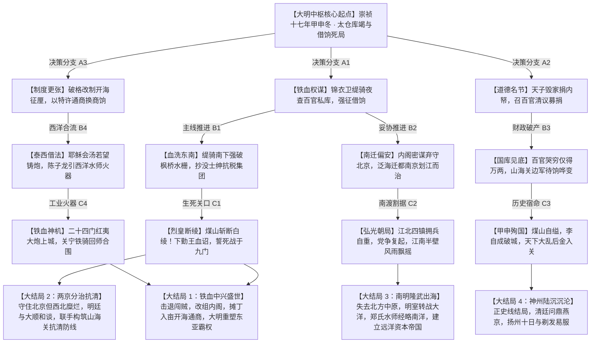

# 《天步艰难：大明中枢长篇史诗底本与剧情树大纲》

---

## 引子 · 朔风悲角

崇祯十七年甲申，正月初八。
天欲雪，彤云密布，铅灰色的阴霾压得整座燕京城喘不过气来。北风自西山山口呼啸而下，如无数柄刮骨钢刀，掠过紫禁城金黄色的重檐庑殿顶，卷起殿角铜铃一阵阵凄厉如鬼哭的呜咽。

太液池的坚冰足有尺厚，龟裂的冰缝在暗夜里发出“格格”的闷响，仿佛大明二百七十六年的社稷根基，正在这极寒之中寸寸断裂。

午门城楼上，守军的红袄早已经破烂不堪，内里塞着冰冷的芦花与烂棉，值宿的士卒冻僵在箭垛旁，连怀里的三眼铳生了厚厚的白霜也无力拂去。
遥远的西北关隘，八百里加急驿骑的马蹄声已经整整三个月没有停歇——李自成在西安称帝，号大顺，建元永昌，百万闯军如黄河决堤，东渡天险，晋中各府望风而溃，太原陷落，大同告急，宁武关总兵周遇吉血战死绝的告急文书被鲜血浸透，残破地呈放在文渊阁首辅的大案上。

而关外，沈阳清宁宫里，刚即位半年的顺治幼帝身后，摄政王多尔衮的猎鹰与快马，正死死盯着山海关的一举一动。正白旗、正黄旗的战马嚼着黑豆，满洲重甲步骑在浑河与辽河之间磨刀霍霍。

中原糜烂，关外强虏，腹背受敌，神州板荡。

然而，更令人窒息的死局，却不在千里之外的沙场，而在这九重宫阙的最深处。
紫禁城乾清宫的御案前，三十四岁的大明崇祯天子朱由检，正披着一件洗得发白、边缘磨破的青缎棉袍，死死盯着案头一份由户部尚书倪元璐泣血具呈的太仓库底清册。

御案前的一方端砚里，墨汁早已结成了黑紫色的冰碴。崇祯用枯瘦的手指捏着御笔，骨节泛出惨白。
“大明两京一十三省……天下万民之供奉，二百七十六载宗庙社稷……”天子的声音沙哑得像两块生铁在互相摩擦，眼底布满了骇人的猩红血丝，“如今户部太仓库，老库内库悉数算尽，竟只剩银……三万二千一百两？”

站在下首的司礼监秉笔太监王承恩垂着头，老泪纵横，不敢发出半点声息。
风穿过雕花格扇门，吹灭了铜鹤灯台上的最后一簇火苗。整个大殿瞬间陷入了无底的幽暗与彻骨的森寒之中。

大明，退无可退。

---

## 第一章：紫禁夜寒 · 太仓库竭与借饷死局

### 一

正月初十，清晨。朔风卷着拳头大的鹅毛雪团，将文渊阁外的石阶埋了半尺。
文渊阁内，生着两盆劣质的黑烟碎炭。没有内廷赏赐的无烟兽炭，内阁辅臣与六部九卿被熏得不住咳嗽，但谁也不敢抬手去擦拭被呛出的眼泪。

首辅陈演端坐在紫檀大案后，双手缩在宽大的狐皮手炉里。他面容枯瘦，颌下稀稀落落的几缕花白胡须随着呼吸微微颤抖。在他左侧，次辅魏藻德一身崭新的大红仙鹤补服，神情精悍，目光流转不定，手指轻轻扣在茶盏边缘，却一口热茶也不饮；右侧，则是刚擢升户部尚书不久的倪元璐。

倪元璐面色如纸，眼窝深陷，身上的青布官袍带着浓重的药草味。在他面前，平铺着三份通红的辽东与蓟密急递。

“陈阁老，魏阁老。”倪元璐打破了令人发疯的死寂，他的声音颤抖却字字如凿，“山海关总兵吴三桂，十二月以来的求饷折子已经发了七道。关宁铁骑五万精锐，关外辽民十四万，待哺待饷。关门积欠边饷已达五个月，连同马料、火药、修械银，共计需银二十二万两。吴三桂在折子里说得明白——三军无粮，已割战马之肉果腹；若正月十五前饷银再运不到山海关，三军鼓噪，山海关门……恐不能为国家守矣！”

“守不住？”魏藻德冷笑了一声，嘴角勾起一抹讥诮，“吴长伯坐拥两辽最精锐之铁甲，朝廷一年赋税大半填了他山海关的无底洞，辽饷、练饷加派了一轮又一轮，百姓鬻儿卖女以奉关宁。如今大敌当前，闯贼逼近京畿，他不思提兵入关勤王，倒天天伸手向朝廷要银子！莫非没有银子，他这大明总兵，便不认大明天子了么？”

“魏阁老！慎言！”倪元璐猛地拍案而起，清瘦的身躯因愤怒而剧烈战栗，“军士是要吃饭穿甲的！关东风雪彻骨，士卒赤足执戟，立于风雪之中，双脚冻烂！没有饷银，连米面豆料都买不到，你让他们凭一腔忠义去挡建奴的铁蹄与流贼的刀箭？！你这是在逼兵变！是在开门迎敌！”

“够了。”
一直闭目养神的内阁首辅陈演缓缓掀开眼皮，声音干涩而疲惫：“玉汝（倪元璐字），老夫只问你一句——户部，太仓库，眼下究竟能拨出多少银子？”

倪元璐像被巨锤击中胸口，整个人颓然跌坐回木椅上。他颤抖着翻开户部的黄色清册，惨笑道：
“老库折银，实存一万四千二百两。天马草料银，留存八千両。南关抽税折银，因运河冰封流贼断道，分文未入。各直省解京秋粮，河南全陷，湖广全陷，山东盗贼蜂起官道断绝，陕西……陕西已尽归李自成所有。眼下户部能调动的现银，合在一起，只有三万两。”

三万两。
这三个字落在大殿里，轻如鸿毛，却又重若千钧，压得满堂公卿脊梁骨发冷。
山海关要二十二万两；宣府、大同待援要十万两；京师三大营二十万人马，已有四个月未发一文月饷；甚至连紫禁城内守卫九门的锦衣卫旗校、光禄寺的米面供应，都已告罄。

“三万两……”陈演喃喃自语，嘴角牵出一丝绝望的苦涩，“二十万饥军，三万两白银。分到每个兵丁手里，不足一分。这哪里是饷银？这是催命的符咒！”

“户部没有，内帑呢？！”给事中光时亨忽然跨出一步，厉声质问，“天下皆知，万历朝矿税所入数千万两，天启朝抄没魏忠贤家资无数，先帝皆存之于大内内帑！如今社稷濒危，天子何以仍紧抱内帑不放？只要圣上开内库，发内帑银百万两，犒赏三军，山海关军心立稳，京营士卒感奋，京师何愁不可守？！”

“住口！”
一声冰冷如刀的斥责从文渊阁外传来。
厚重的锦帘被挑开，一股刺骨的雪沫卷入殿中。司礼监掌印太监王德化与秉笔太监王承恩并肩而入。
王承恩脸色阴沉如铁，手执天子朱笔御批的诏条，目光在光时亨脸上狠狠剜了一眼：
“光给事中好大的胆子！妄议内帑，构陷圣德！圣上自崇祯元年登极以来，衣服穿破了着人补了再穿，后宫嫔妃连一件新织锦缎都舍不得添置！先帝内库究竟有没有银子，先帝爷去的时候留下了多少，皇上比谁都清楚！实对你们说了吧，内帑内库空得能跑老鼠！昨夜万岁爷翻遍了内承运库，将宫中金银器皿尽数砸碎融化，合在一起，也不过熔得碎银七千余两，已连夜拨给工部打制火药！”

王承恩深吸一口气，目光扫过满堂面面相觑的阁臣九卿，字字如刀：
“万岁爷有旨：太仓库既竭，国事已不可为。今日辰时三刻，文武百官于中极殿候旨——行‘借饷’大典！”

---

### 二

中极殿外，雪越下越大。
大明王朝的三品以上红袍大员、勋贵公侯、国戚巨室，数百人整整齐齐地跪在覆满积雪的金砖之上。雪水渗透了厚厚的棉靴，寒气直逼骨髓，但整座广场上死一般寂静，只有牙齿打战的声音在风中细微作响。

大殿正中，天子朱由检端坐于龙椅之上。
他面容极年轻，却已生了满头斑白的发丝。那双深陷的眼窝里，燃烧着一种近乎疯狂的灼痛与执念。他没有穿明黄色的衮服，只穿着一件青灰色的粗绸旧袄，外面罩着一件磨破了边角的貂裘，腰间悬着一把太祖高皇帝御赐的天子剑。

“诸位爱卿。”崇祯缓缓开口，声音通过御前侍卫的接力传导，回荡在风雪交加的中极殿外，“今日召诸卿来，不议国策，不问刑赏。只谈一事——救国。”

天子站起身，缓缓走下汉白玉丹陛。他的每一步都踏得很慢，鞋底踩在冰冷的地砖上，发出沉闷的回响。
“李自成的大军已至宣府，顺承门外已见贼谍骑影。山海关外，建奴调兵遣将，只待山海关生变。朕这个当皇帝的，昨夜翻遍了祖宗传下来的内库，把乾清宫的铜炉都砸了，凑出了七千两碎银。朕问户部，户部只剩三万两。朕把自己的血肉刮干净了，也凑不齐二十万边饷。”

崇祯在群臣面前停下脚步，目光从首辅陈演、次辅魏藻德、兵部尚书张国维的头顶一一掠过，最后落在了站在勋贵之首的嘉定伯周奎身上。
周奎，当朝周皇后的生父，崇祯天子的亲岳丈。

“老皇亲。”崇祯的声音忽地柔和了下来，柔和得令人头皮发麻。
周奎浑身剧烈一抖，战战兢兢地跪伏在地：“老臣……老臣在。”

“你是国丈，国休戚与共。朕听说，嘉定伯府在东四牌楼占地百亩，典当铺开了十八家，南方的丝茶商队每年入京，利银以十万计。”崇祯俯下身，盯着周奎那张满是老人斑的苍老面孔，“眼下国家快亡了，朕向国丈借银十万两，以充山海关军饷。待贼寇平定，朕以朝廷两京田税，加倍奉还。国丈，意下如何？”

周奎的眼泪刷地流淌下来，鼻涕眼泪糊作一团，他拼命在冰雪覆盖的金砖上磕头，发出“砰砰”的钝响：
“万岁爷明鉴！皇上救命啊！老臣哪里来的十万两银子？！老臣家贫如洗，全靠朝廷微薄岁禄度日，家中人口众多，每日连肉食都吃不起！前日为了给老妻治病，还典当了宫中赏赐的旧衣袍！老臣愿毁家纾难，老臣……老臣愿出白银五百两，以报圣恩！再多……再多便是敲骨吸髓，老臣也拿不出了啊！皇上啊！！”

周奎哭得凄惨欲绝，整个人几乎厥死过去。

崇祯定定地看着这位涕泗横流的岳丈，眼角剧烈抽搐。
他知道，周皇后为了顾全皇家颜面，昨日已偷偷派宫女从私蓄中送了五千两银子给生父周奎，让他出面带头捐款，好歹凑足一万两给天子撑起场面。
可这位国丈，硬生生扣下了女儿给的四千五百两，只拿出了区区五百两！

“五百两……”崇祯低低地笑了一声，笑声尖锐而凄厉，宛如夜枭啼血。
他猛然转头，看向内阁首辅陈演：“首辅，你呢？你为百官之表率，你出多少？”
陈演扑通一声跪倒，叩头如捣蒜：“回圣上，老臣为官清廉，两袖清风，家中别无长物，唯愿出白银一千两！”

次辅魏藻德跟着跪倒，声泪俱下：“臣家中藏书数千卷，愿尽数变卖，凑得五百两，以纾国难！”

“臣出二百两！”
“臣愿出一甲子月俸，折银八十两！”
“臣家仅余旧钱三千文，愿尽数解交户部！”

一时间，风雪大作的中极殿前，哭穷之声此起彼伏，如同一场荒诞绝伦的群魔乱舞。满朝朱紫大员、世袭公侯，个个痛哭流涕，诉说着自家的凄惨与清贫。往日里锦衣玉食、出则高车驷马、宴饮动辄千金的京官勋贵，在此刻仿佛全成了天下最可怜的乞丐。

户部尚书倪元璐看着这一幕，气得浑身乱颤，喉头一甜，竟哇地喷出一大口鲜血，染红了胸前雪白的仙鹤补服。
“国将亡……必有妖孽！”倪元璐仰天嘶吼，热泪混着鲜血滚落，“堂堂大明中枢，文武百官，连二十万两借饷都凑不齐！列祖列宗在天之灵，看着你们这群误国奸佞啊！！”

---

### 三

入夜，乾清宫暖阁。
殿门被死死关严，厚重的门帘将风雪隔绝在殿外。内里没有点大灯，只有御案上的一盏牛油红烛，爆出一朵朵毕剥作响的灯花。

崇祯坐在阴影里，脸上的表情隐在黑暗之中，看不出丝毫喜怒。
王承恩悄无声息地掀帘而入，身后跟着一名身穿飞鱼服、腰佩绣春刀的精瘦汉子。那汉子身上的斗篷还落着厚厚的雪，眉宇间带着一股北镇抚司特有的阴鸷与血腥气——正是锦衣卫指挥使骆养性。

“跪下。”王承恩低声道。
骆养性双膝跪地，将一份盖着锦衣卫漆红火漆的厚厚密册高高举过头顶。

“念。”崇祯吐出一个字。

骆养性咽了一口唾沫，拆开密册，低声念道：
“锦衣卫北镇抚司侦缉密报：
正月初九，嘉定伯周奎府。周奎于后花园假山地窖内，秘藏生银二十八万两，赤金八千两，西洋玛瑙、夜明珠四箱。又在彰仪门外开设有暗典当铺三处，存银汇票折合白银十二万两。
首辅陈演，其弟陈瀚于东四牌楼藏匿窖银四万两，自崇祯十四年起，私受河南、山东地方官贿赂共计十一万两，现悉数封存于其京郊顺义庄园地窖。
次辅魏藻德，私纳粮商贿银三万两，置京畿良田两千顷，藏金三千两于佛堂夹墙之内。
太监曹化淳、王德化私宅，合银六十余万两……
武清侯李国瑞府，封存祖传金宝及现银四十万两……
京中五品以上京官、勋戚共一百六十四户，据锦衣卫暗桩清查估算，各家府邸地窖所藏现银，不少于……一千八百万两。”

“啪！”
一截御笔在崇祯指间生生折断，断木刺入掌心，鲜血渗出，顺着苍白的手指滴落在御案上。
崇祯没有皱一下眉头，任由鲜血染红了那份密报。

“一千八百万两……”崇祯的声音极轻，轻得如同来自九幽地府的低吟，“朕向他们要二十万两，他们给朕五百两，八十两，旧钱三千文！大明养士三百年，养出了一群敲骨吸髓的硕鼠！大明快沉了，他们想的不是补船，而是抱着从船上偷拆下来的金银，等着换主子！！”

“皇上息怒，龙体要紧啊！”王承恩跪伏在地，额头贴着金砖。

“息怒？朕再息怒，这大明江山就要断送在朕的手里了！”崇祯猛地站起身，天子剑轰然出鞘，雪亮的剑锋在烛火下映照出他近乎扭曲的面容。
他死死盯着骆养性，眼中爆射出狂暴而决绝的凶光：
“骆养性！”
“臣在！”骆养性浑身紧绷，呼吸凝滞。

“锦衣卫大统领的名头，你戴了这么多年，也该见见血了。”崇祯将天子剑扔在骆养性面前，剑身在金砖上发出刺耳的金铁鸣响，“朕给你一道中旨密勒！不经内阁，不经通政司，不经科道言官！今夜起，锦衣卫北镇抚司给朕动用所有缇骑！”

骆养性心头剧震：“皇上……彻查哪一家？”
“哪一家？”崇祯惨笑一声，眼中杀机毕露，“自嘉定伯周奎始！凡在密册之列者，给朕一家一家地查！不用明旨抄家，用锦衣卫的手段——借！按密册上的数目，七成借给朝廷！谁若抗命不借……”

天子的声音陡然变得阴寒如冰：
“……按私通闯贼、谋逆大罪论处！就地拔舌，抄没全族！朕倒要看看，是他们的骨头硬，还是朕的天子剑利！”

殿内死一般寂静。
骆养性额头上渗出了细密的冷汗。这一刀切下去，整个大明朝廷的官僚体制、勋贵外戚网络，将被生生撕碎！这是饮鸩止渴，也是九死一生的绝赌！
“臣……遵旨！”骆养性咬紧牙关，双手接过了那柄滴血的天子剑。

“慢着。”
崇祯忽然叫住了他，目光投向了南方那片无尽的漆黑虚空。
“光刮京城的这群硕鼠，解得了眼下的渴，解不了天下的困。吴三桂要饷，西北要兵，江南……江南才是天下的血脉。承恩！”
“老奴在。”
“拟旨。命锦衣卫南镇抚司精锐，连夜持朕密旨下江南！越过南京六部，越过各府巡抚，去见东南的海商与漕运总督！朕要江南的粮，朕要泰西人的炮！哪怕把东南的天捅漏了，也得把银子和粮食给朕运回北京！”

---

## 第二章：缇骑出京 · 东南抗粮与内阁密旨

### 一

正月二十，江南苏州，枫桥水驿。
与京师的漫天风雪不同，江南早春的雨丝细密绵长，带着化不开的潮湿与寒意。然而寒雨之中，大运河两岸的枫桥码头，却早已被冲天的火把与喧嚣的人声撕裂。

数十艘吃水极深的平底漕船被巨大的铁索死死锁在水栅之内，帆樯林立，上面堆积如山的麻袋里装满了金黄的新米与精细白面。但船头上站着的，不是押运漕粮的运军，而是手持木棍、铁叉、渔叉的数千名织工、纤夫与商帮盐勇。

河岸之上，高悬着白布大幡，上书醒目的八个墨字：
“朝廷苛政，民不聊生；抗交辽饷，保我桑梓！”

码头一侧的水榭茶楼里，雕梁画栋，暖香袭人。
数十位身穿杭绸长衫、头戴方巾的士绅名流正围坐在一起。坐在主位上的，是复社骨干、名满江南的名士顾杲，在他身旁，则是洞庭商帮领袖翁大理，以及苏州织造行会的大东家沈廷宪。

“诸位东家，诸位同仁。”顾杲轻轻展开手中的泥金折扇，语气从容不迫，“北都昨夜传来密信，朝廷太仓库枯竭，户部尚书倪元璐又在行加派之策，要向江南七府追索‘练饷’、‘剿饷’共计二百八十万两，更下严旨催逼本年春运漕粮一百万石！诸位以为，此粮此银，该交是不该交？”

翁大理冷哼一声，将手中的青花瓷盏重重砸在茶几上：“交？拿什么交？！去年江南大水，桑蚕减产三成，朝廷不仅不免税，反而每亩加派银三分九厘！我洞庭商帮走淮安运生丝的船队，过一道关卡收一次重税，到了通州，连本钱都折了进去！银子交上去了，西北的流贼剿灭了吗？辽东的建奴退了吗？银子全进了那些满口仁义道德的京官私囊！我等若再交，便是自掘坟墓！”

“翁兄所言极是。”沈廷宪抚须长叹，“况且，如今运河以北，流贼四起，山东临清一带盗贼如毛。这一百万石漕粮运出江南，能不能过黄河都在未定之天。与其送入贼口、喂饱贪官，不如留在江南，以安我八府生民！”

“可是……”一名年轻的书生有些担忧地低声道，“听闻皇上下了严旨，若抗粮不纳，按谋逆论处。更有传言，锦衣卫缇骑已离京南下……”

“锦衣卫？”顾杲仰天大笑，折扇在掌心一敲，神色傲然，“大明乃士大夫与天子共天下！东林先贤杨涟、左光斗公之风骨，犹在眼前！我复社弟子数千，天下士子之心皆在江南！当年魏忠贤阉党何其凶暴，江南士民‘开读之变’，五人仗义舍生，毙阉党缇骑于市井之中！如今万岁爷若敢违背祖制，以特务鹰犬荼毒东南，天下清议何存？！东南士民，绝不奉诏！”

“对！绝不奉诏！抗税到底！”
茶楼内外，商贾士绅齐声呐喊，声震运河。

就在此时，一声尖锐刺耳的号炮骤然在枫桥镇口炸响！

“轰！！”

浓烈的黑烟撕破了早春的烟雨。伴随着急促沉重的马蹄声，数十匹通体乌黑的健马踏破石板路，如同一道黑色闪电撞入了码头水栅。
马上的骑士尽披锁子甲，外罩猩红猩猩毡斗篷，腰悬绣春刀，手中黑漆短弩早已上弦，森冷的箭头齐刷刷对准了茶楼与码头上的抗税人群。

为首一骑勒住战马，战马人立而起，发出一声震耳欲聋的嘶鸣。
马上之人扯下斗篷风帽，露出一张刀削斧凿般的阴沉面孔——锦衣卫北镇抚司镇抚使、崇祯天子亲命密使，陆天明。

---

### 二

“锦衣卫办事，闲杂人等跪迎！”
数十名缇骑齐声厉喝，刀出半鞘，一股百战余生的惨烈煞气瞬间压制了全场的喧嚣。原本群情激愤的纤夫织工见状，吓得面如土色，不由自主地向后退缩。

顾杲脸色微变，但他自恃名士清流，料定朝廷不敢在江南大开杀戒，当即整了整衣冠，昂首走下茶楼，拱手高声道：
“来者何人？此地乃江南文华之邦，运河粮储重地，岂容尔等爪牙披甲执刃、喧哗驿道？！天子有祖制，锦衣卫不得干预地方钱粮……”

“噗！”
顾杲的话未说完，一道雪亮的刀光在细雨中暴起！
陆天明甚至没有下马，长刀出鞘半尺，刀鞘重重砸在顾杲的面门上！

“咔嚓”一声脆响，顾杲惨叫一声，鼻梁骨碎裂，满脸是血地倒飞出去，跌落在泥泞之中，泥金折扇摔得粉碎。

全场死一般寂静。所有人倒吸一口冷气，惊骇地看着这一幕。
在大明朝，文官士大夫高高在上，锦衣卫缇骑抓人尚需刑部或通政司行文，何曾见过二话不说直接动手的凶煞？！

陆天明翻身下马，战靴踩在泥水里，一步步走到满脸是血的顾杲面前，一脚踏在他的胸口上。
“祖制？”陆天明从怀中掏出一卷明黄色的绢帛圣旨，展开在众人眼前，“天子密诏在此！天步艰难，国运悬于一线。山海关外建奴压境，居庸关下流贼破门！北京城里的皇上已经典当了龙袍铜鼎，你们这群蠹虫，却在此处聚众抗粮、鼓噪造反！睁开你们的狗眼看看，这是皇上的朱批天子剑令！”

绢帛之上，崇祯皇帝用鲜血混着朱砂写就的十二个大字，触目惊心：
“阻漕一石者斩！抗银一两同谋逆！就地正法，毋须奏请！”

翁大理与沈廷宪吓得双膝一软，噗通跪倒在泥浆里。
“大……大人饶命！我等非是谋逆，实是江南税赋沉重，民不聊生啊！”翁大理颤抖着磕头。

“民不聊生？”陆天明冷笑一声，拔出腰间绣春刀，刀尖挑开身旁一艘漕船的伪装麻袋。
麻袋破裂，里面哗啦啦倾泻而下的，根本不是什么粮食，而是一箱箱码放整齐的走私生丝、上等紫砂、徽墨，以及——一锭锭铸造精美的泰西银元（西班牙双柱银币）！

“江南织造大户，一年走私日本、南洋生丝数十万斤，获利白银数百万两，市舶司分文税银未得，全进了你们复社文人的雅集与商帮的密库！”陆天明森然道，“这就是你们说的民不聊生？！你们在这里抗朝廷的粮，背后却把粮草和军资暗中卖给郑芝龙的海盗，甚至经由水路走私运往辽东，卖给满洲八旗！沈老板，翁老板，要不要本官把你们与盛京范文程往来的密信，当着全苏州百姓的面念一念？！”

沈廷宪如遭雷击，整个人瘫软在地，面无人色。
他们万万没想到，锦衣卫的暗桩早已将东南走私的隐秘脉络摸得一清二楚！

“锦衣卫听令！”陆天明厉声喝道。
“在！”
“封锁枫桥所有水闸！凡参与抗粮之商贾，家产悉数查抄入官！首恶顾杲、沈廷宪、翁大理打入铁槛车，押赴北京诏狱！传令苏州知府、松江知府、常州知府，限三日内，将朝廷所需一百万石漕粮、二百万两辽饷凑齐运出！若有一处迟延，府尹以下，就地免职锁拿，以叛国罪论处！！”

“诺！！”缇骑轰然应诺，长刀出鞘，铁锁链铿锵作响，一场江南百年来未有之血色清洗，在风雨之中骤然爆发。

---

### 三

是夜，苏州城外寒山寺别院。
禅房之内，檀香袅袅，却驱不散窗外的阴雨与血腥气。

陆天明换下了染血的飞鱼服，只穿着一件玄色紧身箭袖，端坐在客位上。在他对面，端坐着一位身穿青布道袍、神情清癯肃穆的中年官员——原户部主事、已故大学士徐光启之关门弟子，陈子龙。

而在陈子龙身侧，却坐着一个金发碧眼、身披黑色耶稣会修士长袍的泰西传教士。传教士胸前挂着银十字架，手中握着一本拉丁文手抄本，面容深邃，目光睿智——正是耶稣会派遣在中国东南协助制造火炮的传教士毕方济（Francesco Sambiasi）的副手、火器技师费尔南多（Fernando）。

“陆镇抚使下手太烈了。”陈子龙轻轻叹息，为陆天明斟上一盏清茶，“顾杲虽有私心，但终究是江南士林领袖。你这一刀下去，江南复社万千士子之心，恐与朝廷彻底决裂矣。”

“决裂？”陆天明端起茶盏，一口饮尽，冷笑道，“卧子先生（陈子龙字），京城快亡了！皇上若守不住九门，大明一朝倾覆，建奴入关，神州陆沉！到那时，剃发易服，道统荡然，你这群复社士子还能坐在这里高谈阔论、吟诗作赋吗？！皮之不存，毛将焉附？！”

陈子龙浑身一震，良久无言。
他何尝不明白这个道理。东南士绅醉生梦死，江南豪族藏富于私，眼见大明这艘巨轮漏水倾覆，却只顾着拆船板给自己打造棺材。

“皇上的密旨，先生看过了吧？”陆天明从怀中取出另一卷蜡丸封缄的黄色绢帛，递给陈子龙。

陈子龙郑重拆开，仔细读完，眼中爆发出不可思议的光芒：“开海……朝廷要全面废止海禁，开辟广州、厦门、宁波、上海四处海关市舶司？！所有出海商船，按规抽厘纳税，由朝廷颁发‘龙旗通商令引’？！天……这可是违背太祖祖制的大变局啊！”

“祖制救不了大明，唯有变法图强方有一线生机！”陆天明沉声道，“万岁爷有密谕：江南缺粮，朝廷缺银。但大海之上，泰西夷商与南洋海商富可敌国！只要朝廷开放通商，保护商路，关税所得每年不下数百万两！皇上命你陈卧子弃笔从戎，总督东南开海筹饷事宜！凡拥护开海纳粮之商帮，朝廷赐予‘皇家通商皇商’之特许权；凡抗税阻挠者，以叛国谋逆罪彻底铲除！”

陈子龙的手剧烈颤抖着。他继承了恩师徐光启的经世致用之学，一生梦寐以求的，便是富国强兵、开海通商、融汇中西之学！如今，在帝国行将就木的悬崖边缘，年轻的崇祯皇帝竟然真的打破了三百年的祖制桎梏！

“那么……泰西的火器呢？”陈子龙转向费尔南多。

费尔南多用略显生硬但极其纯正的官话开口道：
“尊敬的长官，澳门总督与耶稣会已经收到了北京汤若望（Adam Schall）神父的密信。汤神父是崇祯皇帝极其信任的朋友。大明朝廷如果愿意签署《海贸保护条约》，允许耶稣会在东南合法传教，并以生丝、茶叶和关税作为抵押，澳门葡萄牙议事会愿意立即提供：
第一，现存澳门炮厂最精锐的三十磅长管‘红夷大将军炮’二十四门；
第二，熟练泰西炮手与铸炮技师二百名；
第三，连发燧发火枪五百支，精炼优质硝石与火药五万斤！
由郑芝龙水师护航，以快船十万火急沿海路北上，直抵天津大沽口！”

“好！！”陆天明猛地站起身，眼中闪烁着狂喜与孤注一掷的豪气，“运河漕粮一百万石，由水陆两路兼程催逼北上；泰西重炮与精锐火器，走海路直插天津卫！陈先生，费尔南多先生，大明最后的命脉，全系于二位之手了！陆某今夜便快马回京复命，咱们……北京城下见分晓！”

三只手在摇曳的烛光下紧紧相握。细雨绵绵的江南长夜里，一股改变华夏国运的暗流，终于狂暴地涌动起来。

---

## 第三章：烈皇独坐 · 煤山挽澜与勤王风云

### 一

崇祯十七年二月二十八。
天公彻底震怒。漫天黄沙从西北戈壁席卷而来，夹杂着森寒的冰雪，将整座燕京城变成了一座浑浊而死寂的鬼城。

沙尘扑打着紫禁城的门窗，发出如厉鬼撞门般的沉闷轰鸣。白昼如黑夜，宫灯在大殿廊下疯狂摇摆，仿佛随时都会被黑暗吞没。

“八百里加急军报！居庸关……失守了！！”
一声尖锐凄厉的哭嚎撕破了乾清宫的死寂。兵部侍郎跌跌撞撞地扑进殿门，官帽甩落在地，披头散发，身上的青袍被泥沙浸透：
“居庸关总兵唐通……监军太监杜之秩……开门迎降！大顺贼首李自成，率步骑五十万，已穿过居庸关，前锋刘宗敏大军破昌平，焚毁十三陵！昌平总兵李守锜降贼！贼军先锋离西直门……不足六十里了！！”

“轰！！”
一道惊雷在黄沙天际隐隐炸响。
乾清宫内，刚刚从京官家中用铁血手段抄得三百万两白银的内阁诸臣，面色在瞬间变成了死人般的灰白。

首辅陈演瘫软在柱子旁，嘴唇发青；次辅魏藻德浑身哆嗦，眼神闪烁，暗中已在袖中摸索着早已拟好的“劝进降表”。
“完了……一切都完了……”周延儒旧党、太常寺少卿失声痛哭，“居庸天险一失，京师便是一马平川！京营三大营老弱病残，如何能挡闯贼虎狼之师？！皇上……南迁吧！快快弃京南迁南京！留得青山在，不怕没柴烧啊！！”

“南迁！请皇上即刻启驾南迁！！”数十名吓破了胆的文官齐刷刷跪倒在地，叩头如捣蒜，声音里带着无法遏制的惶恐与哀求。

御阶之上，崇祯皇帝缓缓站起身。
这一个多月来，他几乎没有合过眼。双颊深陷，颧骨高耸，那一双布满血丝的龙目里，早已褪去了往日的焦躁与猜忌，取而代之的，是一种令人灵魂发颤的森冷与从容。

“南迁？”崇祯轻声吐出这两个字，嘴角甚至勾起了一抹极其诡异的微笑。
他一步一步走下金阶，停在那位呼喊南迁最响亮的官员面前。

“昔日土木堡之变，英宗北狩，于谦力挽狂澜，言‘提议南迁者斩’，方有京师保卫战之中兴！”崇祯的声音很低，却如雷霆在殿内轰鸣，“如今大敌当前，强寇逼门，朕若是南迁，京师数百万黎民谁来护卫？！北方九边重镇由谁来统御？！朕若是逃了，这中原大地，岂不尽成流贼建奴屠戮之血场？！”

“皇上……留得龙体在……”
“咔嚓！”
天子剑骤然出鞘！一道雪亮的剑芒在昏暗的大殿内闪电般掠过！
那位高喊南迁的太常寺少卿头颅冲天而起，温热的鲜血喷溅在乾清宫朱红的蟠龙金柱上，滚烫的血滴溅了陈演和魏藻德一脸！

大殿之内瞬间鸦雀无声。群臣吓得魂飞魄散，死死趴在地上，连大气也不敢喘一口。

崇祯甩干剑刃上的血珠，天子剑轰然插在金砖之上，声裂金石：
“自太祖高皇帝驱逐胡虏，立国二百七十六载；成祖文皇帝迁都燕京，立下祖训：天子守国门，君王死社稷！
朕，是大明的第十六代皇帝！
今日，朕就在这紫禁城里，哪儿也不去！
再有妄言南迁动摇军心者，以此贼为戒，株连九族！！”

天子手按剑柄，目光如寒电般扫视群臣：
“王承恩！”
“老奴在！”
“将内库抄没周奎、陈演等贪官所得三百万两白银，尽数搬至正阳门与德胜门城楼之上！白银堆在城垛前！朕要全军将士亲眼看见——凡登城杀贼一人者，赏银五十两！斩贼将一名者，赏银五百两！伤残者由国库终身奉养，战死者由朕亲自为之祭奠、立中烈祠！”

“臣……遵旨！！”王承恩老泪纵横，大声应命。

---

### 二

三月十五，黄昏。
狂风稍歇，凄艳的晚霞将整座燕京城染成了如血的猩红。

崇祯没有留在乾清宫，他甩开了战战兢兢的宫女和太监，只带着王承恩一人，登上了紫禁城后苑的万岁山（煤山）。
山顶寿皇亭前，古柏森森。那株后世无数人凭吊的老槐树，在呼啸的暮风中伸展着遒劲而狰狞的枝桠。

极目远眺，西直门外的地平线上，黑压压的大顺军营寨连绵百里，无数柄迎风猎猎招展的红旗遮天蔽日。闯军冲车的火把如点点鬼火，在旷野中迅速蔓延。大明帝国的咽喉，已被铁索死死卡住。

崇祯静静地立在老槐树下，山风吹动着他的青缎长袍。
王承恩跪在天子身后，怀里紧紧抱着一段素白的三尺绫罗。老太监眼角含泪，嘴唇颤抖，却不敢发出一言。他知道，按照祖制与帝王气节，城破之时，便是天子殉国之刻。

崇祯转过身，目光落在那段白绫上。
他伸出手，轻轻抚摸着冰冷滑腻的白绫，忽然放声长笑。笑声苍凉、悲愤，却带着一股斩断宿命的决然狂傲：
“承恩，你以为朕带你上煤山，是要学那亡国之君，找一根绳子把自己吊死在这歪脖树上吗？！”

王承恩猛地一颤，伏地大哭：“万岁爷……若是贼军破城……侮辱宗庙圣驾……老奴愿先死以殉万岁啊！”

“混账！”崇祯厉声断喝，一把夺过王承恩手中的白绫，天子剑横空一斩！
“嘶啦！！”
坚韧的白绫在锋利无匹的天子剑下瞬间化为漫天飞舞的碎絮，随风飘散在煤山的万丈暮色之中！

“朕不悬梁！朕亦不饮鸩！”崇祯长剑指天，目光如烈火燃烧，“太祖开国，成祖靖难，世宗御极，神宗万历御侮朝鲜……我大明列祖列宗何曾向叛贼胡虏低过头？！天子死国门，是战死国门！是用朕的骨血与帝王之躯，作为这大明九门防线的最后一道城砖！只要朕一息尚存，这大明江山，便绝不会亡！！”

崇祯猛地割破自己的龙袍前襟，拔下头上的玉簪，以金簪蘸着指尖流淌的鲜血，在血红的龙袍布帛上疾书：
“联承天命十七载，虽德薄见弃，然不忍社稷沦于腥膻。今日九门危难，特发血诏，布告天下勤王之师！凡我大明忠勇将士，克期并进，共赴国难！天道循环，大明中兴，在此一战！！”

写罢，崇祯将染血的布帛掷于王承恩面前：
“誊抄三千份！动用宫中所有信鸽、快马！以蜡丸死死封存！向山海关吴三桂、向密云、向天津水师、向山东、向南直隶全面飞递！！告诉全天下的将士——大明天子，就在紫禁城城头，等着他们！！”

---

### 三

血诏飞出紫禁城的当夜，密云卫与蓟镇的连绵山峦之中。
一支万余人的骑步大军正在风雪泥泞中仓皇前行。帅旗之下，密云总兵唐通的脸色阴晴不定，腰间佩刀悬着大顺永昌皇帝赐予的伪印信，怀中却又揣着崇祯皇帝的血诏。

“总兵大人，李闯前锋刘宗敏大将军有令，命我军明日拂晓前抵达德胜门外，作为攻城先锋，为大顺军填护城河……”副将低声密报，声音中满是惊惧。

“填护城河？那是拿我们密云弟兄的命去当炮灰！”唐通咬牙切齿，眼中闪烁着痛苦与挣扎。他开门投降，原是为了保全麾下部属的性命，却不料李自成军法酷烈，对降将根本不加信任，直接驱赶去攻打坚城。

就在此时，一道冷冽的黑影如鬼魅般穿透营帐的阴影，无声无息地落在了唐通的案前。
“谁？！”唐通拔刀出鞘。

“唐总兵，别来无恙。”
来人掀开黑色斗篷，露出一枚金光闪闪的金牌——大明御赐如朕亲临·锦衣卫缇骑统领！
紧接着，一块盖着血手印的黄绢布帛狠狠拍在唐通的脸上！

“睁开你的狗眼看看！万岁爷的勤王血诏！”来人正是昼夜疾驰赶回北方的陆天明，他面容憔悴如恶鬼，但眼神却炽热如烈阳，“唐通！万岁爷在德胜门城楼上看着你！大明在煤山没有亡！山海关吴三桂两万关宁铁骑已过丰润，天津卫海运快船运抵泰西大炮二十四门、江南漕粮一百万石！你若是执迷不悟助贼攻城，明日京师决战，你便是千古罪人，诛灭九族！你若是反戈一击，切断刘宗敏退路，大明中兴第一功臣，世袭国公非你莫属！！”

唐通看着那血迹斑斑的诏书，浑身剧烈颤抖。
天子未逃！关宁铁骑已动！江南漕粮火炮已到！
“大顺……李闯不过是一群乌合之众的流寇！”唐通猛地扯下腰间的伪顺官印，拔刀狠狠一劈，将伪印斩成两半！
他拔出佩刀，向着京师方向轰然跪倒：
“密云总兵唐通……誓死勤王！弟兄们，调转马头，随老子杀向沙河，斩杀流贼哨骑，策应天子守城！！”

与此同时，山海关至京师的官道上。
两万关宁铁骑蹄踏狂风，马脖子上挂着铜铃，黑色的铁甲在月光下泛着幽蓝的死光。总兵吴三桂身披重铠，目光如鹰隼般直刺西方。
在他战马的身后，是锦衣卫从通州急递送来的二十万两雪花银。
“全军疾驰！”吴三桂扬起马鞭，厉声长啸，“天子在九门等候！若让流贼破了京城，关宁军退无可退！随本帅杀回北京，建不世之功！！”

风云激荡，神州各地暗涌的勤王力量，在崇祯帝决绝的坚守之下，如百川归海，向着风暴中心的燕京城轰然汇聚！

---

## 第四章：孤臣泣血 · 决战关河与借洋火器

### 一

三月十七，夜。紫禁城兵仗局与盔甲厂火光冲天。
刺鼻的硫磺味、焦炭味与滚烫的铁水气息弥漫在半空。数十座高耸的化铁炉日夜不停地喷吐着烈焰，将漆黑的夜空照得一片赤红。

一位身披黑色修士长袍、留着灰白长髯的西洋老人，正手持铁规铁矩，满脸黑灰地爬在一门巨大的铜炮炮管上，用拉丁文与熟练的明代官话大声呼喊指挥：
“加大铜锡比例！三分铜，一分锡！内膛要用水磨之法研磨光滑，绝不能有一丝砂眼！火药用细绢过滤，配比按硝石七分、硫磺一分半、木炭一分半！快！这是三十磅重型加农炮，稍有差池便会炸膛！！”

这位年逾六旬的老人，正是钦天监正、耶稣会传教士汤若望（Johann Adam Schall von Bell）。
在崇祯皇帝的全力支持下，汤若望奉命在紫禁城内昼夜铸造火炮。而在今日午后，天津巡抚冯元飏率领的水师快船队，历尽千难万险，终于将陈子龙与费尔南多从澳门带来的二十四门泰西长管重炮、二百名西洋炮手与数万斤精炼火药，沿白河一路逆流抢运进了通州码头，并连夜用重型骡车拉进了北京城！

沉重的车轮碾压着青石板路，发出震撼人心的隆隆巨响。
崇祯皇帝身披锁子甲，在一队锦衣卫的簇拥下大步走入盔甲厂。

“若望先生！”天子高声呼唤。
汤若望连忙从炮架上滑下来，以西方骑士之礼单膝跪地：“皇帝陛下！赞美天主，泰西二十四门‘天佑红夷大将军炮’已全部改装就绪！臣又为陛下连夜仿铸了中型佛郎机子母速射炮四十门！射程可达四里，炮弹所及，铁石俱碎！配合大明神机营的新式火绳枪与三眼铳，足以在城垣下筑起一道不可逾越的死亡火网！”

崇祯伸出粗糙的手掌，重重拍在滚烫的炮身之上。
铜炮冰冷沉重，上面铸造着大明崇祯纪年与清晰的“日月大明”徽记，以及一行拉丁铭文：“以真理与铁血，守护正义之城”。

“先生大功，社稷永不相忘！”崇祯深吸一口气，厉声传旨，“将重炮连夜吊上德胜门、西直门、彰仪门城楼！火药、开花弹、葡萄霰弹全数入位！传旨神机营统领——明日攻城，给朕放近至一百步，而后万炮齐发！朕要让李自成的流贼尝尝，什么叫雷霆天威！！”

---

### 二

三月十八日，黎明。
浓烈如墨的战云彻底笼罩了燕京城九门。
随着一声刺破苍穹的牛角号声，大顺军如决堤的血海狂潮，自西、北两面向北京城发起了总攻！

李自成头戴毡笠，身披黄缎箭衣，立于西直门外三里的高冈之上。在他身后，是大顺军最精锐的“孩儿军”与老营骑兵；而在前方，刘宗敏亲率十万前锋步卒，推着数百辆巨大的吕公车、云梯、冲撞车，如同一座移动的钢铁森林，踏碎积雪与冻土，咆哮着向城墙逼近。

“破城者，赏银万两，封万户侯！”刘宗敏挥舞着镔铁大刀，厉声咆哮。

城墙之上，原本怯懦涣散的京营士卒，此刻却爆发出了惊人的死志。
因为在德胜门城楼的最高处，天子朱由检一身戎装，亲自按剑而立！天子的大明黄龙旗在呼啸的朔风中如烈焰狂舞！
在天子身后，是一箱箱敞开的白银，银光在晨曦中闪烁得夺目耀眼！

而在城墙垛口之间，一尊尊狰狞漆黑的红夷大将军炮早已推上炮位，黑洞洞的炮口在冰雪中散发着无尽的死神气息。
二百名身穿皮甲的泰西炮手与陈子龙带来的南国火器义勇，手持引火线与量药角，神情冷峻地注视着如潮水般涌来的闯军。

“五百步……四百步……三百步……”
城楼上，陈子龙死死盯着敌军前锋，高高举起手中的令旗。

冲在最前方的，是大顺军的先锋骁将李友部，数千名悍勇的流贼士卒扛着云梯，嘴里叼着短刀，如疯魔般嚎叫着冲过冰封的护城河。他们以为，这座繁华腐朽的帝都，会像太原、大同一样，在潮水般的冲击下一触即溃。

然而，他们面对的不再是软弱的文官，而是一座武装到牙齿的铁血要塞！

“二百步……一百五十步！！”
“点火！开炮！！”陈子龙手中的令旗轰然斩落！

“轰！轰！轰！轰！轰——！！”

天地在这一瞬间失去了声音！
二十四门泰西红夷大将军炮与四十门佛郎机子母炮同时怒吼！狂暴的烈焰自城楼垛口喷薄而出，将清晨的阴霾彻底撕成粉碎！
数百斤重型的铁弹与装填了上千枚铅丸的葡萄霰弹，以摧枯拉朽的恐怖速度，横扫了整个城外旷野！

那是人类早期火器史上最惨烈的屠杀！
坚固的吕公车在重型铁弹的狂轰之下如玩具般四分五裂，巨大的木屑如雨点般激射；冲在最前列的数千名大顺军精锐，甚至连惨叫都未能发出，便被狂暴的霰弹铁雨撕扯成了漫天飞舞的血肉碎末！

冰雪覆没的大地瞬间被滚烫的鲜血融化，化作了一片翻滚着人体残肢与断臂的泥泞血海！

“天雷！官军引了天雷啊！！”后方的大顺军士卒吓得肝胆俱裂，前锋攻势在这一轮灭绝人性的饱和火炮覆盖下瞬间停滞！

“休要后退！敢退者斩！”刘宗敏暴怒如狂，亲手斩杀数名后退的旗牌官，挥刀驱赶第二梯队继续狂扑，“推云梯！贴上去！城头火炮打不到死角！上城者重赏！！”

---

### 三

大顺军不愧是转战十余年、淘汰余生的百战悍贼。在刘宗敏残酷的弹压之下，数万老营死士踩着同袍的尸体，冒着密集的弹雨，硬生生顶着盾牌冲到了城墙脚下！

数百具高大的飞梯轰然搭上了德胜门的城垛！
“杀啊！！”满面横肉的流贼凶悍地顺着云梯向上攀爬，飞爪铁钩如雨点般落上城堞。

就在城防防线摇摇欲坠的危急关头，城楼马道上忽然响起了一阵沉闷而整齐的铁靴踏步声！
一支身披破旧锁子甲、眼神却如孤狼般幽冷的精锐步卒大步登上了城楼！他们手中没有多余的旌旗，只有一杆杆染血的重型长枪与巨大的斩马刀——正是卢象升当年“天雄军”残存老卒，以及孙传庭潼关战死后散落中原的“秦军”百战遗孤！

为首一员大将，满面刀疤，身躯魁梧如铁塔——正是卢象升生前亲信校尉杨陆凯！
“天雄军何在？！”杨陆凯厉声长啸。
“在！在！在！！”数百名孤臣老卒爆发出山崩地裂般的怒吼。

“卢督师在巨鹿战死！孙督师在潼关死绝！今日九门之下，便是吾等为督师复仇、为大明尽忠之死所！随我杀！！”
杨陆凯手抡一柄六十斤重的斩马大刀，率先扑向云梯垛口！
刀光如匹练斩落，三名刚刚探出头来的流贼将领瞬间被连人带盔甲斩断成两截！

滚烫的沸油金汁从城垛倾泻而下，神机营士卒手持三眼铳与自生火枪，贴着垛口向下方近距离猛烈攒射！惨叫声、皮肉烧焦的恶臭味、火药的硝烟味在城头上混杂翻滚。

崇祯皇帝按剑站在大纛之下，任由流矢从耳畔呼啸而过，射穿了他的龙袍大袖。
天子面色如铁，纹丝不动。
天子不退，大纛不倒！
城头上的大明守军见状，士气如火山般彻底爆发，伤兵抱着滚木雷石与爬上城头的流贼同归于尽，整座德胜门化作了绞碎一切生灵的修罗屠场！

从清晨鏖战至正午，大顺军在九门城下遗尸两万余具，血流成河，却始终无法突破德胜门半步！

就在刘宗敏中军动摇、李自成准备调集老营发起最后殊死一搏的致命时刻——
西方的地平线上，忽然响起了惊天动地的马蹄轰鸣！

“报——！！”
一名斥候跌滚在地，魂飞魄散地向李自成哭喊：
“闯王！不好了！关宁铁骑……吴三桂的两万铁甲骑兵绕过昌平，切断了我们的后路！还有密云唐通的反戈叛军，正向我们中军大营猛扑过来！！”

李自成面色剧变，手中的马鞭啪嗒落地。
他猛然抬头，望向那座在漫天硝烟与血火中巍然屹立的雄伟帝都。城楼之上，大明的金黄龙旗在万丈日光下猎猎拉扯，刺痛了他的双眼。

大顺军，气数已尽。

---

## 第五章：九门喋血 · 铁血内阁与大明中兴

### 一

三月十九日，正午。
血战达到了最癫狂的顶峰。

“咚！咚！咚！咚！！”
德胜门城楼之上，隆隆的战鼓声骤然变调，不再是固守的号令，而是狂暴无匹的“全军突击”！

在数十万守军与城外敌军震骇欲绝的目光中，身穿金甲、外披猩红战袍的崇祯天子朱由检，亲自走到了那面两人高的牛皮巨鼓前，夺过鼓槌，双臂运足神力，狠狠擂向鼓面！

天子亲征！天子擂鼓！！

“开城门——！！”
随着守将一声撕心裂肺的大吼，德胜门、西直门、阜成门沉重的千斤闸轰然拉起！护城河上的吊桥重重砸在满地血泊与尸骸之上！

“杀！杀胡灭贼！！”
蓄势已久的京营精锐与神机营步骑，在杨陆凯、陆天明的率领下，如出闸的猛虎，从城内汹涌杀出！
而在外围，两万关宁铁骑如同一柄烧红的钢铁重剑，自大顺军薄弱的侧翼狠狠刺入！铁蹄踏碎骨骼的声音清脆刺耳，三眼铳与马弓在密集的贼军阵中犁出了一道道纵横交错的血槽！

“退！快退往沙河！！”
刘宗敏在乱军之中被泰西长枪刺中左臂，满身是血，凄厉大呼。
大顺军的战线彻底崩溃。原本就由各地降军、饥民组成的数十万大军，在失去了一鼓作气的破城之势后，兵败如山倒！士卒自相践踏，溺死在护城河与高粱桥下者不计其数！

李自成在亲军老营的拼死护卫下，仓皇向西逃窜。他回望紫禁城，看着城楼上那道宛如神祇般擂鼓不息的金甲身影，惨然长叹：
“朱家天子……竟至于斯！天不亡大明，真天不亡大明也！！”

残阳如血。
城外的喊杀声渐渐低沉下去。三万大顺精锐伏尸城下，降者四万，缴获辎重马匹无算。
崇祯扔下手中的鼓槌，双手已震得虎口崩裂，鲜血淋漓。他扶着城垛，俯瞰着城外狼烟弥漫的无垠山河，长长地吐出了一口胸中压抑了十七年的浊气。

燕京城，保住了。
大明，活下来了。

---

### 二

三月二十一，皇极殿（紫禁城奉天殿旧址）。
这一日的奉天早朝，没有礼部繁文缛节的韶乐，空气中还弥漫着顺贞门外未曾洗净的浓烈血腥气。

文武百官战战兢兢地列队入殿。
许多原本准备好了降表、私自在家中缝制大顺毡笠的东林清流与勋贵大员，此刻跪在冰冷的金砖上，浑身抖如筛糠。

大殿正中，崇祯皇帝端坐于九龙宝座之上。
天子依然没有更换朝服，他穿着那件染着黑血与硝烟的锁子甲，天子剑横置于膝头。在他身侧，锦衣卫指挥使骆养性、御前密使陆天明手按刀柄，数十名如狼似虎的锦衣卫大汉将军分列丹墀两侧。

“首辅陈演。”崇祯冷冷开口。
陈演浑身一软，扑倒在地，磕头如捣蒜：“皇……皇上！老臣有罪！老臣老迈昏聩，未能早筹军饷……”

“你不是昏聩，你是通敌。”
崇祯平静地挥了挥手。
陆天明跨步上前，将一沓从李自成退军大营中缴获的密信狠狠甩在陈演脸上：
“崇祯十七年二月初三，陈演私遣家仆出城，向李自成通报京师布防图；二月十六，密约闯军开彰仪门！陈大人，这上面的私印与笔迹，莫非也是旁人伪造的不成？！”

陈演如遭五雷轰顶，面色死白，连一句辩解的话都说不出来。

“次辅魏藻德。”崇祯的目光移向魏藻德。
魏藻德吓得瘫软在地，哭号道：“皇上！臣忠心耿耿！臣家中藏书变卖，凑饷五百两啊！！”

“五百两？”崇祯嘴角浮现出一抹残酷的冷笑，“锦衣卫昨日抄了你的宅邸，从你家佛堂夹墙里挖出了赤金八千两，雪花银十四万两！京郊良田三千顷！魏藻德，你不是说家中只有藏书吗？朕的大明天下，就是亡在你们这群‘满腹经纶、两袖清风’的社稷蛀虫手里！！”

天子猛地拔出天子剑，掷于丹阶之下：
“陈演、魏藻德，私通叛贼，贪黩误国，着即革去一切官爵，判凌迟处死，抄没全族！
嘉定伯周奎，身为国丈，匿银百万抗不纳饷，除爵，流放岭南，家产悉数籍没入库！
自户部尚书以下，凡内阁文渊阁、六部九卿之中，暗通逆贼、抗税阻粮者共七十三人，悉数交由锦衣卫北镇抚司与东厂按律严办！绝不姑息！！”

“皇上饶命啊！皇上！！”
撕心裂肺的哭喊求饶声在大殿内回荡，锦衣卫缇骑如狼似虎地冲入殿中，将这些平日里不可一世的阁臣尚书如死狗般拖拽出殿。
丹阶之下，残存的文官武将无不面无人色，整座大殿陷入了前所未有的铁血肃杀之中。

---

### 三

杀戮之后，便是新生。
崇祯缓缓站起身，目光掠过百官，落在了站在殿中央的几位孤臣与实务干臣身上：
陈子龙、倪元璐、吴三桂、汤若望、费尔南多，以及刚刚提拔的兵部职方司郎中堵胤锡。

“自今日起，旧内阁尽废。”
崇祯天子的声音宏亮坚毅，响彻九霄：
“朕设‘文武兼资·铁血枢密内阁’！
以倪元璐为内阁首辅，兼领户部，总揽天下度支财政！
以陈子龙为东阁大学士，兼领兵部侍郎，总督东南开海、市舶司商税与火器制造！
封吴三桂为平西伯，兼领蓟辽督师，总兵山海关，节制关宁与三道兵马！
命汤若望为工部侍郎兼兵仗局总监，大造泰西重炮与神机火器！
起用堵胤锡、史可法、瞿式耜等经世知兵之士，分抚四方！！”

天子转过身，面向宗庙太庙的方向，朗声颁布了震撼天下的大明更张三律：

> “第一，更宗法，开重商！全面废止海禁祖制！大明永开广州、泉州、宁波、上海、天津五口通商！设五口市舶海关司，商船纳税领引出海，关税尽归国库！
> 第二，摊丁入亩，官绅纳粮！废止江南士绅优免赋税特权！一切田亩依《鱼鳞图册》实绩照章纳粮，隐匿匿田者全数没官！
> 第三，强兵实伍，火器定乱！裁撤京营虚冒名额，废三眼旧铳，全军依泰西操典改练自生火枪与长管红夷大炮！”

百官之中，倪元璐与陈子龙热泪盈眶，双膝跪地，高呼万岁：
“皇上英明！圣化鼎新！大明社稷，从此中兴矣！！”

“吾皇万岁！万岁！万万岁！！”
万岁呼声从皇极殿前爆开，如潮水般席卷了整座紫禁城，撞击在巍峨的九门之间。

阳光穿透重重阴霾，洒在金碧辉煌的紫禁城角楼之上。
太液池的坚冰在初春的暖阳下彻底轰然崩碎，春水滔滔，奔流向东。
大明王朝，在悬崖的边缘斩断了宿命的绞索，以天子之血、万民之志与铁血重器，在焦土废墟之中，铸就了一座坚不可摧的铁血中兴丰碑！

---

## 附录：【大明中枢】阵营核心故事树与宏观抉择架构

作为游戏【大明中枢】阵营的世界观与剧情底层设计，本底本全面承载“治世威权（霸道/王道）”、“经世实务（权谋/名节）”、“秩序更张（鼎新/祖制）”三大意识形态轴线。玩家扮演大明中枢决策核心（崇祯天子 / 铁血内阁执政），在甲申国难前后的历史十字路口展开多层命运推演：

### 核心决策矩阵与剧情数值影响

1. **第一幕：紫禁夜寒（太仓亏空）**
   - **抉择 1（严酷度 +10，官僚忠诚 -20，国库 +300万）：** 派遣北镇抚司查抄周奎、陈演，以谋逆罪就地没收私库。
   - **抉择 2（正统度 +10，士绅拥戴 +15，国库 +1万）：** 遵守旧法度，内帑尽熔金银器，宽贷百官，等待南粮。
   - **抉择 3（革新度 +25，泰西好感 +20，海防崛起）：** 召见传教士与海商代表，提前宣布开海通商，引入西洋军械贷款。

2. **第二幕：东南风云（抗粮与海禁）**
   - **抉择 1（霸道路线）：** 斩杀复社名流，以铁腕压服江南织造，强运百万石漕粮北上。
   - **抉择 2（妥协路线）：** 承认东南免税特权，换取复社文人拥戴，谋划太子南迁监国。
   - **抉择 3（实务经世）：** 任命陈子龙为南直隶巡抚，组建海商武装联盟，以海外贸易利润补贴辽饷。

3. **第三幕：九门死战（煤山之变）**
   - **抉择 1（天子死国门·战死）：** 崇祯斩断白绫，亲临德胜门擂鼓，关宁铁骑与秦军天雄残部合围，击溃大顺军。
   - **抉择 2（君王死社稷·殉国）：** 遵照正史线，鸣钟百官不至，留下血书自裁煤山，剧情线切换至【南国海邦】或【盛京八旗】视角。
   - **抉择 3（海道播迁·南巡）：** 密由天津卫水师登舰南巡，保留正统皇权法统，建立南京“铁血流亡朝廷”。

本底本与故事树大纲为全盘构建游戏【大明中枢】阵营之宏观战略、分支检定与叙事剧本提供不可撼动的正史底蕴与史诗张力。

（全书完）
