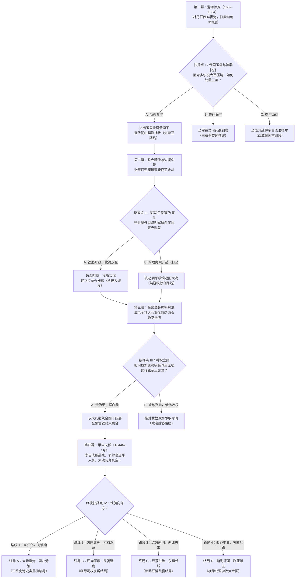

# 《九白苍狼：大漠蒙古史诗》
## ——大元正朔、长生天神权与瀚海两万里铁血重光

---

## 引子 · 苍狼与白鹿的正朔

在欧亚大陆最辽阔的地表上，只有一种秩序曾真正让整个已知世界低头。

那是自斡难河发源的乞颜部铁骑，是成吉思汗立于肯特山巅的九游白纛“查干苏勒德”。自忽必烈建号大元、定鼎大都以来，无论是金帐汗国统治的伏尔加河原野，察合台汗国纵横的天山南北，还是伊尔汗国马踏的美索不达米亚平原，四海诸国皆是大元大汗的封藩！

在大漠蒙古诸王公的骨血与记忆深处，南方的朱明朝廷，不过是昔日大元牧马图录中丢失的江南农田；而东方的建州女真八旗，更是微不足道的奴仆——在元朝盛时，建州与海西诸部女真，皆隶属于大元开元路、水达达路总管府管辖，他们不过是向黄金家族贡纳貂皮、海东青与人参的“林中野人”（乌梁海与水达达）！努尔哈赤的六世祖猛哥帖木儿，在大元旧制中不过是一个卑微的万户长！

即便天道流转、元祚北迁，黄金家族依旧是大漠草原无可争议的“蒙哥·腾格里”（长生天）独家代行人。达延汗中兴六万户，俺答汗席卷中原九边，蒙古大汗的法统从未中断。

然而，到了十七世纪三十年代，长生天下的大漠陷入了一场前所未有的剧变。

东方的奴仆后裔皇太极在盛京黄袍加身，妄图以“后金”与“大清”之名窃据天命；南方的朱明王朝在流贼与边患的撕咬中苟延残喘，九边将领却用最下作的手段蚕食塞外边民；而在蒙古内部，哈萨尔后裔科尔沁部、阿巴嘎部为了盛京的联姻富贵与世袭札萨克官衔，竞相剃发易服，沦为满洲黑龙的先锋恶犬。

察哈尔部林丹巴图尔汗，作为达延汗嫡派子孙、全蒙古名义上的最高共主，肩负着整个大元帝国的最后孤统。他性格暴烈刚强，誓死不从满洲，亦鄙夷明廷文官的铜臭恩赐。

天聪六年（1632年）夏，后金倾国之兵联合叛蒙联军翻越兴安岭，林丹汗率部众十万自察哈尔腹地大举西奔。

这绝非软弱的逃亡，而是一场旨在避其锐气、重走成吉思汗西征旧道、联络漠西漠北、重聚九白纛的大战略转移！

黄金家族的苍狼哪怕流尽最后一滴血，也绝不向昔日的家奴与江南的农夫屈膝！

---

## 第一章：瀚海残阳 · 察哈尔西奔与黄金孤统

### 一

大黑河两岸，风沙如泼。

狂风卷着黄昏的冷霜，打在阿尔斯兰的玄铁兜鍪上，发出细密而沉闷的金石之声。阿尔斯兰勒紧战马的肚带，那匹骨架高大的青黑杂血神驹扬起前蹄，对着东方阴沉的天际发出一声暴烈的高亢嘶鸣。

阿尔斯兰，乞颜部孛儿只斤氏，达延汗的嫡亲血裔，察哈尔大汗林丹汗同父异母的兄弟。在整个漠南六万户中，他是唯一承袭了昔日怯薛军“万户长”荣耀的悍将。他的面容犹如用瀚海黑石斧削而成，坚毅、冷酷，左眼眉梢斜斜挂着一道被马刀撕裂的陈年旧疤。

“贝勒爷，后队哈喇嗔万户的辎重……被咬住了。”

年轻的先锋骁将阿海策马疾驰而至，满身血污，马鞍两侧悬挂着两柄带血的马刀。阿海是阿尔斯兰的义弟，察哈尔部最精准的神射手，能于二百步外开二石桑木硬弓洞穿铁叶。

“来的是哪条家犬？”阿尔斯兰没有回头，声音低沉得像地底滚动的熔岩。

“科尔沁！卓礼克图亲王吴克善的轻骑，还有镶黄旗的两千满洲巴牙喇！”阿海唾了一口带血的唾沫，眼中满是滔天的耻辱与暴怒，“吴克善那条哈萨尔的败类，带着科尔沁的骑兵抄了我们的大营侧翼！那些该死的叛徒，身上穿着满洲主子赐给的织锦箭衣，头顶剃得精光，留着像老鼠尾巴一样的细辫子，嘴里喊着满语的呼号，把我们察哈尔老弱的毡车点成了一道火海！”

阿尔斯兰的十指猛然收紧，精钢打造的护腕护甲在马鞍上压出深陷的凹痕。

科尔沁！

曾经成吉思汗二弟拙赤哈萨尔的封地，流淌着最尊贵乞颜部血脉的漠南雄部！如今，为了盛京皇太极许诺的“世袭罔替札萨克亲王”爵位，为了让他们的格格成为满洲皇帝的皇后与侧妃，吴克善、满珠习礼这群跳梁小丑，竟然将长生天的誓言踩在脚下，甘愿给昔日给蒙古大汗放鹰捕貂的建州家奴做先锋！

“他们忘了成吉思汗的大扎撒，忘了祖宗的骨血。”阿尔斯兰缓缓拔出腰间的长刀，刀身在黄昏如血的落日下泛着幽蓝冰冷的玄光，“既然他们剃了头发，做了野人的奴才，那他们在大漠里，就只配当被狼群撕碎的死尸。”

“贝勒爷，大汗的旨意是让我们速速渡过黄河，不要与敌军缠斗！”阿海急声道，“大汗的身体……已经支撑不住了。”

阿尔斯兰眼眸深处掠过一丝刀锋般的痛楚。

林丹汗，他的兄长。那位怀抱重塑大元雄心的大汗，性格太过刚愎，在收服喀喇沁与土默特时手段过于严苛，反而让这群心怀叵测的投机王公倒向了满洲；如今又在长途转进途中染上了可怕的疫病。

“大汗可以走，但察哈尔的骨头不能断在黑河滩上！”阿尔斯兰调转马头，高高举起手中的长刀，“传令怯薛精骑八百人！取下弓袋，拔出马刀！成吉思汗的子孙，从来不在奴仆的狂吠面前后退！今日，让科尔沁的叛徒看清楚，谁才是这片草原真正的主人！！”

八百名身披双层重锁子甲的察哈尔怯薛死士，在风沙中爆发出震碎云霄的狂啸：
“豁儿赤！乞颜！！”

### 二

黑风口的狭长峡谷，宛如大地被天神巨斧劈开的伤口。

科尔沁卓礼克图亲王吴克善策马行进在前列。他头戴镶嵌东珠的暖帽，身上披着皇太极御赐的石青缎团龙褂，意气风发。在他看来，林丹汗大势已去，察哈尔这头垂死的老狼不过是一具等待瓜分的肥肉。只要擒杀林丹汗，夺得大元传国玉玺，他在大清朝廷中的地位便将凌驾于所有蒙古王公之上。

“王爷，前面的峡谷风大，恐有察哈尔残部的伏兵。”科尔沁副统领诺木齐谨慎地提醒道。

“伏兵？”吴克善冷笑一声，手中的马鞭轻蔑地指向前方昏暗的山壑，“林丹汗连自己的大斡耳朵都丢了，像丧家之犬一样往青海逃窜！察哈尔的兵马早就吓破了胆，拿什么来伏击本王？满洲镶黄旗的大炮就在三十里外，谁敢阻挡大清天威？！”

话音未落，一声尖锐刺耳、撕裂空气的厉啸骤然从千仞绝壁上崩炸开来！

“鸣镝！！”

“噗嗤！”

一支长达三尺二寸、由精铁铸造的鈚箭，携带着摧枯拉朽的狂暴巨力，直接洞穿了诺木齐的护心铜镜，将他整个人狠狠钉死在马鞍之后！

紧接着，两边高崖上碎石崩落如暴雨，数十辆装满火油与枯骨的大车被点燃推下，烈焰如火龙横扫，狭窄的峡谷瞬间化为一片焦热地狱！

“杀——！！”

伴随着惊天动地的马蹄轰鸣，阿尔斯兰与阿海率领八百怯薛铁骑，宛如从烈火与黑烟中踏出的复仇神灵，逆着狂风狠狠撞击在科尔沁骑兵的胸膛上！

那是纯粹的屠杀。

察哈尔怯薛是大元帝国传承四百年的禁卫军精锐，所用战马皆为喀尔喀神骏与西域大宛马杂交，体魄强健，披挂马铠。八百铁骑排成坚不可摧的“凿穿战阵”，精钢打制的斩马长刀在黄昏的火光中划出一道道凄厉的血弧！

“阿尔斯兰！！”吴克善骇得魂飞魄散，在护卫的拼死抵挡下连连后退。

阿尔斯兰策马狂奔，双目猩红如血。战刀横削，一名试图阻挡的满洲牛录章京连人带刀被生生斩成两段，滚烫的内脏与鲜血喷洒了一地。阿尔斯兰在乱军中锁定了吴克善那面刺眼的团龙旗，声音如雷霆炸响：

“吴克善！哈萨尔的耻辱！你这跪在建州野人脚下的断脊走狗！可认得达延汗子孙的战刀？！”

阿海在飞驰中开弓如满月，三箭连珠破空而至！
“铛！铛！噗！”
两支箭射穿了吴克善身侧侍卫的面甲，最后一箭直接削断了吴克善头盔上的东珠顶戴，将他的暖帽狠狠钉飞在石壁之上！披头散发的吴克善面色惨白如死，惊恐地尖叫：“护驾！快拦住这匹疯狼！回撤！往盛京大军方向退！！”

科尔沁的三千骑兵被八百怯薛彻底击穿，自相践踏，死伤枕藉。

阿尔斯兰勒住战马，看着满地丢弃的满洲顶戴与科尔沁军旗，眼中没有胜利的喜悦，只有无尽的悲凉。

曾几何时，蒙古勇士的马蹄是要踏平金国与西夏的城郭；而今，自己斩杀的，竟然全都是流淌着蒙古骨血的同族！这场由盛京野心家编织的残酷内讧，正在一口一口将长生天骄傲的子民吞噬殆尽。

“贝勒爷，满洲主力追兵的大号角响了，在二十里外。”阿海策马回转，刀刃上滴滴答答淌着鲜血。

“点火，把峡谷烧断。”阿尔斯兰收刀入鞘，“走！赶赴青海大草滩！”

### 三

青海大草滩，打柴沟。

昆仑山与祁连山的冷风在此处汇聚，草木凋零，黄沙吞噬着泛白的盐碱池。

林丹汗的金顶大斡耳朵已经破旧不堪，原本九层的织金帷幕在风沙的撕扯下变成了灰黄色。帐外，数百名忠诚的察哈尔老人与孩童跪在泥水里，双目空洞，听着大帐内传出的沉闷哭泣与低沉的萨满神鼓。

阿尔斯兰掀开厚重的狼皮毡帘步入大帐。

帐内弥漫着浓烈的腐臭与草药味。林丹汗仰卧在一张铺着白虎皮的硬榻上。他的面颊完全塌陷，皮肤焦黑溃烂，天花的毒疮如密密麻麻的恶鬼之眼爬满了他曾经威严的面孔。他的嘴唇干裂发紫，胸膛急促地起伏着，每一次呼吸都带出肺叶破损的嘶鸣。

大福晋苏泰太后跪在榻侧，眼眶通红，发髻散乱。这位叶赫那拉部的贵女手中死死握着一柄精金柄短刀，眼中闪烁着冷酷而坚决的光芒。在她身后，十三岁的世子额哲面如土色，浑身战栗如风中的落叶。

“阿尔……阿尔斯兰……”林丹汗似乎感知到了战将的归来，吃力地转动着浑浊的眼球。

阿尔斯兰快步上前，双膝重重跪在硬榻前，握住了大汗滚烫而干枯的右手：“大汗，臣弟回来了。科尔沁的三千追兵被斩杀大半，吴克善抱头鼠窜，后卫无虞。”

林丹汗枯瘦如柴的脸上挤出一丝比哭还要难看的惨笑。

“杀得好……杀得好……”大汗剧烈地咳嗽起来，大口大口的黑血从嘴角溢出，苏泰太后急忙用锦帕擦拭，泪水终于忍不住滚落下来。

林丹汗死死抓住阿尔斯兰的铁甲护腕，指节因用力而发白：

“阿尔斯兰……朕……朕的四十万大军，没了……察哈尔的草场，丢了……腾格里，为何要绝我大元之祚？！”

“大汗！大元之祚未绝！”阿尔斯兰昂起头颅，声音沉重如铁，“漠北喀尔喀三部尚在，漠西卫拉特四部尚在！只要黄金家族的骨血不灭，九白纛不倒，我们便能重整旗鼓！”

“喀尔喀……卫拉特……嘿嘿，他们都在看着朕死啊……”林丹汗眼神中泛起回光返照的厉芒，他吃力地转过头，看向缩在角落里的额哲。

“额哲……你过来！”林丹汗嘶声吼道。

额哲哭着膝行上前：“父汗……”

“你听着！”林丹汗一把揪住儿子的衣领，眼中满是滔天的暴怒与不甘，“盛京的皇太极派了密使，许诺封你为和硕亲王，许诺尚皇太极的长女……你是不是动心了？！你想跪在大清的崇政殿前，当一条摇尾乞怜的哈巴狗，是不是？！”

额哲吓得嚎啕大哭，伏地不敢言。

林丹汗猛地松开手，惨笑连连。他知道，自己的这个儿子生性怯弱，根本担不起重建帝国的万钧重担。他猛然转向阿尔斯兰，枯指如利爪般指向大帐正中央那只沉重的玄铁大箱：

“阿尔斯兰！大元传国玉玺……‘制诰之宝’就在里面！皇太极做梦都想得到它，因为没有这枚玉玺，他的大清在大漠眼里，永远是盗贼！永远是家奴！”

林丹汗深吸了一口气，眼神变得无比清明而森冷：

“但你听好……石头救不了帝国，玉玺换不来战马！当年先祖顺帝北奔，失了中原，但草原尚在！如今皇太极要玉玺，额哲要富贵……便让他们拿去！”

“大汗？！”阿尔斯兰与苏泰太后同时一震。

“拿去！”林丹汗咬牙切齿，鲜血顺着齿缝流淌，“皇太极得了玉玺，必定按捺不住野心南下入关，去跟朱家皇帝争夺中原花花世界！两头猛兽在关内撕咬，大漠才能有喘息之机！”

“阿尔斯兰……你不同！”林丹汗死死盯着兄弟，目光如火炬般炽烈，“你带上怯薛精锐，去鄂尔多斯！去八白室！那柄太祖皇帝的九游白纛苏勒德神矛，才是真正的魂魄所在！成吉思汗的战神之灵在矛尖沉睡！唤醒它！联络漠北，扫荡叛逆！待天下大乱之时，统领十万铁骑，由北向南……再造大元！！”

“腾格里在上！朕……在天上看着你！！”

林丹汗发出生命中最后一声惊天动地的怒吼，身躯骤然绷直，随即重重跌落在虎皮榻上，双手僵死地垂落。

崇德前夕，大元黄金家族最后一位名义上的蒙古大汗，在青海大草滩打柴沟咽下了最后一口气。

风暴在帐外呼啸，大雪狂卷。

额哲伏在尸首旁放声痛哭。而苏泰太后缓缓站起身，将那柄金柄短刀递到了阿尔斯兰的手中，面容冷若冰霜：

“阿尔斯兰，大汗走了。大营里的投降派今夜就会派人去盛京请降。你若不走，他们为了向多尔衮表忠心，连你的人头都会割下来送去领赏。”

阿尔斯兰接过短刀，看着大汗圆睁的双目，缓缓拔出佩刀，在自己的额头上狠狠刻下一道血印！

“太后保重。”阿尔斯兰声音冰冷入骨，“告诉多尔衮，玉玺他可以拿走，但黄金家族的江山，我迟早会用铁骑踏着他的白山黑水，一寸一寸收回来！”

阿尔斯兰转身掀帘，大步迈入苍茫的暴风雪中。

---

## 第二章：玉玺北狩 · 科尔沁部投降与盛京博弈

### 一

天聪九年（1635年）四月，西拉木伦河畔的草滩上泛起了一层薄绿。

多尔衮的大帐犹如一座庞大的移动城堡，八旗镶白旗与正白旗的织锦巨蟒旗在春风中翻卷，杀气腾腾。在大营外围，科尔沁部、喀喇沁部、土默特部的数万降兵战战兢兢地列队肃立，他们头顶光秃秃的头皮在阳光下泛着油光，那一根根崭新的金钱鼠尾辫在风中显得滑稽而卑微。

多尔衮端坐于帅椅之上，神情清冷肃杀。在他身侧，豫亲王多铎面带讥讽，手按刀柄，目光如刀子般在跪拜的人群中扫视。

“罪臣额哲，率察哈尔全族部众，谨奉大元传国玉玺，归降大清皇帝汗天威！”

十三岁的额哲身穿丧服，跪伏在泥泞的草地上，双手高高托举着一只铺着金丝缎帕的沉香木盒。在他身后，察哈尔部的数十名台吉与诺颜齐刷刷跪倒在地，额头贴在地面，噤若寒蝉。

多尔衮缓缓走下台阶。他没有立刻去接那只木盒，而是用皮靴的尖端轻轻碰了碰盒沿，冷笑道：“额哲世子，你可知大清为了征讨你父亲的狂妄，耗费了多少八旗勇士的性命？当年林丹汗在宣府、大同抢夺明廷岁币，自封四十万蒙古之主，何等不可一世？今日，竟落得如此下场？”

额哲浑身发抖，泪流满面：“罪臣知罪！罪臣愿为大清天子牧马守边，永世不叛！”

多尔衮这才伸出手，揭开了缎帕。

青玉雕琢的传国玉玺静静躺在盒中，螭龙纽盘曲如生，底部八个阳文篆字在阳光下熠熠生辉——“受命于天，既寿永昌”。

多铎大喜过望，抚掌狂笑：“哈哈哈哈！得玺了！十四哥，太宗皇帝得此玉玺，大清承继中原大统名正言顺！南朝朱家的小皇帝，气数尽矣！”

然而，多尔衮那双深邃狭长的眸子却没有丝毫狂喜。他拿起沉重的玉玺，目光穿过跪拜的人群，冷冷落在了站在不远处的一位蒙古王公身上。

那是科尔沁卓礼克图亲王吴克善。

吴克善脸上带着谄媚的笑容，快步趋前，屈膝打千：“奴才吴克善，恭贺十四王爷！察哈尔降服，大漠底定，皇上天命所归，天下再无抗衡大清之辈！”

“吴克善。”多尔衮淡淡开口，声音不辨喜怒，“本王听说，黑风口一战，阿尔斯兰带着八百残骑，斩了你麾下三员骁将，连你的顶戴都射飞了？”

吴克善的笑容瞬间僵死在脸上，冷汗如瀑布般从额角渗下，结结巴巴道：“奴才……奴才无能！那阿尔斯兰乃是一头疯狼，全军悍不畏死……但王爷放心，奴才已遣科尔沁五百死士，严密封锁了阴山所有隘口，那狂徒插翅难逃！”

“蠢材。”多铎毫不留情地叱骂道，“十个额哲，也抵不上一个阿尔斯兰！阿尔斯兰跑了，八白室的苏勒德神矛还在鄂尔多斯！只要神矛一日不入盛京，蒙古各部就依然以为大元没有亡！你这个哈萨尔的后裔，办的差事简直像个喝醉了马奶酒的蠢妇！”

吴克善吓得扑通跪倒在地，连连叩首：“奴才该死！奴才该死！”

多尔衮抬手制止了多铎的怒骂。他将玉玺放回盒中，递给身旁的侍卫，目光如鹰隼般锐利地盯视着西北方的长天。

“传本王令箭，八旗大军即刻分兵：第一路，押送额哲、苏泰太后及传国玉玺回盛京，筹备皇上崇德改元大典；第二路，由阿山统领满洲两黄旗精锐，协同科尔沁部，进驻归化城，严密监视土默特与鄂尔多斯各部动向！”

多尔衮转过身，看着噤若寒蝉的蒙古各部王公，声音如坚冰裂石：

“自今日起，大漠再无万户与大汗！所有归降部落，尽皆编入八旗蒙古，划地为旗，设札萨克管辖！凡私越界山放牧者，斩！私藏武器马匹者，抄没全族！若有暗通阿尔斯兰者，诛九族！！”

冰冷的军令在草滩上空回荡，数万名昔日纵横大漠的蒙古骑兵，低垂着头颅，彻底沦为了盛京帝国的附庸与战车前驱。

### 二

盛京，崇政殿前广场。

这是一场充满神权计算与地缘权谋的盛大典礼。

皇太极身披明黄织金龙袍，端坐于九龙宝座之上。阶下，满汉文武百官与来自漠南各部的四十九旗蒙古王公黑压压跪倒了一大片。在大殿的一侧，西藏达赖喇嘛与班禅额尔德尼派遣的黄教高僧们手摇法铃，口诵梵咒；而在另一侧，满洲正黄旗的萨满神巫们敲击着羊皮神鼓，腰间的铜铃发出尖锐狂乱的鸣响。

神权与王权在此刻交织成一张无形的罗网。

皇太极深谙游牧民族的心理。他不仅要用满洲八旗的重甲强弓征服草原的肉体，更要用“转轮圣王”（Chakravartin）的神圣光环，彻底取代成吉思汗黄金家族在精神世界中的至高地位！

“宣旨——！”内阁大学士范文程手捧黄绢，高声宣唱。

随着长长的敕令宣读完毕，皇太极将大元传国玉玺郑重放置于案台之上，接受万民朝贺。改国号为“大清”，改年号为“崇德”！

大典之后，大政殿深处举行了绝密的满蒙联姻夜宴。

金樽美酒，烤全羊的香气弥漫在大殿之内。然而，这绝非温情的家庭聚会，而是一场赤裸裸的利益瓜分与政治人质分发。

皇太极坐在主位，面容宽厚而眼神深不可测。在他身旁，坐着来自科尔沁草原的皇后哲哲、庄妃布木布泰（后来的孝庄文皇后）以及宸妃海兰珠——科尔沁博尔济吉特氏的女人们，用她们的子嗣与美貌，牢牢将科尔沁部与盛京的命运捆绑在了一起。

“吴克善，满珠习礼。”皇太极微笑着端起酒金碗。

科尔沁的两大台吉急忙离席出列，满脸堆笑地跪在殿前：“奴才在！”

“你们科尔沁部，这次西征察哈尔，出了大力。”皇太极声音温和，却带着如山岳般的威严，“朕封吴克善为和硕卓礼克图亲王，满珠习礼为扎萨克达尔汉巴图鲁郡王，世袭罔替！另外，朕的第四女固伦靖端长公主，许配给吴克善之子弼尔塔哈尔为妻！”

“谢皇上天恩！奴才万死难报万一！愿为大清粉身碎骨，永镇北疆！”吴克善激动得浑身发抖，连连叩头。

坐在下首的土默特降将阿达海、喀喇沁台吉色楞等人，眼中满是羡慕与嫉妒的红光。为了这世袭罔替的亲王顶戴与满洲公主的下嫁，他们甘愿把自己的部族拆散，把数以万计的青年壮丁送上关内与明军交战的绞肉机战场！

然而，就在群臣欢呼庆祝之时，一个清脆而冰冷的声音在大殿一角突兀地响起：

“皇上好手段。用几顶金帽子和几个女人，就把成吉思汗子孙的骨头，全买成了盛京看家护院的鹰犬。”

整个大政殿瞬间死一般寂静！

乐声骤停，满洲侍卫霍然按刀。

说话的，正是坐在降顺席位上的苏泰太后。这位叶赫那拉部的孤傲贵女，身穿察哈尔传统的苏木貂皮袍，发髻高耸，冷冷地看着皇太极。在她的身旁，刚刚被封为“察哈尔亲王”的十三岁额哲，吓得面无血色，死死扯着母亲的衣角。

皇太极脸上的笑容没有消失，只是双眼微微眯起，透出一股令人不寒而栗的帝王威压。

“苏泰福晋，”皇太极声音平缓，“当年叶赫城破之时，你父亲金台吉自焚于高台，发下‘纵使叶赫剩下一名女子，也要灭亡建州’的毒誓。如今你嫁入察哈尔，林丹汗亦死于瀚海。你觉得，这天命，难道还会眷顾你那些死去的父兄与丈夫么？”

苏泰太后冷笑一声，霍然站起身，目光如两道利箭刺向皇太极：

“天命？爱新觉罗·皇太极，你少拿天命来欺瞒草原！大元的玉玺你拿到了，但这片大漠你真正拿到手了吗？！漠北喀尔喀三部，谁向你称臣了？漠西准噶尔巴图尔珲台吉，可曾踏入你盛京一步？鄂尔多斯八白室的苏勒德神矛，还在达尔扈特人的手中！！”

苏泰太后猛地指向殿外苍茫的夜空，声音激越凄厉，在大政殿的穹顶下久久回荡：

“长生天没有瞎！阿尔斯兰还在阴山！只要九游白纛一日不倒，黄金家族的血性一日未尽，你们偷来的这身龙袍，便随时会被草原的铁蹄踩成破布！！”

“放肆！！”
鳌拜怒吼一声，拔刀欲斩。

皇太极却猛地一挥手，止住了侍卫。他站起身，缓步走到苏泰太后面前，居高临下地注视着这位倔强的亡国太后。

“福晋说得很好。”皇太极的声音低沉而平静，仿佛深渊中的暗流，“朕不杀你。朕会把你赐给郑亲王济尔哈朗为福晋。朕要让你活着，睁大眼睛看着——朕是如何用大清的八旗铁骑踏平山海关，是如何让喀尔喀与卫拉特的汗王跪在朕的脚下，又是如何……把阿尔斯兰的人头，挂在八白室的石柱之上！”

“带下去！”

苏泰太后昂着头，在侍卫的押送下大步走出大殿，连看都没看跪在地上瑟瑟发抖的亲生儿子额哲一眼。

皇太极转过身，对身旁的范文程冷冷吩咐道：

“告诉张家口那边的范永斗……立刻切断给大漠的一切铁器与火药走私。同时，给宣大总兵官王朴送两万两银子，让他出兵扫荡大同外围的察哈尔游骑！朕要让阿尔斯兰在阴山背后，变成一具冻死在风雪里的枯骨！”

一场横跨数千里、交织着血与铁的围猎大网，在盛京的夜宴中轰然张开。

---

## 第三章：铁火暗流 · 张家口密窟与晋商寡头操盘

### 一

大境门外，夜幕低垂。

在塞外与长城的交界处，张家口不仅是大明与蒙古互市的榷场，更是整个十七世纪东亚大陆最庞大、最隐秘的军火与白银血脉。

塞外滴水成冰，但在大境门向北五里的西沟绝壁之下，地火与熔炉的气息却将冰雪融化成了泥浆。这里是晋商八大家之首——范永斗的地下密窟“万全仓”。

穿过伪装成皮毛货栈的三道重铁闸门，脚下赫然是一座深达地下数十丈的天然石灰岩溶洞群。洞窟内灯火通明，数百名精壮的私人镖师与带刀死士巡弋在甬道之间。而在那些纵横交错的巨大洞厅里，景象足以让任何一个大明刑部尚书或辽东督师魂飞魄散：

左侧洞窟，整整齐齐码放着上万口漆着黑漆的樟木大箱。箱盖半敞，露出一锭锭带着大明户部税银官印的五十两重雪花银锭，在火把照耀下反射着森然刺目的冷光；
右侧洞窟，是数以千计的铁箍火药桶，空气中弥漫着刺鼻的硫磺与硝石气味；
而最深处的溶洞里，赫然陈列着数百门自葡萄牙澳门转运而来的西洋佛郎机子母铳、三千杆大明兵仗局精制斑鸠脚鸟铳，以及堆积如山的山西熟铁条、瑞典精钢马刀！

这绝非寻常商贾的货栈，这是一个足以左右王朝兴衰的地下军火帝国！

在正中央铺着整张东北雪山吊额白虎皮的紫檀木大椅上，范永斗正悠闲地用一只白玉茶匙拨动着景德镇宣德窑青花盖碗中的武夷大红袍。

他年过五旬，面容儒雅，穿着一件价值千金的玄色貂鼠裘袍，手指上戴着两枚帝王绿的翡翠扳指。在他身侧，介休王登库、祁县靳良玉等几位晋商巨头肃立两旁，案几上的算盘珠子在账房先生们枯瘦的手指下噼啪乱响，那是亿万两白银在关内外流转的摄魂魔音。

“范掌柜好大的气魄。”

一个低沉如铁石摩擦的声音在洞窟石阶上突兀地响起。

洞内的数十名镖师霍然拔刀，刀锋在火光下泛着惨绿的淬毒幽光。

范永斗眼皮微微一抬，轻轻啜饮了一口香茗，微笑道：“来者是客。更何况，是乞颜部的真正主人、长生天的苍狼到了。退下，把刀收起来，莫要惊扰了阿尔斯兰贝勒。”

阿尔斯兰披着一件没有任何纹饰的粗羊皮大氅，腰跨长刀，与手按桑木强弓的阿海拾阶而下。他的目光在这座庞大的地下军火库中缓缓扫过，瞳孔深处泛起一丝冰冷的杀机。

“范掌柜，你这地下洞窟里的铁器与火药，比大明宣府镇总兵官的武库还要充裕十倍。”阿尔斯兰走到石桌前，拉过一张沉香木交椅坐下，大马士革弯刀重重横在桌面上，“外人都说你是大明的皇商，可我看，你才是这宣大塞外真正发号施令的地下皇帝。”

“贝勒爷谬赞了。”范永斗放下茶盏，笑容温润如玉，“生意人，在商言商。这天下是大明朱家的，还是大清爱新觉罗家的，亦或是大元孛儿只斤家的，与我范某人何干？朱家的皇帝给官印，爱新觉罗家的皇上给特许商牒，而蒙古的台吉汗王……给的是天下最好的战马与皮毛。”

范永斗倾身向前，那双老谋深算的眸子里闪烁着赤裸裸的资本狂热与傲慢：

“崇祯皇帝在紫禁城里算计着天下钱粮，户部国库空得能跑耗子，九边军饷欠了整整两年；而我范家一张银票，可以在江南调集十万石精米，可以在广东买空澳门的红夷大炮！贝勒爷，您是要做这乱世里挨饿的雄鹰，还是要跟范某做这笔平分天下的买卖？”

### 二

“买卖？”阿海冷哼一声，踏前一步，手中强弓发出嘎吱的紧绷声，“范永斗！你少在这里装神弄鬼！盛京崇政殿里皇太极改元大清的黄绸缎，是你范家商队运出关外的！给镶黄旗造红衣大炮的铜料与硝石，是你运去盛京的！你一面吸着大明的骨髓，一面给满洲家奴递刀子，如今还想在我们察哈尔身上发横财？！”

面对杀气腾腾的阿海，范永斗面不改色，甚至连眼神都没有颤抖一下。

“年轻的台吉，火气不要太大。”范永斗淡淡一笑，指尖轻轻敲击着紫檀木桌面，“吴克善拿了皇太极的札萨克金印，给满洲人当马前卒，那是他的蠢。他以为靠联姻就能换来万世富贵？殊不知在大清的铁蹄下，蒙古骑兵不过是一次性的耗材！”

范永斗转头看向始终沉默不语的阿尔斯兰，声音压得极低，透着一股近乎残酷的清醒：

“阿尔斯兰贝勒，我知道林丹汗死了，额哲跪了，传国玉玺进了盛京。满洲人以为大漠已经成了他们的后院。可范某知道，玉玺是假的，大漠真正的心脏还在阴山与八白室。皇太极前日派了内国史院大学士范文程给我送了密信——要我范家联合大同总兵王朴，彻底切断阴山的茶马暗道，用三千满洲死士将你在八白室连根铲除。皇太极开出的价码，是大清入关之后，黄河以北所有省份的盐铁专卖特权！”

洞窟内的空气瞬间凝固到了极点。阿海的弓箭已然搭上了重铁鈚箭，箭尖直指范永斗的眉心！

然而阿尔斯兰的脸上依然没有波澜，甚至嘴角勾起了一抹极其残忍的冷笑。

“那你为何没有把我的行踪报给王朴和多尔衮？”阿尔斯兰冷冷问。

“因为皇太极太聪明，也太贪婪。”范永斗眼中掠过一丝森冷的寒芒，“满清一旦毫无悬念地吞了草原、踏平关内，天下归一，像我这样的豪商巨贾，在大清皇帝眼里便是一头养肥了的肥猪，迟早要被拉上祭台开膛破肚！只有关内有李自成、辽东有八旗、大漠有您这柄长生天的神矛，三方鼎立，犬牙交错，我晋商八大家才能在夹缝中呼风唤雨，左右天下大势！”

范永斗站起身，从身后的暗格中取出一份泛黄的皮纸舆图，重重拍在石桌之上：

“这是大同、宣府、蓟镇三镇的边防布防图，详细标注了七十二处关隘的守军人数、粮仓位置，以及宣大总兵官王朴所有的走私暗道！另外，外头洞窟里的两千杆鲁密铳、一百万发精铅弹丸、五百桶上等黑火药，以及三十万斤山西熟铁，范某全部半价折给贝勒爷！”

阿尔斯兰目光如刀，盯着那张布防图：“你的条件是什么？”

“第一，我要整个漠北喀尔喀与漠西卫拉特的皮毛与黄金独家包销权；第二……”范永斗微微一笑，那笑容像毒蛇吐信，“帮我杀一个人。”

“谁？”

“大明宣大总兵官，王朴。”

### 三

“为何要杀他？”阿海皱眉问道，“王朴不是你们晋商的大靠山么？这关口的一道道关卡，若没有总兵的大印，你们的商队如何走私出关？”

“靠山？”范永斗冷笑一声，面容第一次浮现出狰狞与厌恶，“那是一头永远填不饱肚子的恶狼！去年范某孝敬了他八万两白银，今年他竟然狮子大张口，要范家三成的红利！不仅如此，这个猪狗不如的东西，在边关干尽了伤天害理的勾当，连朝廷拨给边民的活命粮都要扣下转卖！更要命的是……他为了掩盖亏空，已经开始在边境上干起了‘杀良冒功’的无耻行径！”

范永斗的声音在大厅中回荡，带着商界枭雄在遭遇不可控风险时的决绝杀机：

“王朴派了他的亲兵营，假扮成塞外马贼，出塞四处劫杀走西口的汉人商贩与出关采樵的流民，割了人头剃发冒充‘察哈尔真鞑首级’向朝廷请赏！昨日，我范家一支运粮的偏队在得胜堡外被这群披着大明官军皮的畜生洗劫，十几个伙计全被砍了脑袋！此人不死，边关必大乱；边关一大乱，崇祯皇帝派钦差彻查，我范家的万全密窟便有暴露之危！”

阿尔斯兰缓缓站起身，收起石桌上的布防图。

他的眼中没有惊讶，只有对大明帝国彻底腐朽的冰冷蔑视。

成吉思汗在《大扎撒》中曾严令：“欺凌弱小者斩，杀害商旅者车裂。”而在南方那个自诩礼义之邦的汉人朝廷里，守卫边关的大帅竟然要靠屠杀自己的百姓来换取乌纱帽与赏银！

“铁器和火药，今夜子时，我的怯薛会用三千匹喀尔喀战马接应出关。”阿尔斯兰按刀而立，宛如一尊不可撼动的青铜巨像，“至于王朴的脑袋……我会亲自割下来，挂在大境门的门楼上，让长生天的鹰隼好好啄食这个畜生的眼珠！”

范永斗深深一揖：“长生天的神矛，果然痛快！范某在张家口，静候贝勒爷的捷报！”

---

## 第四章：杀良冒功 · 撕碎明朝边将假面

### 一

塞北十一月，大同得胜堡外荒原。

狂风卷着如刀的雪片，漫天肆虐。地面冻结得如生铁般坚硬，衰草在风中瑟瑟发抖。长城隘口那高大的夯土烽燧在阴沉的铅云下耸立，宛如一座座孤绝的墓碑。

在一处背风的干涸河谷中，数百名衣衫褴褛的大明边民正拖家带口、深一脚浅一脚地向着关内艰难挪动。

这些都是大同、朔州一带活不下去的汉人百姓。崇祯年间北方大旱，赤地千里，陕北李自成的兵火蔓延，官府的苛捐杂税与“练饷”、“剿饷”却如催命符般层层加码。这些百姓冒死“走西口”，企图到长城外的大漠深处帮蒙古牧民放牧、打草，换一口青稞面糊口活命。如今天寒地冻，大漠大雪封山，他们怀揣着在塞外辛苦一年换来的几张粗羊皮和少许干酪，想要赶在年关前潜回关内，救活家中的老母与妻儿。

人群中，一位枯瘦的老汉紧紧搂着怀里只有六岁的孙女。小女孩冻得嘴唇发紫，身上只裹着一件破旧的夹袄。

“爷爷，过了前面那个烽火台，就能到家了吗？妞妞饿……”小女孩声音微弱得像风中的细丝。

老汉用满是冻疮的大手将怀里的半块硬如石头的干酪塞进孩子嘴里，泪眼浑浊：“乖妞妞，快了，快了！过了得胜堡，进了大同城，咱们把羊皮卖了，爷爷给你买白面馍馍吃……”

突然！

远处长城隘口的方向，传来了一阵急促如雷鸣的马蹄声！

雪幕被蛮横地撞开，一支百余人的骑兵队伍自烟尘中疾驰而来。他们身穿大明官军的标准棉甲，腰悬雁翎刀，头戴红缨笠帽，手里高擎着三眼铳与铁链！领头的一名千总满脸横肉，马刀出鞘，眼中闪烁着如饿狼看到肥羊般的贪婪与残忍。

那是大同总兵王朴麾下的精锐家丁营！

“官爷！是官军大爷！”老汉喜出望外，拉着孙女和周围数十名逃荒百姓纷纷跪倒在雪地里，叩首哀求，“军爷行行好，我们是关内的良民啊！在塞外给蒙古人放羊打草换口吃的，求官爷开关放我们回乡吧！”

骑在马上的千总勒住战马，居高临下地俯视着这群骨瘦如柴的百姓，嘴角浮现出一抹令人毛骨悚然的狞笑。

“良民？”千总用刀尖挑开老汉身上的破布包袱，露出了里面的几张粗羊皮，“私自出塞，通敌附虏！大明律，擅出边塞与虏交通者，依叛逆论斩！”

老汉吓得魂飞魄散，连连磕头，额头砸在冻土上鲜血迸流：“军爷明察！小人世代在大同浑源当佃农，绝不是叛贼啊！求军爷饶命！饶命啊！”

“饶命？”身旁一名明军把总阴恻恻地笑道，“老东西，兵部新下了急帖，皇上在京师催问宣大边防战果，宣大总督衙门按兵不动，总兵大人正为‘斩级’发愁呢！朝廷有旨：斩获东虏真鞑首级一名，赏银五十两，官升一级！你们这些贱骨头，活着也是冻死饿死，不如把脑袋借给老子，换总兵大人一道升官的奏折！”

千总眼中凶光骤现，战刀向前狠狠一挥：

“男的全部砍了割脑袋！女的扒光衣服扔在雪里冻死！手脚利索点，把胡须全剃了，头顶中间剃光留两撮头发，用锅灰和桐油把脸涂黑！谁要是敢漏出破绽，老子连他的脑袋一起割！！”

“畜生！！你们这些披着人皮的畜生！！”

老汉绝望地爆发出一声凄厉的长嚎，拼死扑上去想要保护孙女。

“噗嗤！”

冰冷的雁翎刀如切瓜砍菜般划过老汉的脖颈，一颗白发苍苍的头颅冲天而起，滚烫的鲜血喷洒了小女孩满脸！

惨绝人寰的屠杀在雪地中瞬间爆发。明军官兵如狼似虎地扑入手无寸铁的人群，战刀疯狂劈砍，三眼铳近距离轰击，绝望的哭嚎与求饶声被无情地淹没在风雪之中。那些官兵熟练地踩住尸体的胸膛，用小刀割下头皮，割下耳朵，将一颗颗滴血的人头扔进装满石灰的大筐里！

小女孩瘫坐在爷爷无头的尸体旁，吓得连哭声都发不出来，眼看着一名满身血腥的官军狞笑着举刀向她劈来——

### 二

“咻——！！”

一道恐怖的音爆撕裂了呼啸的风雪！

那是一支长达三尺三寸、通体由纯乌兹钢打造的重箭！重箭在半空中甚至带起了一圈肉眼可见的空气波纹，直接将那名挥刀明军的胸甲轰成了齑粉！巨大的动能将他整个人带着倒飞出四丈开外，狠狠钉穿在干涸河谷的冻土石壁上，当场四分五裂！

全场明军骇然失色！

“谁？！哪个吃了熊心豹子胆的敢管官军的闲事？！”千总厉声尖叫。

在河谷顶端的苍茫雪脊之上，战马的长嘶声如惊雷滚过天际。

雪幕散开，三十名身披重甲、头戴双翅鹰翎铁盔的察哈尔怯薛铁骑宛如从神话中走出的战神，冷冷俯视着谷底的屠杀。而在最中央，阿尔斯兰手持大马士革长刀，阿海手中的二石硬弓正缓缓放下，弓弦的颤音经久不散。

阿尔斯兰的目光掠过满地的残肢断臂，掠过那被割下头颅、尸身尚在抽搐的汉人老弱，掠过那筐里堆放的、被剃发抹油企图伪装成“蒙古虏首”的平民人头。

他的左颊刀疤泛起令人胆寒的紫黑色，那是暴怒到了极致的征兆。

“大元的怯薛们，看清楚了。”阿尔斯兰的声音低沉得仿佛雷云翻滚，“这就是自称衣冠礼乐、代天牧民的大明官军。在关内，他们把自己的百姓当成两脚羊；在关外，他们把人头当成换取赏银的牲口！”

“贝勒爷……”阿海的眼眶赤红，手中的箭矢再次搭上弓弦，“杀光他们！！”

“不留活口。”阿尔斯兰刀锋一指，“用这群畜生的血，祭奠大漠的长生天！”

“轰！！”

三十名怯薛宛如三十颗从九天坠落的黑色陨石，顺着陡峭的河谷绝壁俯冲而下！战马的铁蹄踏碎积雪与岩石，发出震撼大地的狂暴轰鸣！

明军千总亡魂皆冒，他做梦也想不到，在这大同边关眼皮底下，竟然会出现如此悍勇绝伦的真正蒙古铁骑！

“放铳！结阵放铳！！”千总凄厉狂吼。

明军手忙脚乱地举起三眼铳与鸟铳，然而在这天寒地冻的白毛风中，劣质的火绳早已熄灭，火药在冰雪的侵袭下根本无法引燃！

“砰！砰！”只有两三支三眼铳勉强炸响，散弹打在怯薛的精钢马铠上，迸溅出一串无力的火花。

下一瞬，钢铁风暴已然降临！

察哈尔怯薛的斩马刀带着撕裂空气的厉啸横扫而过。一名明军骑兵连人带马被阿尔斯兰一刀从肩胛劈入、斜斜斩成两段！鲜血在雪地上喷射出五尺多高！阿海策马在乱军中穿梭，弓无虚发，每一声弓弦震颤，便有一名明军咽喉中箭落马！

这根本不是战斗，而是一场狂暴的天谴。

不过半柱香的功夫，百余名明军家丁被斩杀殆尽，河谷彻底被滚烫的鲜血染成了赤红色。

千总被打断了双腿，像一条蛆虫般在血泥里拼命向长城方向蠕动。阿尔斯兰策马走到他身前，战马沉重的铁蹄一脚踏在他的脊背上，骨骼碎裂的脆响令人心惊肉跳。

“好汉……鞑靼爷爷……饶命！饶命啊！”千总满脸鼻涕眼泪，哀嚎求饶，“小人上有八十老母……这些首级……是总兵大人的军令啊！是王总兵逼我们干的！每颗首级总兵抽三十两，我们才分五两啊！！”

阿尔斯兰翻身下马，缓缓拔出腰间的短刀，踩住千总的头颅，目光森然：

“你们大明的官家，管你们叫兵，管我们叫‘虏’。可今日在这长生天下，谁才是真正的野兽？！”

短刀刺入，刀锋在骨骼间摩擦的声音冰冷刺骨。

阿尔斯兰一把将千总的头颅割下，拎在手中。他没有将这颗头颅扔掉，而是用马尾粗绳穿过发髻，系在马鞍旁。

### 三

雪停了，惨白的残阳照耀着死寂的河谷。

数十名侥幸存活下来的汉人边民战战兢兢地聚拢在一起，跪在阿尔斯兰的战马前。他们浑身发抖，不知道这群凶悍无匹的蒙古大兵接下来会将他们怎样处置。

那个幸存的小女孩妞妞跪在爷爷的尸体旁，小手紧紧拽着阿尔斯兰那染血的大氅下摆。

阿海走上前，低声道：“贝勒爷，这些汉人怎么处置？若放他们回去，大同的官军迟早会把他们斩草除根；若杀了……”

“成吉思汗的大扎撒里，何曾杀过无寸铁之民？！”阿尔斯兰断然打断了阿海的话。

阿尔斯兰走到小女孩面前，单膝跪在冰冷的雪地里。他伸出那只布满厚茧、刚刚斩杀过数十名官军的大手，动作却异乎寻常的轻柔，轻轻拭去了小女孩面颊上的冰冷血迹。

他从怀中掏出一块风干的熟牛肉，塞进小女孩颤抖的小手里。

“别怕。”阿尔斯兰用虽然生硬、但沉稳有力的汉语说道，“从今日起，没有人能再割你亲人的头颅。”

他站起身，对着那些绝望的汉人边民高声宣布：

“大明的皇帝视你们为草芥，大明的官军割你们的头颅领赏！这关内，已经没有你们的活路！我是大元乞颜部的阿尔斯兰！跟我走！越过长城，去阴山！去敕勒川！”

“在草原上，只要你们肯出汗出力，大元有最好的草场给你们种青稞，有最好的牛羊给你们果腹！凡匠人、铁匠、火器手，皆授千户之礼！长生天的苍狼，只吃恶狼的肉，绝不欺凌受苦的羔羊！！”

这群在生死边缘徘徊的汉人百姓愣住了。他们看着眼前这位浑身浴血、面带刀疤的蒙古将领，看着他身后威风凛凛的怯薛铁骑，又看了看满地惨死的“大明官军”，突然爆发出撕心裂肺的嚎哭！

那是被逼入绝境的底层黎民对故国的绝望，也是在炼狱深渊中重新看到生路的震撼。

“青天大爷！大汗万岁！！”

数十名汉人百姓推金山倒玉柱般跪伏在地，向着阿尔斯兰疯狂叩首。

阿尔斯兰下令将缴获的明军战马与干粮分发给这些边民，让怯薛护送他们先行撤往阴山后方的大营。而在这些边民中，赫然有数名曾在宣府兵仗局服役多年的老铁匠与铸炮师——这批宝贵的工匠，将成为阿尔斯兰日后在大漠深处建立火器铸造营最核心的种子！

处理完毕后，阿尔斯兰跃上战马，解下马鞍旁千总的头颅，将其高高悬挂在得胜堡外的枯木之上。

在枯木的树皮上，阿尔斯兰用滴血的战刀刻下了八个铁画银钩的蒙汉双语大字：

**“杀良冒功者，此即下场！”**

狂风再次呼啸而起。

大明九边的腐朽与血腥，终于在这片风雪荒原上被彻底撕碎了虚伪的遮羞布。而阿尔斯兰的铁骑，不仅赢得了草原勇士的效忠，更在这条漫长的边境线上，悄然播撒下打破蒙汉壁垒的全新火种。

---

## 第五章：神权圣轮 · 达赖调解与金顶法会交易

### 一

崇德五年（1640年）秋，漠北肯特山南麓，土谢图汗汗庭“库伦”。

金色的秋阳洒在无边无际的草浪上，整座营地被上万顶白色的毡帐所覆盖，宛如漫天繁星坠落大地。这是自也先瓦剌瓦解、达延汗重组六万户以来，蒙古草原上规模最庞大、规格最高的一场盛会——喀尔喀各部、漠西卫拉特四部、察哈尔抗清余部以及鄂尔多斯达尔扈特人，共同聚集于此，召开全蒙古“忽里勒台金顶法会”。

大营的中央，拔地而起一座巨大的金顶黄缎大斡耳朵。

大帐之外，数千名来自卫拉特的短发战士与喀尔喀的披甲长刀手分列两侧，虽同为蒙古儿女，但眼神交汇之间，却闪烁着数百年部落宿怨的警惕与杀气。而在大帐的一角，一支特殊的队伍引起了所有人的注视：

那是来自雪域高原拉萨布达拉宫的五世达赖喇嘛与四世班禅额尔德尼的特使团。

数十位身披朱红与明黄袈裟的藏传佛教格鲁派（黄教）高僧手持金刚杵、转经筒与海螺法号，在悠扬深沉的梵音中缓步穿行。领头的，正是西藏政教核心的大国师、格鲁派策墨林呼图克图——罗桑丹增。

然而，在这慈悲肃穆的梵呗佛光背后，却涌动着最肮脏、最复杂的政治权谋与资本交易。

金顶大帐后方的密帐内，藏香缭绕，青铜佛灯幽暗。

罗桑丹增脱去了庄严的法冠，盘腿坐在一张堆满了锦缎的胡床之上。在他面前的紫檀木长几上，摆放着三只截然不同的包袱，分别代表着如今窥伺大漠的三大强权：

第一只包袱里，是盛京皇太极送来的密信与厚礼——纯金铸造的四臂观音像三尊、重达五千两的盛京官银，以及一份盖着大清皇帝玉玺的黄绫诏书，承诺在大清入主中原之后，奉格鲁派为天下第一国教，册封达赖喇嘛为“西天大善自在佛”；其条件，是在法会上宣布皇太极为“转轮圣王”（Chakravartin）与文殊菩萨化身，令漠北漠西各部尽数归顺大清！

第二只包袱里，则是北京崇祯皇帝派遣司礼监太监暗中送来的三万两户部赏银与白玉如意，请求大喇嘛施展佛法，调停明蒙冲突，严禁蒙古各部踏入长城一步；

而第三只包袱，空无一物，只有一柄沾满风霜与血污的短刀——那是阿尔斯兰派人送来的铁血信物。

“国师，盛京的使者图赖已经在帐外等候多时了。”一名心腹小喇嘛跪在帐帘旁，低声回禀，“图赖说了，只要法会上宣布皇上为转轮圣王，这三千两黄金与拉萨大昭寺的重修金顶，大清即刻派镖队起运。”

罗桑丹增微闭的双目缓缓睁开，眼中没有出家人的四大皆空，只有政客待价而沽的精明与冰冷。

“急什么。”罗桑丹增冷哼一声，手中转动着价值连城的沉香木念珠，“皇太极的银子固然诱人，但他现在被明朝的松山、锦州死死拖住，胜负犹未可知！卫拉特巴图尔珲台吉已经征服了青海，固始汗的大军正横扫康藏！若此时贸然倒向盛京，把漠北与漠西的汗王逼急了，他们一怒之下拆了库伦的黄寺，贫僧拿什么去见长生天与佛祖？！”

“那……明朝的银子呢？”

“明朝已是风中残烛，崇祯小儿的银子拿着烫手，且先收下，虚与委蛇便是。”罗桑丹增站起身，拂了拂袈裟上的香灰，目光投向帐外那一柄若隐若现的九游白纛，“真正难缠的，是阴山那匹苍狼阿尔斯兰。他手中有成吉思汗的苏勒德神矛，又在边关斩杀了王朴、截断了满洲的粮道，如今漠南旧部民心全系于他一人。今日法会，若不能降服此人，盛京与拉萨的这桩大买卖，便做不成！”

### 二

法会正午，金顶大斡耳朵内。

铜号齐鸣，梵唱震天。

漠北喀尔喀土谢图汗衮布、车臣汗硕垒、札萨克图汗素巴第，漠西卫拉特巴图尔珲台吉、准噶尔诸部首领环列大帐两侧。案几上摆满了烤全羊与醇香的马奶酒，但帐内的气氛却压抑得令人窒息。

罗桑丹增高坐于法台正中央，宝相庄严，双手结降魔印，声音如洪钟大吕在大帐内回荡：

“阿弥陀佛！长生天浩荡，佛法慈悲！今全蒙诸部汗王聚首，乃为平息干戈、订立大典！皇天在上，佛祖在下，盛京大清皇帝顺应天命，得传国玉玺，敬奉三宝，实乃末世救苦之‘转轮圣王’！贫僧奉五世达赖喇嘛法旨，劝谕蒙古诸汗王：息兵罢战，共奉盛京正朔，共结满蒙之盟！凡违逆圣轮法旨者，永堕金刚地狱，部族受天火焚绝！！”

随着大喇嘛这一番充满神圣威压的法旨宣读，随行百余名喇嘛齐声吹响巨大的海螺法号，铜钹轰鸣，震慑得在场许多信奉黄教的蒙古王公心惊肉跳，纷纷合十低头。

土谢图汗衮布面色阴晴不定，而巴图尔珲台吉则手按佩刀，冷笑不语。

就在这一片神权威慑的肃穆死寂中，一声刺耳狂暴的大笑骤然撕裂了整座大帐！

“哈哈哈哈哈哈！！”

那笑声粗粝、狂傲、充满了无尽的讥讽与睥睨！

帐帘被一股狂暴的劲风蛮横地掀开，刺目的阳光照射而入。一道魁梧如铁塔的身影披挂重锁子甲，按刀大步踏入大帐！在他身后，义弟阿海高高擎着一柄长达丈二、九十九束纯白马鬃在风中如烈焰狂舞的神矛——成吉思汗九游白纛“查干苏勒德”！

而在神矛之侧，察哈尔大萨满博额乌恩其盲目望天，羊皮神鼓在手中爆发出如滚雷般的震颤狂鸣！

“阿尔斯兰！！”

大帐内数千人霍然失色，惊呼声此起彼伏！

罗桑丹增脸色骤变，手中的转经筒猛地一滞，厉声喝道：“大胆阿尔斯兰！佛门法会清净之地，安敢带凶兵秽物闯入？！你目无佛法，不怕遭天谴么？！”

阿尔斯兰大步走上法台，皮靴踩在猩红的织锦地毯上，发出沉重如擂鼓的闷响。他根本连看都没看大喇嘛身后的护法武僧一眼，径直走到罗桑丹增的法座前，将手中那柄滴血的马刀“铮”的一声重重插在法台正中央的金莲座旁！

“天谴？”阿尔斯兰居高临下地俯视着大国师，眼眸中雷电闪烁，杀意滔天，“罗桑丹增！你嘴里念着阿弥陀佛，袖子里揣着盛京的三千两买命黄金！你把佛祖的袈裟当成招摇撞骗的行头，把长生天转轮圣王的神冠，卖给一个祖上在赫图阿拉放猪捕貂的建州奴仆！长生天若要降下天谴，第一个要劈碎的，就是你这个两头通吃的秃驴！！”

“放肆！！”
数名西藏护法金刚僧怒吼着拔出降魔铁杖扑上前来。

然而阿尔斯兰身形动如奔雷，右手大氅一甩，左臂如铁钳般瞬间卡住最前一名武僧的脖颈，猛然一记霸道绝伦的贯摔！
“轰！！”
坚硬的青石法台被生生砸得粉碎，那名两百斤重的武僧狂喷鲜血，登时昏死过去！阿海二石强弓同时拉满，箭尖森然锁定罗桑丹增的咽喉！

全场皆惊，无人敢动！

### 三

大帐内落针可闻，唯有盲眼大萨满乌恩其的神鼓声在幽暗中低沉回响。

老萨满一步一步走上法台，用枯槁的手指抓起一把祭台上的青稞，撒向半空，苍老的声音带着穿透四百年的亘古苍凉：

“蒙古的汗王们！睁开你们被酥油糊住的眼睛！四百年前，圣祖成吉思汗在斡难河源立起九游白纛，何曾需要番僧赐予什么圣王封号？！长生天的太阳，照耀着肯特山的苍狼；白鹿的骨血，流淌在每一个乞颜部男儿的胸膛！”

老萨满猛然指向神矛苏勒德，双目圆睁，宛如神明降世：

“真正的天命，在这柄饱饮了四海强敌之血的神矛之上！谁若背弃长生天去认奴作父，他的子孙便永世沦为乞儿，他的草场便化为流沙！腾格里长存，黄金家族永在！！”

“轰——！！”

神矛尖端的幽蓝电芒在帐内昏暗的虚空中如游龙吞吐，森严浩瀚的威压让在座的喀尔喀三汗与卫拉特台吉齐齐站起身来，体内的游牧图腾战意被疯狂唤醒！

巴图尔珲台吉霍然拔刀，高举过顶：“老萨满说得对！我们卫拉特人，只拜长生天，只认成吉思汗的大扎撒！皇太极算什么东西，也配骑在我们蒙古大汗的头上拉屎？！”

土谢图汗衮布亦踏前一步，朗声道：“喀尔喀世代供奉黄金家族，绝不受盛京家奴的羁縻！阿尔斯兰贝勒，神矛既出，喀尔喀愿与你并肩而立！”

阿尔斯兰转过身，冷冷看着面色煞白、瘫坐在法座上的罗桑丹增。

他伸手抓起案几上皇太极送来的密信与黄金诏书，在佛灯上直接点燃。熊熊烈焰在他指间燃烧，化作灰烬，随手扬在大喇嘛的秃顶之上。

“罗桑丹增，带着你的金银，滚回拉萨去。”阿尔斯兰声音如刀锋割喉，“告诉达赖喇嘛：大漠不需要外来的圣王！成吉思汗的子孙，就是这片大地唯一的转轮！若再敢替盛京散布妖言，惑乱我草原部族，本王的铁骑便踏平青海，把你们的黄寺改作大元的牧马场！”

罗桑丹增面如死灰，在数十名弟子的搀扶下，连滚带爬地逃出大帐。

这一天，全蒙古四十四部共同订立了《喀尔喀·卫拉特神圣法典》。在这部法典中，草原各部歃血为盟：共同推举阿尔斯兰为“长生天大巴图鲁”，奉九游白纛为统军大纛；各部休战互助，统一火器与战马调配，誓死阻绝大清与大明对草原的蚕食！

长生天的古老神权与草原铁骑的狂傲意志，在这一刻彻底压碎了外来政教客的虚伪操弄。

---

## 第六章：九白重聚 · 铁骑南指再造大元

### 一

崇祯十七年，大顺永昌元年，大清顺治元年（1644年）四月。

天崩地裂，神州鼎沸。

中原大地在这一年迎来了三百年未有之浩劫巨变。李自成的大顺军攻破北京，崇祯皇帝在煤山自缢，明皇朝寿终正寝；然而李自成尚未来得及在紫禁城坐稳龙椅，山海关总兵吴三桂便因家眷反目，引清军入关。摄政王多尔衮倾吐满蒙汉八旗几乎全部精锐，在一片石战役中以逸待劳击溃李自成主力，旋即兵不血刃踏平燕京九门！

然而，在这场被后世汉人史书视作“天命鼎革”的惊涛骇浪背后，多尔衮却犯下了一个致命的战略盲区。

为了压制中原庞大的汉地军民，为了追剿李自成的大顺残部与防备江南拥立的南明弘光朝廷，多尔衮不仅抽空了辽东盛京的防务，更是将驻扎在漠南归化城、西拉木伦河的所有八旗重兵悉数抽调南下！

那座曾经囚禁察哈尔旧部的八旗扎萨克大网，此时在大漠腹地，已经变成了一个毫无防守的空壳！

阴山之巅，天风浩荡。

阿尔斯兰披玄铁锁子重甲，腰悬大马士革弯刀，立于千仞悬崖之上。在他身后，喀尔喀土谢图汗、车臣汗、卫拉特巴图尔珲台吉，以及被压迫整整十年的察哈尔旧部将领阿海、博尔术等人，全部按刀肃立！

他们等待这一刻，已经整整煎熬了十二年！

从林丹汗大溃退的大黑河，到青海大草滩打柴沟的绝命托孤；从张家口密窟中与晋商巨鳄的铁火交易，到大同雪原上撕碎明军杀良冒功的伪善假面；从库伦金顶大帐中怒斥番僧驱逐盛京伪命，到今日阴山脚下汇聚的漫天铁骑！

“报——！！”

一名背插白翎的怯薛探马如飞而至，翻身下马跪倒在冻土上，声音因极度的亢奋而颤抖：

“大汗！南面急报！多尔衮已率八旗主力尽数度过山海关，进占燕京！驻守归化城的满洲固山额真巴颜图，麾下只剩下五百老弱残兵与两千名动摇不定的降卒！整个长城一线，空无一人！！”

阿尔斯兰缓缓闭上眼睛。他伸出手，感受着自北向南狂暴呼啸的朔风。

那是长生天的呼吸。那是在地底沉睡了四百年的成吉思汗与历代大元先祖铁骑的战魂在苏醒！

阿尔斯兰睁开双眼，目光如雷电划破苍穹。

他猛然拔出腰间的长刀，刀锋在初夏的日光下折射出刺目的幽蓝寒芒，直指向南方那道蜿蜒残破的万里长城！

“乞颜部的子孙们！达延汗的勇士们！长生天的苍狼们！！”阿尔斯兰的声音如九天雷霆滚过敕勒川原野，“奴仆进了关东，朱家丢了神州！腾格里把祖宗的土地，还给我们了！！”

“全军拔营！南下踏平归化城！重聚九白纛！再造大元！！”

“万岁！大汗万岁！！”
“腾格里！乞颜！！”

刹那间，漫山遍野爆发出惊天动地的战吼！

十万大漠铁骑！

漫天蔽日的狼头大纛与成吉思汗九游白纛同时扬起，战马的铁蹄踏碎了阴山的岩石，如同一股摧枯拉朽的钢铁山洪，顺着古老的河道向着南方的漠南腹地狂暴宣泄而下！

### 二

顺治元年五月初八，归化城外。

这座昔日俺答汗修建的“青城”，是大漠蒙古在漠南最重要的政治与商贸枢纽。自察哈尔西奔以来，清廷在此设立归化城副都统，作为监视整个漠南蒙古的心脏。

城楼之上，满洲留守额真巴颜图正惊恐万状地看着地平线尽头升腾而起的滔天黑烟与如雷马蹄。

“快！关城门！放狼烟！向盛京告急！向燕京十四王爷告急！”巴颜图歇斯底里地尖叫。

然而，还没等狼烟点燃，归化城南门处却骤然响起了震耳欲聋的排枪与喊杀声！

城内，那些被压迫剥削了整整十年的土默特牧民与当年被阿尔斯兰救下的汉人铁匠工匠们，在原察哈尔旧臣的率领下，早已潜伏入城！他们手持鸟铳与马刀，将守卫城门的满洲甲士瞬间斩杀殆尽，轰然推开了厚重的包铁城门！

“轰！！”

城门洞开，十万蒙古铁骑如狂暴的黑色狂澜席卷而入！

阿海策马冲锋在最前列，手中的二石强弓连环爆鸣，每一箭都将一名负隅顽抗的八旗兵钉死在城垛之上！阿尔斯兰亲率怯薛亲军直扑都统衙门，大马士革长刀横削而过，巴颜图甚至来不及拔出佩刀，便被阿尔斯兰一刀斩飞了头颅！

那颗戴着满洲顶戴的头颅滚落在青石板上，城头上迎风招展的满洲织金黄龙旗被怯薛一把扯下，扔入熊熊烈火之中！

取而代之的，是成吉思汗九游白纛苏勒德神矛，带着破晓的万道金光，重新稳稳插在了归化城的最高箭楼之上！

归化城光复！

紧接着，风暴横扫大漠：
西拉木伦河光复！察哈尔旧地全境反正！科尔沁部留守王公惊骇震恐，闭门自守，纷纷遣使呈递请罪降表！曾经投靠满清的四十九旗蒙古各部，在九游白纛的无敌神威与十万铁骑的兵锋之下，如梦初醒，纷纷斩杀清廷任命的旗佐监军，带着牛羊与战马，汇聚于归化城下！

短短一个月内，大漠长城以北，万里江山尽复大元旧貌！

### 三

燕京，紫禁城武英殿。

天启与崇祯留下的残破宫苑内，摄政王多尔衮正站在巨幅天下舆图前。刚刚在一片石击溃李自成的大清摄政王，本应意气风发，然而此刻，他的手中却死死捏着一封来自归化城的加急血书，脸色惨白得如同涂了一层石灰。

在大殿下首，刚刚从江南督战返回的豫亲王多铎、肃亲王豪格、大学士范文程等人，面如死灰，鸦雀无声。

血书上只有短短十二个字：
**“阿尔斯兰克复归化，九白重聚，漠南尽失！”**

“十四哥……撤兵吧！”多铎双目赤红，咬牙切齿道，“给我三万两白旗铁骑，我杀回塞外！趁阿尔斯兰立足未稳，夺回归化城！”

“撤兵？你拿什么撤兵？！”多尔衮猛然转过身，一掌狠狠将紫檀木帅案拍得粉碎，发出一声绝望而愤怒的咆哮：

“李自成退守潼关，尚有二十万老营死士在西安等着跟我们决战！江南史可法在扬州立了弘光帝，左良玉数十万大军顺流而下！阿济格与吴三桂在山西死死咬住大顺军，一步都退不得！若此时抽调八旗主力回师塞外，大清不仅打不赢阿尔斯兰，连这刚刚吃进嘴里的燕京城，都要吐出来拱手还给明朝和李自成！！”

多尔衮剧烈地喘息着，这位满清开国以来最杰出的政治家，终于尝到了腹背受敌的滔天苦果。

他看着舆图上那道将中原与大漠割裂开来的万里长城。他曾经以为用一块传国玉玺、几顶世袭亲王的帽子和几个科尔沁的女人，就能将那个曾经征服欧亚的马背民族彻底驯服为看家护院的家奴。

但他错了。

长生天没有死，成吉思汗的狼性没有死！黄金家族在绝境中熬过了严冬，终于在满清入关的最脆弱咽喉上，狠狠插进了一记致命的神矛！

范文程颤巍巍地跪倒在地，声音沙哑：“王爷……为今之计，万万不可与蒙古正面冲突。如今大清唯一的活路，是在中原站稳脚跟。关外……关外只能认了。”

多尔衮闭上眼睛，两行痛苦的青筋在额角剧烈跳动。良久，他长长吐出一口浊气，声音沉痛如铅：

“传旨……封锁大同、宣府、居庸关、山海关所有长城要隘。大清各军，未得令箭，擅自出关挑衅者，斩立决。”

多尔衮睁开眼，盯着范文程，一字一顿：

“给阿尔斯兰修书一封……以大清皇帝与摄政王名义宣布：大清承认大元蒙古大汗之独立主权，愿与黄金家族结为‘兄弟之邦’，以长城为永恒界限，南北分治！岁赐金银三十万两、布帛十万匹，永不相侵！！”

殿内的满清王公们屈辱地低下了头颅。

他们征服了大明，却在这一天，被迫在长城脚下，向大漠的长生天低下了高傲的头颅。

### 四

顺治元年秋九月九日，阴山祭天圣坛。

天高云阔，浩瀚的大漠如一幅壮美的金色画卷铺展在天地之间。

九重白石砌筑的古老祭坛之上，成吉思汗的八白室灵帐高高耸立。正中央，丈二长枪“九游白纛查干苏勒德”直插苍穹，九十九束雪白的马鬃在浩荡的天风中舒卷如云，散发出神圣威严的银白光芒。

在祭坛之下，敕勒川数十里原野上，整整二十万蒙古铁骑肃穆列阵！

漠北喀尔喀土谢图汗、车臣汗、札萨克图汗，漠西卫拉特准噶尔巴图尔珲台吉，鄂尔多斯济农，察哈尔各部台吉……所有的草原豪酋、王公、诺颜，无一缺席。两万名在塞外安居乐业的汉人火器营与铁匠方阵，亦身披重甲肃立于侧，军容严整如铁壁。

大萨满乌恩其手持羊皮神鼓，盲目朝天，发出了穿透九霄的长生天赞歌：

> “长生之天，降命于苍狼！
> 圣祖成吉思汗之大扎撒，永镇八荒！
> 破盛京之锁链，焚奴仆之伪诏！
> 重聚九白之纛，再造大元之邦！
> 浩浩大漠，万世荣光！！”

在万众瞩目的屏息静气中，阿尔斯兰踏着白石台阶，一步步登上了祭坛顶端。

他身着大元传统的玄黑织金大汗衮服，腰佩太祖神剑，左颊上的刀疤在秋阳下犹如天赐的勋章。他站在高台边缘，俯瞰着自己用十二年的热血、战火与决绝所重聚的十万铁骑与万里江山。

阿海双手托着一只盛满烈酒的金碗，单膝跪地奉上。

阿尔斯兰接过金碗，拔出长刀划破掌心，一滴金红色的黄金家族本命之血滴入酒中，随后高高举碗向天，将血酒洒向长生天：

“第一盏，敬长生天！保我大漠儿女，铁骨不折，长生不息！”
“第二盏，敬圣祖成吉思汗！苏勒德长明，大元之祚，再造重光！”
“第三盏，敬这片草原上每一匹奔腾的战马，敬每一个长眠在瀚海风雪中的勇士魂魄！你们的血没有白流，黄金家族……回来了！！”

“万岁！大汗阿尔斯兰！！”
“万岁！大元成吉思汗之嗣！！”
“腾格里！！乞颜！！”

二十万人推金山倒玉柱般齐齐跪拜！二十万柄长刀出鞘直指长天！战马的嘶鸣与雷霆般的战吼撼动了整个阴山山脉，惊得长城上的驻军浑身战栗！

阿尔斯兰霍然转身，长剑出鞘，直指南方苍茫的华北原野。

烽烟在中原的大地上升腾，一个新兴的异族王朝正在紫禁城的废墟中摸索前行；
然而在这万里长城之北，在这辽阔无垠的瀚海长生天下，大元的苍狼已经擦亮了利齿，重新屹立在世界屋脊的北巅。

南北分治的大幕轰然拉开。
而属于大漠蒙古的传奇史诗，才刚刚写下最壮丽的铁血篇章！

（全书完）

---

# 【大漠蒙古】阵营游戏剧情分支树与系统设计大纲

## 一、 阵营核心世界观与设计哲学

在《九白苍狼：大漠蒙古史诗》的架构中，【大漠蒙古】阵营绝非大明与大清夹缝中的软弱附庸，而是**欧亚大陆至高皇权正朔的真正继承者**。

- **核心矛盾**：大元法统与长生天神权 vs 满清八旗制度奴役与神权渗透 vs 大明九边腐朽军阀与晋商资本操盘。
- **阵营底色**：傲岸、铁血、高机动、信仰长生天、重商重工匠。
- **终极目标**：重夺九游白纛苏勒德神矛，打破满清与明朝的围剿，统合漠南漠北漠西，达成草原一统与南北分治（或逆向问鼎中原）。

---

## 二、 剧情分支树架构图（Mermaid Flowchart）

---

## 三、 阵营核心机制设计（Faction Mechanics）

### 1. 【长生天眷顾度 / 苏勒德信仰值】（Sulde Faith: 0~100）
- **获取途径**：
  - 成功举办敖包祭典、迎回苏勒德神矛（+30）
  - 击破满洲八旗牛录或斩杀投清叛王（+10/次）
  - 处决欺凌边民的恶将与奸商（+5/次）
- **衰退惩罚**：向满清或明廷称臣妥协（-25），部族遭番僧蛊惑（-15）。
- **特权能力**：
  - `信仰值 > 80`：**【长生天战神】**。全军骑兵冲锋伤害+30%，士气永不崩溃，雪天行军免除损耗。
  - `信仰值 < 30`：部族离心，触发投清叛逃事件。

### 2. 【晋商资本与暗道走私度】（Shanxi Cartel Influence）
- 玩家可与张家口晋商八大家（范永斗等）进行高危高回报博弈：
  - **贩马换火器**：用草原战马换取鲁密铳、佛郎机子母炮与优质熟铁。
  - **情报反间**：通过晋商伪造假军情诱使清军八旗在辽西走廊与明军互相消耗。
  - **资本反噬风险**：若晋商好感度过高，其会在大漠建立地下钱庄控制草原经济；玩家需适时动用武力抄没其密窟。

### 3. 【杀良冒功揭露度 / 边民同盟值】（Borderland Solidarity）
- 打破传统“农牧对立”机制：
  - 拯救关外汉人流民与匠人，可解锁**【大元汉军火器营】**，研发红衣大炮与改良鸟铳。
  - 公开处决明朝腐败边将，大幅提升长城沿线汉人百姓对黄金家族的归附度，战时开关迎客。

---

## 四、 五大历史推演结局（Endings）

| 结局编号 | 结局名称 | 达成条件 | 终局画卷与历史推演 |
| :--- | :--- | :--- | :--- |
| **Ending A** | **【大元重光 · 南北分治】** *(史诗正统结局)* | 迎回白纛，在库伦法会击破神权操纵，趁1644年清军入关攻克归化城，统合漠南漠北二十万人马，迫使多尔衮求和。 | 满清深陷中原泥潭无力北顾，与大元签订长城之盟。大元大汗重新坐镇归化城，以长城为界恢复南北朝格局，黄金家族再造草原盛世。 |
| **Ending B** | **【逆向问鼎 · 燕京易主】** *(狂想霸权结局)* | 火器化部队占比>50%；在山海关大战时奔袭大同破居庸关，趁多尔衮与李自成鏖战之际攻破燕京。 | 蒙古铁骑时隔276年重回大都，李自成西撤，清军被截断在山海关以东。大元在中原短暂复辟，开启全新北方大混战。 |
| **Ending C** | **【汉蒙共盟 · 驱除女真】** *(战略联盟结局)* | 与南明弘光/隆武朝廷签订兄弟平准之约，自北方横扫辽西截断清军粮饷，配合江南抗清。 | 清军在黄河与长城两线受挫溃败退回盛京，大明偏安江南，大元领有长城以北与河套走廊，形成稳定的东西并立格局。 |
| **Ending D** | **【瀚海汗国 · 欧亚雄主】** *(大陆帝国结局)* | 拒绝卷入关内争夺，与卫拉特巴图尔珲台吉联合西征，横扫哈萨克汗国与中亚河中地区。 | 避开关内绞肉机，建立横跨阿尔泰山至乌拉尔山的庞大内亚游牧帝国，重新打通陆上丝绸之路。 |
| **Ending E** | **【盛京锁链 · 历史沦亡】** *(历史悲剧结局)* | 屈从多尔衮，交出玉玺与神矛，接受大清札萨克旗制。 | 察哈尔与漠南蒙古彻底沦为满清八旗的附属马前卒，在征讨中原与江南的惨烈绞杀中流尽最后一滴血，黄金家族直系彻底消亡。 |
