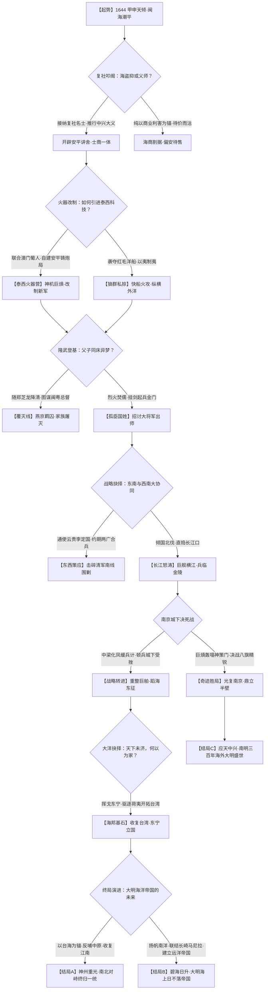

# 《闽海龙旗：南明海邦长篇史诗底本与剧情树大纲》

---

## 游戏阵营世界观体系：【南国海邦】

### 一、阵营核心哲学与历史定位
- **阵营名称**：南国海邦（大明海外行朝 / 郑氏海上商业军事帝国）
- **阵营旗帜**：日月飞龙旗（青底赤龙，背倚日月双轮）
- **文明范式**：华夏古典正统法统与十七世纪早期海洋大航海资本武装集团的奇迹合流。打破中原王朝“以农立国、重陆轻海”的历史宿命，开创以海运通商、火器列阵、华夷互通为骨骼的海上东方日不落帝国。
- **历史坐标**：公元1644年（崇祯十七年甲申国难）至公元1662年（永历十六年收复台湾并图谋南洋）。

### 二、游戏四维阵营数值机制
1. **海关关税 / 大洋银流（Treasury & Trade Silver）**
   - 衡量海商帝国的财金命脉。依靠日本长崎铜银贸易、澳门丝瓷交易、南洋马尼拉大帆船香料航路，以及五虎门、金门洋引税银（过洋船税）。银流充裕则水师百万人粮饷无忧，更可于海外采购高烈度火药与火炮；银流枯竭则军心离散。
2. **泰西科技 / 火器水师条（Western Tech & Naval Doctrine）**
   - 涵盖葡萄牙濠镜澳造炮所、荷兰东印度公司夹板船制式、自生火铳（燧发枪）营规、线式侧舷炮战法（Broadside）。该数值决定对中原清军骑射的降维火力打击能力与破城防守能力。
3. **华夏法统 / 士大夫气节度（Imperial Legitimacy & Confucian Zeal）**
   - 依托复社清流名士、大明南渡三百年文脉与隆武朱姓皇恩。法统值高则江南士绅影从，西南李定国大军呼应，各地抗清义军云集响应；法统丧失则沦为寻常海盗番帮，失去号召中原汉家儿女的政治合法性。
4. **水陆战备 / 铁人水兵力（Naval-Amphibious Military Power）**
   - 包含中西合璧封板巨舰、大熕沙船、铁人重装甲士方阵与水鬼奇兵。水战天下无敌，但陆战攻坚需防范北方八旗重骑兵的野战突袭。

### 三、全景故事树结构图（Mermaid）

---

## 第一章：闽海潮平 · 龙旗出洋与复社叩阍

### 一

崇祯十七年四月廿八，福建泉州府安平镇（安海）。

五月的闽海，空气里早已弥散着沉闷黏稠的湿热，夹带着万顷重洋扑鼻而来的鱼腥、咸盐与龙涎香的气息。但今日自北面驿道快马传来的风，却冷得彻骨，宛若来自幽冥血海。

“天崩了……京师陷贼，万岁爷在煤山……自缢殉国了！”

驿卒几乎是连滚带爬地撞进了安平镇中那座富丽逾于王侯的郑氏总兵府大堂。那驿卒浑身血泥，嘶哑干裂的喉咙里吐出的每一个字，都像是一柄生锈的凿子，硬生生凿进堂内每一个人的耳膜深处。

堂上刹那间陷入了令人窒息的死寂。紫檀雕龙大椅之上，福建总兵、平国公郑芝龙手里的那只西洋嵌金自鸣钟骤然发出“咔嗒”一声脆响，机关走到了正午，一只纯金机巧的杜鹃鸟自雕花盒中弹跃而出，发出清脆啼鸣。可在满堂重臣武将听来，那声啼鸣比杜鹃啼血还要凄厉百倍。

郑芝龙的面孔沉在堂上一片幽暗的光影里。这位曾经纵横日本平户、台湾笨港与南洋群岛的“尼官”（Nicholas Iquan），年过不惑，黑须修整得整整齐齐，眼角带着海风与刀霜雕刻出的深刻纹路。他的目光缓缓扫过阶下，那里立着郑芝鸿、郑芝豹、郑彩等一众郑氏宗族悍将，每一个人的腰刀都在刀鞘里不安地摩擦作响。

“大哥！闯贼逼死先帝，北直隶尽赤！”胞弟郑芝豹一步跨出，虎目圆睁，右手狠狠按在佩刀柄上，“南京魏国公徐弘基、马士英诸公定要另立新君。这江南半壁，这天下……到底归了谁？咱们郑家这数千号夹板巨舰、八万水师儿郎，该何去何从？！”

郑芝龙没有立时作答。他抬起右手，用拇指抚过腰间挂着的那枚万历年间传下的御赐金牌，又摸了摸旁边荷囊里装着的荷兰东印度公司总督巴达维亚送来的赤金信印。他的目光越过高耸的照壁，望向安平港外的五虎门洋面。

那里，帆樯如云。

极目所至，数以千计的中式巨型乌尾大船、广船开浪舶，以及数十艘高耸入云的西式三桅夹板大船（Galleon），黑压压地铺满了整个蔚蓝色的海湾。每一艘巨舰的主桅顶端，都高悬着迎风猎猎作响的日月飞龙旗。水手们赤着精壮如铜铸般的胸膛，在悬空的索具间飞快穿梭；船舷两侧，一尊尊乌黑森冷的铜炮铁铳在烈日下泛着幽蓝的精光。海风浩荡，战鼓隐隐，这片海域之上流淌着的，不仅是大明朝廷名义上的水师旌节，更是整个十七世纪东亚乃至太平洋西岸最令人胆寒的海上武装商业帝国。

在辽东八旗踏碎山海关、闯王大顺军席卷京畿的这一刻，大明天下崩解如山摧，但在这东南一隅，海浪却依然忠诚地亲吻着郑氏战舰的坚固龙骨。

“慌什么。”郑芝龙终于开口，声音沙哑沉缓，带着长期操舵定风波之人的冷定，“崇祯爷殉了社稷，南京还有留都六部，还有凤阳陵寝。这大明的招牌只要不倒，海上的商税银子就依然姓郑。派三艘飞剪快哨，八百里加急驰往留都，看看马士英、史可法他们立的是福王还是潞王。还有——”

郑芝龙眼帘微抬，眸子里掠过一丝罕见的温软与审视：

“森儿从南京国子监回来了没有？”

“回大帅，大木公子的坐船方才已越过圭屿，直入安平澳了！”亲卫校尉单膝跪地禀道。

话音未落，一阵沉稳而急促的脚步声踏碎了堂前的寂静。

一名年仅弱冠的年轻儒生大步踏入总兵堂。他身着一领略显风尘仆仆的月白生绢儒衫，方巾束发，身躯昂藏魁伟，面如古玉，鼻若悬胆，双目深邃如晨星初升。虽然文质彬彬，但举手投足之间，竟隐隐透出一股令百战宿将亦不敢轻侮的沉毅与威严。

这便是郑芝龙的嫡长子，名森，小字大木。如今正受教于复社泰斗、礼部尚书钱谦益门下，号“大木”，寄托着海内名流挽狂澜于既倒的深望。

“父亲！”

郑森疾步上前，双膝跪地，行子侄大礼。但他抬起头时，眼眶通红，双拳已紧紧握出骨白之色，衣襟上甚至还带着南京太学奔赴海疆时的草露与尘灰。

“京师大变，先帝受辱煤山！南京诸公不思枕戈待旦、合兵北伐，反在弘光行在为了拥立之争争风吃醋，马士英引江北四镇骄兵自重，阮大铖小人得志捕杀异己！”郑森的声音如金石交鸣，在大堂之上激荡回响，“儿子南下之时，沿途见中原流民塞道，胡虏清兵已出山海关，兵锋直指淮扬。华夏神州已到亡天下之千钧一发！父亲坐拥东南百万之众，巨舰千艘，粟支十年，若再作壁上观，任由江山沦于腥膻，何颜对九泉之下的列祖列宗？何颜对天下衣冠士民？！”

“住口！”

郑芝豹厉声喝止：“大木！你读圣贤书读痴了！如今江南危局如卵累，淮扬四镇拥兵数十万尚且难保半壁，咱们郑家靠的是海上刀头舔血挣来的家底！海上的风浪咱们说了算，中原的烂泥塘，咱们凭什么去填？！”

“阿叔此言差矣！”郑森蓦地站起，儒衫下摆猎猎翻卷，目光如电刺向郑芝豹，“覆巢之下，安有完卵？若北方胡骑踏破金陵，席卷闽粤，难道海上的波涛真能隔断千里狼烟？今日退居海角，明日退往夷岛，天下无华夏之土，我郑氏纵有万两黄金、千艘洋船，在青史上亦不过是跳梁海盗而已！”

“够了。”

郑芝龙轻轻一拍扶手。堂内嘈杂骤停。

郑芝龙凝视着眼前这个长子。郑森身上流着一半日本平户田川氏的坚韧之血，又自幼受儒家名师熏陶，骨子里那股士大夫的傲骨与气节，竟比江南那些饱读诗书的相公们还要烈上三分。郑芝龙心中既有一丝暗自的骄傲，又涌起阵阵商贾枭雄独有的忌惮与警惕。

“大木，你随钱尚书读书三年，胸中有气魄，为父不怪你。”郑芝龙站起身，慢慢踱步至郑森面前，抬手按在儿子的肩膀上，语调低沉莫测，“但你要懂得，这天下的大棋，不是光凭一口浩然正气就能下得赢的。没有炮，没有银子，没有船，连南京城里的叫花子都不会听你的慷慨陈词。你可知今日除你之外，安平港还来了什么人？”

郑森微微一怔：“何人？”

郑芝龙冷笑一声，转头向后堂吩咐道：

“请几位江南来的‘清流神仙’，出来见见咱们这位大木公子吧。”

---

### 二

后堂屏风轻响，数道削瘦的身影在亲卫的引领下缓缓步入。

为首一人，长须飘拂，青布儒袍已被海水浸渍出圈圈盐白，眼窝深陷，但眉宇之间那一股凛然不可侵犯的傲岸之气，却在踏入这武夫大堂的瞬间激荡开来。在他身后，跟着两位年轻人，一人背负剑匣，目光冷峻如冰；另一人则面色苍白，手握半卷残破的书册，咳嗽声低沉而急促。

“大木？！”为首的儒士见到郑森，失声惊呼。

“卧子先生！完淳老弟！”郑森浑身剧震，几乎不敢相信自己的眼睛，快步迎上前去，深深一揖到地，“陈先生！你们怎会泛海至闽？！”

来者正是江南复社文宗、华亭名士陈子龙（字卧子），其后两人，则是十五岁的少年天才夏完淳，以及浙东水师义军统领张名振。

陈子龙一把扶住郑森的双臂，眼角老泪滚滚而下：“大木！金陵已不可为！马阮当国，醉生梦死于秦淮烟柳；史宪之（史可法）督师江北，左良玉拥兵自雄各怀鬼胎。虏酋多尔衮提满汉精骑十万渡河，扬州、淮安旦夕不保！我等复社门生数百人，散尽家资，联络四方义旅。然而陆路兵马皆成惊弓之鸟，唯见这苍茫闽海之上，龙旗猎猎，战列森森！大木，我等不远万里浮海叩阍，为的不是向平国公乞求半席安身之地，而是为了这神州三百年社稷，向郑氏借天兵！”

这一声“借天兵”，在大堂梁木之间回荡，震得郑氏诸将皆面色微变。

张名振踏前一步，解开背上的布囊，里面赫然是数道带血的万言血书与江南十二府名士联署的抗清同盟书：“平国公！江南士庶，天下人心，尚未死绝！自崇祯皇帝北狩，江浙闽粤千万百姓日夜悬望。若郑氏以水师精锐逆流北上，横扼长江咽喉，切断京杭大运河漕运，使北兵粮道断绝；再以重炮铁甲合围淮扬，则天下义士必云合响应！届时南都定，中原复，平国公便是不世出的匡复首功，封王拜相，光耀千秋，岂不胜过偏安这漳泉一隅数十百倍？！”

郑芝龙静静地听着。他的嘴角挂着一丝似笑非笑的弧度，目光在陈子龙那张疲惫激昂的脸上逡巡良久，随后从茶几上端起一盏武夷岩茶，用茶盖轻轻刮着浮沫。

“陈先生，张将军。”郑芝龙的声音波澜不惊，“你们复社文章冠绝天下，老夫一向佩服得紧。大木拜在虞山钱宗伯门下，老夫每年奉往南京的修金银合，少说也有三万两。江南士林待我郑家，过去不过视作海寇招安的粗鄙武夫罢了。今日神州陆沉，诸位倒想起老夫这三千快船、数万红头贼兵了？”

陈子龙脸色微微发白，但他挺直了脊梁，沉声道：“昔日门户之见，今日国难之前，已如飞烟。平国公若以私怨废大义，子龙无话可说；但若平国公胸中尚有一丝华夏血性，便该知晓，虏骑若是踏平了江南，郑家的海商之道，绝不可能独善其身！”

“先生错了。”郑芝龙放下茶盏，瓷盖与茶托发出清脆的撞击声，“老夫是个生意人。生意人的规矩，是先算本钱，再算盈亏。史可法向老夫要兵，马士英向老夫要饷，如今二位又来要老夫提全军水师去长江同满洲铁骑硬拼。敢问先生，我郑家儿郎的命，就不是命？我这数千条海船一旦沉入江底，大明能赔老夫一条吗？朝廷给老夫的官职，不过是个从一品总兵；若老夫的水师拼光了，老夫在这海面上，连一条打渔的沙船都使唤不动！”

“父亲！”郑森忍无可忍，大步跨到堂中，厉声道，“国之不存，何谈私产？！朝廷若亡，海关引税皆归虏手，我郑氏纵有万艘海舶，亦不过是无根之浮萍！复社诸先生不顾生死，蹈海相投，此乃天下人心归我郑氏之兆！人心所向，天命所在，此时不提兵北上，更待何时？！”

“大木，你退下！”郑芝龙猛地站起，身上威棱暴涨，一股久经血海波涛的海盗枭雄煞气压得整座大堂温度骤降。他冷冷俯视着长子，又环视着陈子龙与张名振：

“你们要借兵？可以。老夫今日便让你们看看，老夫的兵，究竟是什么兵！随老夫到五虎门来！”

---

### 三

暮色降临，海天交界处泛起一片浓烈的酡红与玄黑。

安平港外的五虎门海峡，怒涛拍击着犬牙交错的礁石，激起数丈高的雪白浪沫。郑芝龙一身玄铁重铠，猩红大氅在狂暴的海风中猎猎作响。他带着郑森、陈子龙、夏完淳、张名振登上了那艘名为“开山号”的巨型乌尾大船。

这艘船足有四层甲板，长三十丈，阔六丈，两舷整齐地排列着四十余个黑黝黝的方形炮眼。主甲板上，两百名身材魁梧、皮肤黝黑如生铁的精壮汉子正肃然列阵。令人震惊的是，这些军士并非寻常汉兵，竟全是一色卷发深目、手持重型火绳枪与阔刃斩马刀的黑人火枪手（卡法尔奴兵）。

“少爷，大帅！”

一名浑身甲胄的黑人统领单膝下跪，用极生涩古怪的官话高声行礼。这是郑芝龙早年在澳门与马尼拉以重金赎买并收编的亲军卫队，作战剽悍凶残，对郑氏忠贞不二，天下罕有其匹。

陈子龙与夏完淳何曾见过这般阵势？面面相觑之下，眼中尽是震撼之色。他们所熟悉的抗清陆军，多是明末饥民充塞、衣衫褴褛、将帅克扣粮饷的乌合之众；而眼前的这支海上武装，甲胄精良，火器泛着西洋蓝光，军纪森严若铁，甚至超越了当年的戚家军！

“起锚！扯满斗风帆！”

随着郑芝龙佩刀出鞘向前一挥，苍凉的海螺号角声冲天而起。整座五虎门洋面上，数以百计的战舰如被唤醒的远古巨兽，铁锚绞盘轰鸣转动，数十具巨大的篾席折叠帆与西洋硬帆次第升空，遮蔽了满天星斗。

海浪被如刀的龙骨狠狠切开，战舰如离弦之箭破浪前行。郑森立在最前端的艏楼之上，咸涩冰凉的海水扑打在他的颊上，胸中万丈豪情如浪潮翻滚。

“大木，你看清楚了！”郑芝龙指着两舷如移动山岳般的舰列，大声喝道，声音穿透了狂风与惊涛，“二十年前，老夫在这片海上，赤手空拳，只有一叶扁舟、七尺身躯！老夫斗倒了李旦，斩了颜思齐，在料罗湾以火攻快船把不可一世的荷兰红毛鬼打得狼狈逃窜！大明朝廷视老夫为草寇，可崇祯爷最后还不是得乖乖降旨招安，封老夫为总兵？！”

郑芝龙转过头，双眼在火把的照耀下射出摄人心魄的精光：“老夫靠的不是程朱理学，不是仁义道德，是这四万万斤坚木雕成的龙骨，是这两万斤精铁浇铸的铜炮！这片大洋，从长崎到马尼拉，从巴达维亚到舟山群岛，每一艘过往的洋船，不买我郑家的‘令旗引票’，就得沉入海底喂鱼！老夫一年收的海税，足足抵得上大明太仓半年的赋税！”

他猛地跨前一步，逼视着郑森：“你以为为父不想匡扶社稷？但大明的大厦已经烂透了！那些东林、复社的道学先生，在朝堂上除了清谈误国、争权夺利，还会做什么？！南京那座破庙，保不住的！老夫若把身家性命全砸进淮扬，一旦全军覆没，咱们郑家在这海上就死无葬身之地！”

郑森迎着父亲那凌厉至极的目光，身形没有丝毫后退。海风吹乱了他额前的碎发，但那双眸子却比夜空中的北极星还要明亮锋利。

“父亲，您说得对。大明的天下，确实被那些空谈心性、贪生怕死的庸臣败坏殆尽了！”

郑森拔出腰间天子亲赐佩剑，剑锋在星光下闪烁着逼人的森芒：“但华夏道统，不可断绝；冠裳礼乐，不可沉沦！正因为天下已无可用之兵，我郑氏的海上天兵才更当挺身而出！父亲一生纵横四海，求的是商道万利、子孙富贵；但儿子想要的，是万民不作异族奴隶，是大明的日月之旗，永远高悬于重洋与神州之上！”

年轻的郑森转过身，面向着怒涛狂卷的台湾海峡，长剑指天，厉声高喝：

“此身既生于华夏，便当死于大义！若天倾不救，我郑森誓不为人！”

夜涛轰鸣，群山响应。

甲板后方，陈子龙与张名振相视一眼，满脸皆是震撼与热泪。在这群只知权衡利害的海商枭雄之中，这位年轻的公子大木，竟如同一柄出鞘的惊世神剑，横空出世在这片苍茫的大洋之上！

郑芝龙凝视着儿子的背影，眼角剧烈地抽搐了几下。他没有再发怒，只是长长地吐出一口带着酒气与咸味的粗气，自言自语般喃喃道：

“痴儿……真是一个痴儿。可老夫怎会生出你这么一个骨头比生铁还硬的种来……”

海风愈发猛烈，五虎门外的暴风雨，终于呼啸而至。

---

## 第二章：佛郎机炮 · 西洋火器与船政变法

### 一

崇祯十七年冬，澳门（濠镜澳），大三巴牌坊下。

青石板路上流淌着南国冬日温热的细雨，教堂顶端的铜钟悠扬地敲响了六下。在这座由葡萄牙人租居了近百年的海隅半岛上，圣保禄学院的花园深处，浓重刺鼻的硫磺、木炭与熔铜气味却压过了乳香的芬芳。

“郑大人，请看。这是我们博卡罗铸炮厂（Manuel Tavares Bocarro Foundry）献给平国公与大木公子的最新杰作——二十四磅长管加农铜炮，我们称之为‘圣天使之吼’。”

说话者是一名身着黑色耶稣会修士长袍的长者，高鼻深目，胸前挂着纯银十字架。他正是历经天启、崇祯两朝，极力主张以西洋火器援救中原明廷的耶稣会传教士毕方济（Francesco Sambiasi），在他身旁，站着澳门葡人议事会的首席火器铸造大师曼努埃尔·塔瓦雷斯。

在他们眼前巨大的工棚中央，一尊长达一丈二尺、重达四千余斤的崭新青铜重炮正悬挂在巨木滑轮绞盘之上。炮身上不仅铭刻着圣母的拉丁文祷词，更极其罕见地以汉文小篆镌刻着一行遒劲的大字：

**“皇明特简招讨水师天威大熕·安平造第一号”**

郑森伸出手，粗糙的掌心抚过冰冷、坚密而光滑的炮管。那铜质极纯，毫无砂眼与气泡，炮口深邃幽暗，散发着一股令人灵魂战栗的毁灭力量。

在他身后，站着郑氏工官统领施琅。此时的施琅年仅二十三岁，面容精悍如鹰隼，正拿着一柄特制的铜尺与通条，仔仔细细地测量着炮膛的内径与火门厚度。

“公子，好炮！”施琅抬起头，眼中满是无法掩饰的狂热，“膛线光整如镜，用的是泰西最新的‘铁芯铜体’冷淬法。若是装填上等自造无烟颗粒火药，实心铁弹能直打五里开外！一炮下去，便是虏兵八旗三层重甲，也要轰成肉泥齑粉！”

毕方济微微一笑，合十胸前道：“大木公子，大清的骑兵已经逼近长江北岸。北京的同修来信说，满洲人凭借从孔有德、耿仲明手中缴获的汉军乌真超哈火器营，同样在大量铸造红夷大炮。大明的军队如果还停留在过去那种单薄炸膛的三眼铳、佛郎机子母铳的时代，在野战中绝不可能抵挡八旗重骑与大炮的联合轰击。”

郑森神色肃然，转头看向曼努埃尔与澳门议事长佩雷拉：“大师，神父，郑氏以万两黄金、千匹湖丝与每年三十艘商船进出澳门免税的特权作为交换，不仅需要这五十门二十四磅长炮，更需要你们的人。”

“我们的人？”曼努埃尔一愣。

“正是。”郑森目光如炬，声音斩截如铁，“大熕虽利，若无精熟抛物算学、弹道度数之师，不过是盲人挥锤；巨舰虽坚，若无精通龙骨造船、双层甲板之匠，亦不过是大而无当的海上活棺木！我郑森要请大师带领麾下六十名熟练铸炮铁匠、铳管拉膛名师，以及四十名擅长测量弹道的炮手，随我移驻安平！我还要在五虎门与金门设立‘神机造船总局’与‘水陆火器讲武堂’！”

议事长佩雷拉眉头紧皱，面露难色：“尊贵的国姓公子，荷兰东印度公司（VOC）的军舰正在马六甲海峡四处猎杀我们的商船，若我们将顶尖工匠尽数迁往安海，澳门自身的防卫……”

“佩雷拉先生，”郑森打断了他的话，唇角勾起一抹冷冽的弧度，“荷兰红毛鬼在巴达维亚有几千兵，在台湾大员（热兰遮）筑有棱堡，老夫与他们打了二十年交道，最知其底细。你们若依附我郑氏，东海、南海的航道上便有我上千艘水师巨舰为你们护航；你们若拒绝……明日起，五虎门将不再对任何悬挂葡萄牙十字旗的商船发放‘引票’。在这片海域，究竟是荷兰人的火炮近，还是我郑家的龙旗快，议事会应当比我更清楚。”

佩雷拉身形一颤，额角渗出冷汗。这位年轻的郑氏少主，看似面容俊秀、举止如儒生名士，可一旦涉及海权博弈与国家军政，其手腕之铁血、辞令之锋利，竟比其父郑芝龙犹有过之而无不及！

“上帝作证……”毕方济深深地叹了一口气，抚胸躬身，“大木公子，不仅工匠如数随行，老僧亦愿亲赴安海讲武堂，为大明新军讲授泰西《几何原本》与《泰西火器图说》。只愿公子有朝一日驱逐腥膻、光复神州之时，莫忘允诺我等在江南自由传教之信约！”

郑森肃容抱拳，朗声道：“华夏容纳万象，公若以工器助我衣冠存续，我大明必以国士之礼相报！”

---

### 二

福建漳州，海澄月港船厂。

巨大的船坞内，数十架高耸的绞车发出震耳欲聋的吱呀声，上千名满头赤膊的造船老匠正喊着雄浑的闽南号子，将一根根从南洋运来的坚硬铁力木、红樟木嵌合进巨大的龙骨框架之中。

郑森与施琅、甘辉站在新建的高台上，俯瞰着船坞内那艘已经初具雏形、令人望而生畏的庞然大物。

那不是传统的平底福船，亦非纯粹的西洋盖伦帆船，而是一种由郑森亲自定夺、融汇东西长处的划时代新舰——**“中西合璧封板甲板大熕船”**。

“公子，这船法当真改得绝了！”施琅手按佩刀，兴奋得面颊泛红，指着船身如数家珍：

“过去福船虽大，但底尖上阔，首尾高昂，吃水虽浅，但遇上西洋红毛横风横浪时，极易倾覆横漂；且船板单薄，经不起重炮对轰。如今依泰西法式，将吃水龙骨加深三尺，船身呈流线开浪形，首尾设坚厚防弹水密舱隔！更要紧的是，咱们加装了三层通长甲板，全用两寸厚的闽西老樟木裹上熟铁皮，称为‘铁壁封板’！”

郑森目光深邃，接言道：“不仅如此。传统的火攻跳帮战，遇上顺风便灵，遇上无风或逆风便是活靶子。海战的未来，在于‘侧舷齐射’（Broadside）！”

他转头看向身旁的副将甘辉：“甘将军，火炮配位如何了？”

甘辉躬身禀道：“回督席！底舱两舷，各开十二个重型炮门，全部配装澳门博卡罗局铸造的二十四磅大熕！中间甲板，配装三十门十二磅佛郎机速射铜炮与荷兰缴获的飞蛇长炮；上层甲板与首尾楼，安设虎蹲炮、自生旋回铳与‘万人敌’火箭飞鸦！全船共计配炮六十尊！一旦在海面拉开单列纵队，一舷三十门巨熕次第轰鸣，弹丸泼水般倾泻而出，便是荷兰人的‘赫克托号’战列舰，也能在一刻钟内将其轰碎沉底！”

施琅沉吟片刻，眼中闪过一丝锐利：“公子，此等战舰造价奇高，一艘便需白银两万八千两，用铜铁无算。平国公在安平那边……若是知道了咱们私改船政，动用如此庞大的海税银库，恐怕……”

“银子的事，不必惊动家父。”郑森眸光微敛，语气平静得像不起波澜的海渊，“我已命五行商号，将今年运往长崎的生丝价格每担上调十五两，日本萨摩藩与德川幕府对大明湖丝求之若渴，断无不允之理。此外，自下月起，凡挂东印度公司旗号经由海峡者，每船加征‘护航水银’五千两。若是不交——”

郑森的声音骤然转寒：“就用这六十门大熕，亲自去海面上向他们‘收银’！”

众将闻言，无不倒吸一口凉气，旋即胸中热血沸腾，齐声轰然领命：“谨遵督席将令！”

---

### 三

泉州万安桥外，郑氏新军大校场。

深秋的肃杀之气笼罩着方圆数里的演武场。三千名精选自漳、泉、潮、惠各府的健儿，此刻正肃立成六个严整如铁铸般的方阵。全场鸦雀无声，唯有中军将旗在海风中发出猎猎爆响。

这支军队的装束，彻底颠覆了当时世人对明朝水陆兵马的固有印象。

最前列的三百名步卒，从头到脚覆盖着冰冷厚重的镔铁连环铠甲，面部扣着狰狞如恶鬼的精钢铁面具，只露出一双双杀气腾腾的眼睛。他们左手持两尺见方的精铁嵌木巨盾，右手握着一柄长达七尺、锋刃寒芒刺目的斩马大刀。

这便是日后令北方八旗骑兵闻风丧胆的王牌杀器——**“铁人军”**的前身！

在铁人军身后，则是清一色的火器鸟铳手。他们不再使用那种引线点火、遇风雨即灭的旧式火绳枪，手中所持的，赫然是清一色从澳门改良生产的“自生火燧发枪”（Flintlock Musket）。腰间配双插鹿皮火药囊，装填定装定量的纸包火药，刺刀紧扣在枪管之侧。

高台上，郑森身披青铜吞口明光铠，腰系白玉钩，手按宝剑，目光森严如冰。

“立铳！”

施琅站在掌旗令台之上，令旗猛地向下一劈！

“哗！”

千名火器营士卒动作整齐划一，踏前半步，托枪、扳动击锤、燧石上膛，黑洞洞的枪口瞬间汇聚成一片令人心悸的死亡丛林。

“举——放！”

“轰！轰！轰！轰！”

没有凌乱杂乱的散乱枪声，演武场上爆发出的，是宛如连绵惊雷般的整齐齐射！白色的硝烟瞬间如巨龙翻滚腾空，百步之外插着的数百个披着三层牛皮厚甲的假人目标，在这一刹那被密集的铅弹狂暴撕碎，木屑与碎甲漫天激射！

硝烟未散，施琅令旗再变：“铁人前突，斩马破阵！”

“杀——！！”

低沉而震撼人心的咆哮声自铁面具下迸发而出。三百重甲铁人迈着整齐沉重的步伐如钢铁巨浪汹涌推进，他们手中的斩马刀在阳光下挥出一片耀眼的死亡银弧，数十根碗口粗的木桩被拦腰斩断，切口平整如削！

站在高台观礼台上的复社诸名士——陈子龙、夏完淳、张名振，早已看得目瞪口呆，浑身颤栗。

十五岁的少年夏完淳激动得脸色通红，死死抓着陈子龙的衣袖，声音颤抖道：“老师……先生！您看！这……这才是真正的天下雄兵！若淮扬有此等铁甲神铳，扬州何至于陷落？！史阁部何至于殉国？！大明有救了……大木兄定能荡平鞑虏、中兴神州啊！”

陈子龙长长地舒了一口气，眼角噙着晶莹的泪光。他转头望向高台中央那道英武决绝的年轻身影，只觉这数月来泛海求援的所有屈辱、艰辛与绝望，都在这震天的火炮与刀光中化为了无尽的希望。

然而，在演武场最偏僻的阴影里，郑芝龙坐在一顶绿呢大轿内，透过竹帘的缝隙冷冷地注视着眼前的一切。

在他身旁，亲信幕僚低声道：“大帅，大木公子这几个月招兵买马，铸炮造船，已耗去了咱们东库四十万两存银。更要紧的是，这军中的将士，如今只知有‘大木督席’，不知有‘平国公大帅’了……而且，南京那边传来的信，江北重镇扬州，多铎的大军已经围城了……”

郑芝龙的手指在袖中无意识地转动着两枚铁胆，发出阴冷的骨碌碌声。

“由他折腾吧。”郑芝龙的声音冷漠得像严冬的海冰，“多铎若是过了江，南京那位弘光皇帝还能坐几天龙椅？这天下就要换主人了。森儿把这支军队练得越精，咱们郑家在未来的新主子面前……筹码便越足。”

他的目光望向北方，神情复杂难明，既有雄霸一方的自负，更深藏着一丝走向深渊的宿命妥协。

---

## 第三章：两都分立 · 隆武即位与海商合流

### 一

弘光元年五月，江南天塌。

扬州城破，督师史可法血战不降，壮烈殉节；多铎下令屠城十日，血流成河。随后，清军铁骑长驱直入，兵临长江北岸。镇江总兵降清，南京守备太监韩赞周开城乞降，弘光帝朱由崧仓皇出逃芜湖，随即被俘解往北京受戮。

大明立国近三百年的应天留都，彻底沦陷于八旗铁骑蹄下。

江南残破，残存的大明宗室如惊弓之鸟南下逃窜。潞王朱常淓在杭州监国仅仅数日便肉袒出降；而在浙东，鲁王朱以海在张名振、张煌言等人的拥戴下，于绍兴宣布监国；与此同时，南安伯郑芝龙、郑鸿逵却派铁骑千人，将颠沛流离逃至福州的大明太祖九世孙、唐王朱聿键迎入了福州城。

弘光元年闰六月廿七，福州天兴府。

万寿桥南，天坛高筑。海风浩浩，吹拂着整肃肃立在闽江两岸的数万水陆大军。唐王朱聿键身着赤红衮龙袍，头戴翼善冠，在百官山呼万岁声中，告祭天地，正式即皇帝位，改元**“隆武”**。

这是大明历史上最为奇异的一场登基大典。

在祭坛之上，新帝隆武帝年过不惑，长眉入鬓，容貌清瞿而双目炯炯有神。他曾因忧心国事被崇祯帝囚禁凤阳高墙七年之久，历经磨难，深知民间疾苦与甲兵之重。与昏聩荒淫的弘光帝截然不同，这位新天子登基伊始，便下旨“减免钱粮、严惩贪墨、亲出关门誓师北伐”。

而在祭坛之下，左右列席的文武百官，却泾渭分明地分裂成两个截然不同的世界。

左侧是礼部尚书黄道周、张肯堂等两袖清风、面容枯槁的江南流亡清流；而右侧，则是身着一品红袍武官补服的郑芝龙、郑鸿逵、郑芝豹等海上巨贾与武夫。

更有甚者，大殿案几之上摆放的不是传统的九鼎八簋，而是福建各海口刚刚送达的一箱箱雪白耀眼的墨西哥鹰洋与长崎马蹄银！

海商资本与皇权法统，在这风雨飘摇的残明乱世，完成了一场前所未有的生死结盟。

“陛下！”黄道周手捧笏板，老泪纵横，“江浙沦陷，江南义士夏完淳、钱肃乐等日夜望中兴之师如望岁！今闽海天兵云集，粮饷富足，伏乞陛下早下亲征之诏，出仙霞关，会师鲁王，收复金陵！”

隆武帝霍然起身，拔出腰间天子剑，朗声道：“朕不入关，天下将士谁肯向前？！朕立誓为社稷死关门，决不作偏安之犬羊！”

此言一出，满堂清流无不叩首饮泣。

然而，站在右侧首位的平国公郑芝龙却嘴角微撇，眼中闪过一丝不易察觉的讥诮与不耐。出关？北伐？在他看来，这不过是这群穷书生的痴人说梦。福建山川险阻，凭险割据、坐收商税才是无本万利的买卖，去江浙同八旗决战，除了耗费白银与水师，能得到什么好处？

隆武帝的目光越过了神色各异的郑芝龙兄弟，径直落在了文官与武将交界之处，立在那里的郑森身上。

今日的郑森，并未穿武将的重甲，而是身着一袭素净的生员儒巾大带。他身姿挺拔如松，在满堂或谄媚、或油滑、或悲戚的面孔中，显得如此孤傲而纯粹。

“这位少年卿家……是何人？”隆武帝的声音中透出一丝难得的温厚与惊奇。

郑芝龙连忙出班跪奏：“回皇上，这是臣之犬子，郑森。少时受业于钱谦益，侥幸忝列太学诸生。”

隆武帝眼睛一亮，离席步下玉阶，快步走到郑森面前。

天子上下打量着眼前这位昂藏七尺的英武青年，只觉其眉宇间那一股浩然正气与沉毅之威，竟如神兵出匣。隆武帝不由自主地伸出双手，重重地抚在郑森宽阔的肩头之上。

“好一位英姿勃发的宗臣国器！”隆武帝的声音微带颤抖，凝视着郑森的双眸，“朕阅人多矣，从未见如卿这般气度沉雄之少年。大木，朕有一言，思之痛心——朕无一女配卿，卿当为吾家儿！”

满堂轰然！

郑芝龙浑身一颤，猛地抬起头，眼中满是惊骇；黄道周等清流重臣亦是面面相觑，继而面露喜色。

天子当朝认子，赐国姓！这是何等旷古未有的殊荣恩宠！

隆武帝面色极其肃穆，取下腰间天子佩印，掷地有声地下旨：

“朕赐卿姓‘朱’！改名‘成功’！字大木！封忠孝伯，拜御营中军招讨大将军！自今日起，这大明的江山社稷，朕与卿……共担之！”

郑森——自此刻起，正式成为名震寰宇的**“朱成功”**，天下共尊之**“国姓爷”**！

年轻的国姓爷双膝重重跪倒在冰冷的汉白玉砖上。当天子粗糙而温热的双手紧紧握住他的掌心时，郑成功只觉胸中翻江倒海，两行滚烫的血泪终于夺眶而出。

“臣成功……叩谢皇恩！”

郑成功长叩到地，额头触地发出沉重的闷响，声音字字啼血：

“臣虽肝脑涂地，粉骨碎身，誓保皇上，誓复神州！若违此誓，天地共诛！”

君臣相携，相拥而泣。

但在龙阶之下，郑芝龙缓缓低下了头，眼中最后一丝父子温情，在这一刻彻底被深不见底的政治寒冰所吞噬。

---

### 二

顺治三年（1646）秋，福建浦城，仙霞关。

作为入闽咽喉、天下险隘的仙霞关，九百丈绝顶横插云天，古道狭窄如线，素有“一夫当关，万夫莫开”之称。只要在此屯兵三千、列数尊红夷大熕，任凭北来十万铁骑，亦绝难飞越半步。

然而，在八月深秋凄冷的细雨中，这座雄关之上的关防重镇，竟空无一人！

城关的大门敞开着，营房里的残茶尚带微温，数十尊守关大炮的火门全被生生灌死了铅汁铁水。原本驻守在此的郑芝龙亲信部队，在数日前接到了平国公的密令——**“大军回防安平，擅留关隘者斩”**！

郑芝龙，主动撤空了仙霞关！

与此同时，清征南大将军博洛统率的满汉精骑十万，如同一群嗜血的饿狼，毫无阻碍地越过天险仙霞关，如潮水般席卷闽北平原！

延平陷落。汀州城破。

逃亡途中的隆武帝朱由崧在乱军之中被清军飞骑追及，天子拔剑自刎未遂，绝食数日殉国；皇后曾氏投水尽节；一代大儒黄道周孤身出关北伐，兵败被俘，于南京雨花台慷慨就义，断头前撕裂衣襟血书“大明孤臣黄道周”，至死挺立不跪！

隆武朝廷，土崩瓦解。

而此时的安平镇总兵府内，却是一片令人窒息的剑拔弩张。

堂内摆着一封来自清军统帅博洛的朱红亲笔书信。信中极尽拉拢利诱之能事，许诺只要郑芝龙率部降清，“即封闽粤总督、一等公，裂土封疆，东南政务尽归郑氏”。

郑芝龙一身崭新的貂皮暖袍，正命人将满箱满箱的家财金银装船封存。

“爹！仙霞关是你故意撤防的？！”

门外一声暴喝如晴空霹雳。郑成功一身是血，披头散发，按剑直闯而入。他刚刚带领亲兵从延平死战突围而出，身上还带着隆武帝蒙难前赐给他的最后一道血诏。

郑芝龙连眼皮都没抬一下，挥手屏退左右，冷冷道：“是为父撤的。”

“为什么？！”郑成功的眼眶几乎裂开，泪血混杂而下，“皇上待我们郑家天高地厚！封你为平国公，加太师！封我为忠孝伯！天下万民仰望我们如救星！你……你竟将关防拱手送给鞑虏，逼死天子，陷天下于万劫不复之地？！”

“蠢材！”

郑芝龙猛地转过身，一掌狠狠拍在案几上，震得茶盏粉碎：

“天高地厚？一个连饭都要靠咱们郑家施舍的落魄王爷，他的恩情值几个钱？！多铎平了江南，博洛下了浙东，鲁王军溃海中，如今整个大江南北全是大清的铁骑！博洛已经向我保证，只要我北上降清，闽粤两省就是咱们郑家的天下！海上的规费照收，洋船照跑！我这是为了保全郑氏数万宗族，保全你这条小命！”

“保全？！”郑成功仰天凄厉大笑，笑声中带着无尽的悲凉与鄙夷，“父亲！你英雄一世，怎能糊涂至此？！清虏以诈术诱你，你手中若有水师巨舰，尚能凭海相抗；你一旦孤身北上，交出兵权，便是一头拔了牙的病虎！任由屠戮的小丑！清廷岂能容你这等降将？！”

郑芝龙面色铁青，上前一步抓住郑成功的衣领，咬牙厉声道：“为父吃过的盐，比你吃过的米还多！博洛乃满洲亲王，金口玉言，岂会食言？！为父已经决定了，明日便启程赴福州清营。你，立刻随我同行！改换冠服，剃发受封，做大清的开国功臣！”

“我不去！”

郑成功狠狠甩开父亲的手臂，倒退三步，锵然一声拔出天子所赐尚方宝剑，剑锋寒光直指地面：

“儿闻古来只有‘父教子以忠’，从未闻‘父教子以叛’！天下皆可降，唯我朱成功不可降！”

“逆子！”郑芝龙气得浑身发抖，指着郑成功的鼻子大骂，“你敢违抗父命？！你若不去，你便是郑家的逆种不孝之子！”

“若忠孝不能两全，”郑成功挺直身躯，眼中泪水已然干涸，取而代之的是坚如玄铁的决死意志，“儿子宁全大明之大忠，不事汉奸之微孝！”

言罢，郑成功猛地撕下自己官袍上的玉带，狠狠摔碎在郑芝龙面前的青砖之上！

白玉粉碎，清脆如裂锦。

郑芝龙看着满地碎玉，整个人呆立当场，良久，从牙缝里挤出一句森冷恶毒的诅咒：

“好……好！你去尽你的大忠吧！老夫倒要看看，你带着你那几条破船，能在这海面上撑到几时！”

郑芝龙大袖一甩，决然而去。

---

### 三

顺治三年十一月，南安孔庙。

夜色深沉，凄风冷雨敲打着古老殿宇的飞檐瓦当。先师大成殿内，烛火在狂风中明灭不定，孔子神像默然端坐，俯视着人世间的沉浮与浩劫。

殿中忽然燃起了一堆熊熊烈火。

郑成功独自一人立在火盆之前。他缓缓脱下了自己身上的青布生员长袍，脱下了象征着儒家正统的四角方巾。他凝视着这身伴随了自己十余年的士子衣裳，眼神中闪过一丝对往昔书卷岁月的眷恋，但那眷恋瞬间便被熊熊燃烧的复仇烈焰所吞没。

“昔为儒子，今为孤臣。”

郑成功声音平静得令人心悸，他双手捧着儒服方巾，毫不犹豫地投入了烈火之中！

布帛在火焰中发出噼啪爆响，火舌舔舐着青衫，化作漫天飞卷的黑色灰烬。

火光映红了郑成功那张棱角分明、决绝如铁的面庞。他面对着孔圣神位，双膝跪地，重重叩了三个响头，随后霍然长身而起，拔出三尺龙泉宝剑，反手一挥，削断了束发的玉簪！

满头黑发迎风狂舞，宛若魔神。

“孔圣在上，先帝在天！”郑成功拔剑指天，声震屋瓦，“生民涂炭，社稷沦亡！自今日起，世间再无诸生郑森！唯有大明招讨大将军朱成功！投笔从戎，誓师诛虏，不复神州，誓不罢休！”

当他大步跨出孔庙山门之时，外面风雨如磐的广场上，早已密密麻麻地肃立着数千名甲胄森冷的铁血将士。

甘辉、施琅、陈辉、张名振……以及那三千神机营与铁人军死士！

更令所有人肝胆欲裂的是，一名浑身是血的骑兵刚刚从安平狂奔而至，跪倒在地号啕痛哭：

“国姓爷！平国公北上至福州，即被博洛锁拿关押，已押送往北京去了！安平老宅……清军破城劫掠，太夫人田川氏……宁死不辱，剖腹自缢尽节了！”

“轰——！”

一道惨白的惊雷撕裂了闽海的夜空。

生母惨死，生父被俘！国破、家亡、君死、母殉！

这世间最惨烈的深仇大恨，在同一夜，全数倾泻在了这个年仅二十二岁的年轻人肩头！

郑成功的面容在雷光中惨白如纸。他没有哭，嘴角甚至缓缓渗出了一缕殷红的血丝——那是他硬生生将自己的牙龈咬碎的声音！

“起兵。”

郑成功从牙缝里吐出了两个字，平静得让人胆寒。

他跃上战马，宝剑向着浩瀚无垠的茫茫大海一指：

“出海！去金门！去厦门！天下虽大，大洋由我郑成功做主！只要闽海之上还有一艘战舰，这大明江山，就还没有亡！”

“杀！杀！杀！”

数千将士振臂狂吼，杀声冲破雨夜，直冲九霄！

---

## 第四章：长江怒涛 · 巨舰横江与西南声援

### 一

永历八年（清顺治十一年，公元1654年）春，南海万顷碧波之上。

一艘悬挂着双龙飞金旗的超轻型飞剪快船，正以骇人听闻的航速破浪南下。船舱隐秘夹层之中，珍藏着郑成功亲笔以血写就的《致西宁王李公定国书》以及大明永历皇帝从西南密授的联军金符印信。

自金门誓师以来，郑成功在闽南浴血转战八年，先后在金门、中左所（厦门）建立起稳固的根据地。他不仅没有被清廷消灭，反而在一次次血战中，歼灭清闽浙总督陈锦、击毙提督杨名高，尽收郑芝龙旧部水师，更将厦门建设成拥兵十余万、战舰三千艘的海上反清心脏！

而在西南万里之外的天边，曾为大西军猛将、后归顺永历天子的晋王李定国，同样掀起了惊天巨浪。他率八大营铁骑与战象出滇黔，两蹶名王——逼得定南王孔有德自焚于桂林，阵斩清敬谨亲王尼堪于衡阳，天下局势为之剧变！

大明的东南海邦与西南山岳，终于穿透了层层重围，在十七世纪中叶的历史天幕下，伸出了两只足以握紧乾坤的铁掌。

“大将军手书上达晋王殿下：”

快船特使林察单膝跪于广东雷州半岛的密林营帐中，向端坐于上的李定国高声朗宣：

“‘东海孤臣成功，遥拜晋王殿下！闻公两蹶名王，威震天下，成功于闽海闻之，手舞足蹈，不能自已！虏运将终，神州将复。成功已治水师三千，巨舰蔽海，誓于明岁六月起倾国之兵直捣长江咽喉，兵临南京城下；尚望殿下提两广精锐，出韶州、克衡阳，直叩武昌！东西合流，夹攻中原，使胡虏首尾不能相顾！中兴大业，在此一举！’”

营帐中央，李定国一身锁子金甲，长身而立，英武沉雄的面庞上涌起激动的红晕。

他快步上前，双手接过郑成功的血书，再看着随船送抵雷州海岸的五十门澳门造十二磅红夷火炮、二十万斤精制火药与三十万两崭新的长崎条银，不由得仰天长叹：

“郑延平真乃天人也！自古偏安海外者，未有能图天下如国姓爷者！我李定国在此指天立誓：君航于海，我驱于陆；同心戮力，誓雪国耻！”

两位明末最卓越的战帅，一海一陆，相隔万里，定下了这篇撼动东亚大陆的“东西夹攻”复国大策！

---

### 二

永历十三年（1659）五月，浙江羊山海面。

然而，苍天的考验往往比人力更为残酷。就在郑成功汇合浙东抗清名帅张煌言（字苍水），统领十七万水陆铁骑、三千艘艨艚巨舰自舟山北伐长江前夕，一场百年不遇的浩瀚飓风（台风）骤然席卷了舟山与羊山群岛海域。

天昏地暗，狂飙拔木。

数十丈高的如山黑浪排山倒海般砸向郑氏舰队。巨舰在浪峰与深谷之间剧烈颠簸，不少战船桅断索崩，甚至发生碰撞沉没。

更令人撕心裂肺的是，郑成功所乘六篷中军大熕船后侧的护航船，在巨浪中被狂暴掀翻，郑成功的后室幼子数人，以及随军将士家眷百余人，在转瞬之间被怒海吞没！

“督席！浪太大了！羊山泊不住了！”部将周全斌满脸是血与海水，死死抱住主桅，嘶声力竭地大喊，“全军折损船只上百，士卒落水数千！风信逆转，撤吧！回厦门重整旗鼓再来吧！”

船舱内，哭声震天，全军震恐动摇。

郑成功身披玄铁重铠，腰悬宝剑，任由暴雨与狂涛浇透全身。他站在剧烈摇晃的船头，看着眼前那片吞噬了自己至亲骨肉的无情汪洋，身躯剧烈颤抖着。

但他没有流下一滴泪。

“撤军？”

郑成功猛地拔剑出鞘，剑指苍穹怒涛，其声如雷霆炸裂，压过了满天狂风暴雨：

“大明天命未绝，我辈岂能因风涛而阻？！昔日太祖高皇帝起于濠梁，百战艰难，何曾退缩？！我十七万大明忠魂将士在此，今日纵然沉入东海喂鱼，也是抗清战死之鬼，绝不做缩首海角的苟且之徒！”

他反手割破自己的左臂，任由滚烫的鲜血洒入狂暴的黑浪之中：

“海若有知，助我北伐！风雨若阻，我便斩灭风雨！全军听令——不准后退一寸！转舵正北，直插长江口！敢言后退者，立斩不赦！”

主帅的铁血与狂怒，瞬间镇住了天地鬼神！

狂风暴雨中，旗舰的主桅上赫然升起了那面已被海水浸得通红的日月飞龙战旗。看到那面在风暴中傲立不倒的旗帜，原本惊恐万状的三千艘战船渐渐平复下来。水手们擦干泪水，咬紧牙关，在怒吼的狂风中奋力拉紧缆绳，重新排成绵延百里的战列纵队，如同一群逆流而上的钢铁巨鲸，破开狂澜，向着北方的长江口，傲然疾进！

---

### 三

六月十六，长江门户，崇明岛、焦山要塞。

自明太祖定都金陵以来，长江天险便是阻绝南北的最大屏障。为了防范郑成功水师，清廷在焦山与金山之间，用数十根水桶粗的滚江铁索横锁江面，两岸炮台林立，驻扎满汉守军数万，自诩“固若金汤”。

拂晓时分，晨雾渐渐散去。

驻守焦山炮台的清军千总揉了揉睡眼惺忪的双眼，漫不经心地望向江面。下一瞬间，他的瞳孔骤然收缩如针尖，整个人僵死在原地，喉咙里发出野兽濒死般的咯咯声。

整座浩瀚无垠的长江水面，不见了一丝江水。

极目所至，漫江之上全是一座座高耸如云的钢铁要塞！密密麻麻的白色硬帆连接成一片漫无边际的雪山，三千艘战列巨舰顺江逆流而上，艨艟相连，旌旗蔽日，遮天蔽日的大明青龙旗与“朱”字大旗在江风中烈猎作响！

“海……海寇来了！满江全是海寇的夹板大船啊！！”

凄厉的警报声尚未传开，郑氏旗舰“开山号”上的二十四磅重炮已然喷射出长达数丈的烈焰！

“轰！轰！轰！轰！轰！”

犹如天崩地裂！

数十艘中西合璧封板战舰在江心排成一字横列，两舷上百门红夷大炮同时发威。密集的重型实心铁弹与链弹狂暴地砸向焦山炮台与滚江铁锁！

“咔嚓——！！”

那数十根横锁长江的万斤铁索，在巨炮的连续轰击与万吨巨舰的坚固冲角撞击下，应声崩断，激起十丈高的浑黄江水！两岸炮台的夯土工事在加农重炮的轰击下如沙堡般坍塌，清军尸骨横飞，溃不成军！

“铁人军登岸！斩将夺关！”

甘辉挥动双斧，率领五千身披冷铁重铠的面具死士跳下两栖冲锋快船，踏着江泥狂啸冲杀。清军的箭矢射在他们身上，叮当乱响弹落一地；铁人军挥舞斩马大刀，如入无人之境，所过之处，清军骑兵人马俱碎！

仅用半日，焦山破，金山拔，镇江克！

江宁巡抚蒋国柱弃城而逃，江南半壁震动，整个清王朝的中原腹地，在郑成功的战舰履带之下发出了濒临解体的痛苦呻吟！

---

### 四

七月十二，南京，应天府紫金山下。

时隔整整十五年。

大明的日月龙旗，终于重重地插回了明孝陵的神道之前。

十七万水陆北伐大军云集南京城下，前锋屯驻观音门、幕府山，后劲控扼大胜关，长江之上艨艟相连八十里。金陵城内数十万百姓士绅人心思汉，清朝江南提督管效忠被围于城内，闭门不敢出。

正午，烈日当空。

郑成功换上了一身全套的一品武臣大礼服，腰佩玉带，在张煌言、甘辉、张名振等百官众将的簇拥下，缓步踏入明孝陵。

神道两侧的石人石兽默然肃立，历经了甲申国难、清兵蹂躏的沧桑洗礼，此刻在这支威风凛凛的华夏王师面前，仿佛重获生机。

郑成功一步一步踏上明太祖高皇帝陵寝的祭坛。

他双膝重重跪倒在长满杂草的石阶之上，双手颤抖着将三牲五谷与烈酒献于案前。这位无论面对飓风暴雨、丧亲之痛、父子背叛都未曾流下一滴软弱眼泪的铁血统帅，在这一刻，将头死死埋入孝陵冰凉的泥土之中，号啕大哭！

“太祖高皇帝在上！”

郑成功的哭声穿透了紫金山的苍松翠柏，悲壮苍凉，令身后十七万三军将士无不纷纷单膝跪地，失声痛哭：

“臣……招讨大将军朱成功……谨率大明遗臣将士，叩拜先帝！十五年了……神州陆沉十五年了！臣未有一日忘却中原衣冠！今日臣提江海之师，克复镇江，兵临留都！皇天后土，实鉴此心！”

风吹动着陵园内的老树，发出如泣如诉的沙沙声，仿佛开国洪武大帝那不屈的英魂，正在长空之中俯瞰着这个为华夏民族坚守最后骨血与尊严的孤独背影。

然而，战场的杀机，往往隐匿在最崇高的荣耀背后。

南京城内的守将梁化凤，乃是一名老谋深算的降将。他看准了郑成功志得意满、又兼爱民如子不忍以重炮轰城伤及城内百万汉家百姓的心思，遣使伪降，称“城内依大清律，守城满三十日方可出降而不罪及家眷，愿将军宽限数日”。

郑成功因顾念城中百姓，又见张煌言已率偏师入芜湖、江南四方郡县纷纷斩木响应，遂生宽仁招抚之心，下令围而不攻，等待城内自降。

但他未料到，清廷自八旗老营调集的三万精锐骑兵与数十路援军，正昼夜兼程、人衔枚马裹蹄，自山东、安徽急驰而来！

九月重阳，天降大雾。

梁化凤在城内潜挖地道，集结八旗与绿营敢死之士，趁郑军庆祝重阳佳节、守备懈怠之际，从南京钟阜门、神策门狂暴杀出；与外围合围而至的清军重骑兵内外夹击！

战局瞬间逆转！

前营大将甘辉遭遇伏击，重伤力竭被俘，立而不跪，破口大骂清廷，被残忍杀害殉国；后营将领潘庚锺等力战阵亡。清军战骑如狂风般冲杀郑军步卒阵地！

在这千钧一发之际，郑成功在幕府山高台之上，展现出了其作为一代海上军事大师的绝顶冷定。

“传令后队：休要自乱阵脚！全军向江岸收缩！水师战列舰靠岸，起重炮封锁山道！”

郑成功亲拔宝剑，立于江岸乱石之间督战。

当清军八旗精骑狂呼奔腾、试图将郑军彻底赶入长江之际，停泊在江畔的三十艘封板大熕船同时降下跳板，船舷上的数十门二十四磅加农大熕在极近距离内，向着追击的骑兵集群轰出了铺天盖地的霰弹与铁丸！

“轰——轰——！！”

一团团血雾在清军骑兵阵中狂暴炸开，战马嘶鸣惨叫，骑兵被连人带甲撕成碎片！

郑军铁人军残部紧随其后结成严密盾墙，短铳齐射，斩马刀翻飞，生生在长江之畔筑起了一道清军无法逾越的钢铁堤坝！

江水被鲜血彻底染红。

郑成功伫立在旗舰艉楼之上，凝视着渐渐远去的紫金山与南京巍峨的城堞。他的右手紧紧握着佩剑，虎口已被震裂，鲜血顺着剑柄滴落甲板。

北伐未竟，南京虽失，但十万主力大军在水师神炮的掩护下安然登船撤退，未伤海权根本。

“南京……”

郑成功缓缓抹去脸上的血渍，目光越过苍茫的江水，望向东方浩瀚无边的万里海疆：

“本官还会回来的。陆上若无立足之地，那便去那万顷大洋之中，夺一座千秋不拔的王霸之基！”

巨舰长鸣，扬帆入海。

---

## 第五章：碧海日升 · 远洋拓土与海上帝国

### 一

永历十五年（顺治十八年，1661）三月，金门料罗湾。

“大将军，当真要打台湾？！”

总兵杨朝栋、萧拱宸等将在中军大帐内，皆露惊惶之色：“台湾乃海外蛮荒绝岛，波涛险恶，红毛荷兰番人占据数十年，筑热兰遮城、乌特勒支堡，城坚炮利，深沟高垒！咱们水师劳师远征，倘若利于陆而拙于海，一旦进退失据，岂非自绝于天下？！”

郑成功端坐于虎皮大椅之上，手中正拿着一卷由荷兰通事何斌秘密绘制的《大员水道海防图》。

此时的郑成功，年方三十七岁。长期的海风与战火磨砺，使他的面庞如刀削斧刻般坚毅，双眸中没有半分北伐失利的颓丧，反而燃烧着一种开拓万古江山的深邃野望。

“你们只知其一，不知其二。”

郑成功站起身，手中的令箭重重地扎在地图上的台湾大员岛（安平）：

“自清虏入关以来，我军转战厦门、金门，弹丸之地，养兵数十万，全靠闽粤商税与沿海输送。如今虏酋下达严酷‘迁界令’，尽焚沿海三十里村落房屋，将百姓驱入内地，意图断我粮道税源。金厦虽险，难容百万之师！而台湾沃野千里，土地肥沃，上接日本琉球，下通南洋吕宋，横扼整个东西洋商贸航道之总枢！”

郑成功环视众将，声如洪钟：

“驱逐荷夷，光复宝岛，此非偏安避敌，乃是为我大明开辟万世不拔之基业！以此深蓝瀚海为根基，进可攻、退可守，以商养战，天下谁能制我？！”

“传令三军：战舰四百艘，精兵两万五千人，挂满帆，发兵东宁！”

四月初一，晨曦初破。

台湾鹿耳门水道。

荷兰东印度公司总督揆一（Frederik Coyett）站在热兰遮城堡的最高了望塔上，手里握着高倍西洋望远镜，信心十足地巡视着海面。在他看来，鹿耳门水道狭窄盘曲，且水浅礁多，郑军笨重的大船若敢贸然闯入，定会搁浅在沙洲之上，成为堡垒火炮的活靶子。

然而，下一刻，揆一握着望远镜的手剧烈颤抖起来，嘴唇褪尽了血色。

“上帝啊……这是什么神迹？！”

海面上，原本退潮见底的鹿耳门海峡，今日竟如天河决口！狂暴的潮水以平日三倍的气势轰然上涨，数丈高的怒涛将所有的暗礁沙洲彻底淹没！

在翻滚的白浪之上，悬挂着大明飞龙红旗的郑氏庞大水师，千帆竞渡，如履平地般从容穿过了被荷兰人视为绝险的水道，铺天盖地而来！

“开火！击沉他们！！”揆一歇斯底里地咆哮。

热兰遮城与乌特勒支堡上的六十门重型加农炮同时怒吼，荷兰战列舰“赫克托号”（Hector）与“格拉弗兰号”亦冲出泊位迎战。

然而，眼前的这支中国军队，早已不再是昔日那些仅凭弓箭短刀的旧朝水勇。

“封板甲板大熕船，列战列线！侧舷齐射！”

郑成功亲临中军，令旗如电。

六十艘装备着澳门重炮的郑氏主力巨舰在海面上以惊人的纪律排成一条严密的双列纵队。当“赫克托号”试图以巨炮轰击郑军小船时，郑军两艘重型大熕船从左右两舷包抄而至，六十门二十四磅巨炮在不足百米的距离内同时发威！

“轰轰轰轰——！！”

橘红色的火光将整座海湾照耀得宛若白昼。“赫克托号”的主桅与火药库瞬间被多枚重磅铁弹击穿引爆，整艘数千吨的荷兰主力战列舰在一声惊天动地的巨响中被炸成两截，缓缓沉入海峡！

陆地之上，数万郑军水陆并进，围困热兰遮城凡九个月。

郑成功命工匠于城外构筑高台炮垒，调集百余门红夷大熕日夜不绝轰击城堡。顺治十八年十二月，筋疲力尽、外援断绝的荷兰总督揆一终于在热兰遮城堡上缓缓降下了东印度公司的三色旗，率残部肉袒出降。

郑成功身披大将军袍，在大批甲士护卫下昂首步入热兰遮城。

他没有屠杀俘虏，而是以东方帝国的雄浑气度，准许荷兰守军保留私人财物、手持武器、擂鼓登船撤离台湾。

自此，被西方殖民者窃据三十八年之久的宝岛台湾，重归华夏版图！

郑成功当即下令改赤嵌为**“承天府”**，设天兴、万年二县，全岛定名为——**“东宁”**！

---

### 二

永历十六年（1662）春，东宁承天府。

春暖花开，赤嵌城外的原野上，呈现出一幅中原前所未有的宏大图景。

郑成功采纳工官陈永华（即金庸小说中陈近南之原型）的经略大策，在全岛推行**“寓兵于农·官军屯垦制”**。将士们卸下重甲，换上农具，分拨全岛各地开垦荒田；引水灌溉，开辟蔗田、茶园与水稻良田数十万亩。高山原住民与闽粤移民歃血为盟，亲若一家。

而在承天府的港口，万国商船往来如织，一派海上大都会的壮阔气象。

“督席，这是户官刚刚清点完毕的今年首季商税海册。”陈永华手捧厚厚一本账册，步入望海楼，眼中满是振奋之色：

“自咱们收复台湾、设立‘山海五行’贸易网以来，江南的湖丝、紫砂、生绢，经由舟山走私密线源源运抵东宁；随后转口日本长崎、南洋马尼拉与暹罗。仅仅长崎一处，今年换回日本精铜三百五十万斤、宽永通宝与白银八十万两！吕宋马尼拉大帆船送来的墨西哥鹰洋，又有六十余万两入库！”

郑成功站在临海的高阁之上，远眺着港湾内停泊的上百艘巨舰。

在他的手中，摩挲着一枚崭新的银币。那不是大清的铜钱，亦非西洋的旧币，而是东宁自铸的**“大明永历通宝”**与海外流通的大银元。银币正面镌刻着飞龙日月，背面则是万顷波涛。

“永华，”郑成功的目光望向南方更辽阔的大洋深处，“你可知，吕宋（菲律宾）的西班牙总督，去年屠杀了我汉家侨民数百人？”

陈永华神色一凛：“督席欲动兵南洋？”

“不错。”郑成功的嘴角泛起一抹冷冽而雄浑的威压，“昔日三保太监七下西洋，威服万国。如今神州陆沉，胡虏只知闭关锁国，禁海迁界，视海洋为畏途。而这浩瀚大洋，正是我华夏儿女浴火重生的广阔天地！我已修书一封，命意大利神父李科罗（Vittorio Riccio）携往马尼拉。若西班牙人不赔罪认错、赔偿血银，明岁深秋，我大明东宁舰队的两百艘封板大熕船，便会直接开进马尼拉湾，让西人的棱堡，尝尝我神机营的滋味！”

---

### 三

天风浩浩，红日初升。

清晨的太平洋之上，万丈紫金色的朝霞刺破了海天相接处的云障，将万顷碧波染成一片耀眼夺目的碎金。

承天府外的台湾海峡与东海之上，数十艘全新的“大明安平级”四桅战列舰正展开宏大的巡航阵列。中西合璧的雪白巨帆被海风鼓荡得如同一面面迎风扬起的盾牌，六十门森冷的加农大熕在炮窗中整齐列位。

甲板上，年轻的水兵们光着脚，身手矫健地在数十丈高的索具间飞快攀爬。他们的脸上洋溢着健康的海风红晕，眼神中不再有明末流民那种深入骨髓的饥寒与绝望，而是充满了大航海时代开拓者特有的自信、骄傲与坚毅！

郑成功按剑伫立在望海楼最高处的栏杆前。

海风拂动着他那已略染风霜的玄黑长髯与猩红战袍。在他的身后，文臣肃立，武将如林，火炮齐整，万民乐业。

在他的脚下，不再是一个即将被异族铁骑踏碎的腐朽没落的封建大陆小朝廷；

而是一个以海为家、以舟为室、以火器重炮为铠甲、以万国商贸为血脉的——**崭新的华夏海上日不落帝国！**

这片蔚蓝色的无垠世界，没有终点。

穿过台湾海峡，是故土江南与未复的神州；

穿过巴士海峡，是辽阔富饶的南洋群岛；

而越过那更遥远无际的太平洋风浪，更有一片辽阔未知的苍茫新大陆，正静静等待着华夏龙旗与坚硬龙骨的叩击。

“日月重光，星汉灿烂。”

郑成功拔出宝剑，剑尖斜指长天旭日，声音低沉而雄浑，回荡在浩渺的海空之间：

“华夏的衣冠，从来不仅在陆地之上；

只要这片浩瀚汪洋还在奔流，

大明的飞龙旗，便永远不会落下！”

波涛万重，潮声如雷，宛如历史的长河在此轰然转向，向着那片吞吐日月的壮阔深蓝，奔涌而去！

---

（全书完）

---

## 附录：【南国海邦】剧情树系统与策略决策矩阵

### 一、幕次结构与分支主干（Act-Node Pipeline）

| 幕次阶段 | 核心主线事件 | 关键决策点（Branching Choices） | 判定主要数值检定 | 对应分歧路径 |
| :--- | :--- | :--- | :--- | :--- |
| **Act I: 闽海潮平 (1644-1645)** | 甲申天倾，复社叩阍借兵 | **Choice 1-1**: 接纳复社名士，开辟安平讲舍 **Choice 1-2**: 纯按商道利害，冷对江南清流 | 法统度 ≥ 60 银流储备 ≥ 50 | 开启【华夏衣冠线】 转向【海霸割据线】 |
| **Act II: 佛郎机炮 (1645-1646)** | 澳门火器输入与造船改制 | **Choice 2-1**: 联合耶稣会与葡人设铸炮局 **Choice 2-2**: 武力袭掠红毛荷兰夹板船 | 泰西科技 ≥ 70 水军兵力 ≥ 65 | 解锁【红夷大熕营】 解锁【盖伦私掠舰队】 |
| **Act III: 两都分立 (1646)** | 隆武即位与郑芝龙北降决裂 | **Choice 3-1**: 毅然焚儒服，起兵金门誓师 **Choice 3-2**: 追随郑芝龙降清以保全家族 | 法统度 ≥ 75 任何数值 | 开启【孤臣抗清主线】 走向【死囚线（Ending D）】 |
| **Act IV: 长江怒涛 (1654-1659)** | 西南李定国会盟与大举北伐 | **Choice 4-1**: 巨熕破铁索，直捣南京金陵 **Choice 4-2**: 偏师袭两淮，稳扎稳打分兵 | 水陆战力 ≥ 80 银流储备 ≥ 75 | 触发【金陵决战】 触发【江南拉锯战】 |
| **Act V: 碧海日升 (1661-1662+)** | 驱逐荷夷收复台湾与远洋经略 | **Choice 5-1**: 跨海东征攻克热兰遮城立东宁 **Choice 5-2**: 集中残部南下夺取吕宋马尼拉 | 泰西科技 ≥ 80 水军兵力 ≥ 85 | 达成【海邦基石·东宁】 开启【南洋远征线】 |

---

### 二、四大终极结局（Multi-Ending Spec）

1. **【结局 A：日月重光 · 神州鼎革】（Golden Ending / 极难）**
   - **达成条件**：法统度 ≥ 85，泰西科技 ≥ 85，水陆战力 ≥ 90，李定国两广合兵成功，南京城下识破梁化凤伪降并以加农重炮轰破神策门。
   - **结局描述**：郑军收复留都南京，李定国大军克复武昌。东西双璧会猎中原，彻底切断大运河漕运与清军粮饷。八旗退守山海关以北，大明于金陵重光，开创华夏陆海兼备的中兴盛世。

2. **【结局 B：碧海日升 · 大明海上日不落帝国】（Novel Ending / 史诗推荐）**
   - **达成条件**：泰西科技 ≥ 90，大洋银流 ≥ 95，水陆战力 ≥ 85，成功收复台湾并降伏荷兰东印度公司，南洋通使西班牙吕宋。
   - **结局描述**：在东宁建立承天府，以长崎、台湾、马尼拉、巴达维亚四角黄金海路垄断全球生丝、香料与白银贸易。建立庞大的蒸汽前夜四桅战列舰队，大明正式蜕变为跳出大陆兴亡周期律的十七世纪东亚海上商业帝国。

3. **【结局 C：南渡偏安 · 隔江划界】（Balance Ending）**
   - **达成条件**：法统度 ≥ 70，水陆战力 ≥ 75，银流储备 ≥ 80，未能全歼中原八旗但水师彻底锁死长江与东南海岸线。
   - **结局描述**：清廷因江南财政断绝、海防糜烂，被迫承认南明政权对闽、浙、粤、台的实际管辖。南北两朝隔大江与重洋对峙，形成近世版“南北朝”。

4. **【结局 D：覆巢之卵 · 燕京长恨】（Bad Ending）**
   - **达成条件**：顺治三年选择妥协降清，或战力不足于厦门覆灭。
   - **结局描述**：郑氏宗族被清廷软禁于燕京柴市口，战舰被焚，海禁森严，大好海权自此沉寂两百年。

---

### 三、核心传奇战术科技库（Legendary Doctrine Cards）

- **【卡牌：澳门博卡罗二十四磅加农大熕】**：战列舰侧舷齐射伤害+40%，攻城防御工事破坏率提升100%。
- **【卡牌：铁人连环玄铠军】**：陆战抗骑兵冲锋能力+80%，近战格斗必定使敌方陷入士气崩溃。
- **【卡牌：山海五行海外引票】**：每回合商税银流收益+50%，解锁日本萨摩藩与德川幕府特殊军火交易。
- **【卡牌：天妃神助·开浪水密舰】**：水师全舰队无视浅滩、暗礁与逆风航行惩罚，狂风暴雨中沉船率降低90%。
