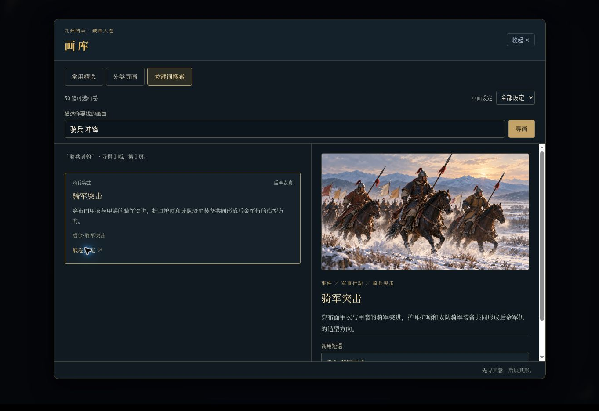

# 场景插画与 AI 工具

此目录接入后金形象修订版 16 张、暗黑场景扩展 16 张，游戏使用原尺寸 WebP。旧 24 个图柄及旧图片保留；其中旧后金 6 图标记 `legacy: true`，默认查询隐藏，准确 ID 仍可解析。其余三阵营各 6 图继续可用。

## 唯一清单与文件

- `data/illustrations/catalog.json`：可编辑的唯一正式清单，含 `assets`、`aliases`、`scenes`。
- `data/illustrations/catalog-data.js`：完整清单的兼容输出，用于旧集成与一致性检查，生产页面不再加载它。
- `data/illustrations/catalog-index.js`：网页启动所需的精简身份、短语、分类和场景索引；不包含完整检索标签、适用/避用说明及图片二进制。
- `data/illustrations/library/search-<hash>.json` 与 `details-<faction>-<hash>.json`：首次检索才读取搜索文字，只为当前结果页或预览读取详情分片；内容哈希避免新旧目录缓存混用。成功读取在当前注册表内复用，失败可重试。
- `data/illustrations/qing/scenes/*.webp`：32 张实际图片。导入只复制，不裁切、缩放或拉伸。
- `illustration-system.js`：UMD 模块；网页 / Worker 全局 `JiuzhouIllustrations`，Node 为 `require("./illustration-system.js")`。
- `harness/plugins/illustrations.js`：独立 AI 插画工具插件。工具执行和查图不会立即打开弹窗或修改存档。
- `gallery-ui.js` / `gallery.css`：首页和游戏菜单共用的只读画库面板；精选、分类与搜索只创建文字卡，只有明确点击预览才赋值图片地址，不修改游戏进度。

`faction` 表示画面的人物服饰、地域或设定来源，不表示玩家的权限。明方角色进入后金营地，可以查询后金营地图；工具不强制按玩家阵营隔离。画面中的囚犯身份、罪名、胜负和效忠不由图片 ID 推定。

## 新增一张图

1. 放入本地图片，例如 `data/illustrations/qing/scenes/qing_new_scene.webp`。
2. 在 `catalog.json.assets` 新增一条独立元数据：

```json
{
  "id": "qing_new_scene",
  "token": "后金·新场景",
  "tokenAliases": ["后金·新场景的等价叫法"],
  "categoryPath": ["环境", "军营与行旅", "营地日常"],
  "relativePath": "data/illustrations/qing/scenes/qing_new_scene.webp",
  "faction": "qing",
  "factionName": "后金女真",
  "category": "地点",
  "categoryName": "地点",
  "title": "新场景",
  "description": "画面里实际可见的内容，不替玩家决定结果。",
  "tags": ["检索词"],
  "useWhen": ["与画面相符的剧情处境"],
  "avoidWhen": ["容易混淆的其他地点或事件"],
  "legacy": false
}
```

3. 为新分类路径的每一层在 `taxonomy` 登记简介；需要露出的图片加入 `featured.global`、`featured.factions` 或 `featured.locations`。执行 `node scripts/build-illustration-catalog.cjs`（`npm run build` 也会执行）。脚本核验全部 ID、短语冲突、文件、别名、分类、精选及场景引用，重新生成启动索引、检索索引和详情分片。已有 SHA-256 的资源会核验内容；有意修改该图时同步更新其 `webSha256` 和 `webBytes`，新图片可先不提供这两个可选字段。
4. 执行 `node test-illustration-registry.cjs` 和相关浏览器检查。测试中的当前包数量是发布验收数；增图时同步更新验收期望。

已有素材包可一次导入，当前适配器接收后金包中的 `web/<id>.webp`：

```powershell
node scripts/build-illustration-catalog.cjs --import-pack "绝对路径/pack.json"
```

它逐文件核验源包 SHA-256、复制到 `qing/scenes/`、核验复制后字节并更新同 ID 元数据，不依赖本机输出目录的固定位置。日常构建不读取源包、不需要原始 PNG。

不要为新语义重用已有 ID。旧图弃用时标记 `legacy: true`，仍保留资源以便旧存档和收藏继续显示。`aliases` 只能登记真正等价的明确更名，例如 `{ "old_equivalent_id": "new_id" }`；不按标题、词语或类别猜图。目前别名表为空，旧 `qing_war` 等仍指向其原图。

`token` 是图片的准确调用短语，`tokenAliases` 是显式登记的同义短语。短语进行 NFC 规范化和首尾空白清理，同一短语不得指向不同图片，也不得冒用其他图片的旧 ID。图片内部 ID、旧 ID 别名与短语在同一个注册表内解析。调用时 `token` 与 `id` 任选一个，同时提供且指向不同图片会报错。存档与交付统一写入稳定 ID；这里的短语是资源键，不是模型分词器中的单个 token。

分类是按用途策展的主路径，例如“事件 → 军事行动 → 骑兵突击”，阵营是独立筛选维度。每幅图有一个主路径，标签和同义短语提供其他入口，不复制图片。精选优先当前背景、当前地点和设定的已编选条目，再补全局精选；最多 6 幅进入 AI 提示词，手动面板最多露出 8 幅精选。

## 绑定静态剧情和地点

在 `catalog.json.scenes.nodes.<faction>` 写明确的节点 ID 与图 ID：

```json
{
  "nodes": {"qing": {"qing_act1": "qing_campaign_map"}},
  "locations": {"shanhaiguan:pass": "qing_frontier_pass"},
  "ids": {"a_new_scene": "qing_new_scene"}
}
```

`sceneFor({ faction, nodeId, coords, sceneId })` 优先 `scenes.ids[sceneId]`，然后准确节点，最后中性地点默认；无匹配返回 `null`。节点值可设 `null`，明确阻止地点默认图。没有分析正文或猜测囚犯罪名、屠杀、胜负的回退逻辑。

当前 364 个后金节点均作显式保守登记，多数使用中性的山川军图，只有少量正文中明确发生围城、骑军突击、营地夜袭或拘押问讯的节点使用对应事件图。它们是章节配图，不代表已经对全部地点、人物、年代或历史细节作严格复原；不根据节点标题单独断定眼前正在发生什么。

全部 81 个 `qing_act5_*` 节点的实际正文采用终局朝堂模板，即使标题写着攻城、献俘、籍没等词，也统一使用中性军图。静态剧情跨越入关后的年代，盛京秋庭、早期军帐不会被当作北京皇极殿或杭州行宫的实景；外交、考试、财政等节点也不自动配尸骸和囚犯图。黑暗事件图由自由剧情根据实际正文查询、选择，没有硬塞进主线。尚无相符静态剧情的扩展图也已全部注册，随时可由 AI 工具选用。

## 运行时接口

```js
const registry = JiuzhouIllustrations;
registry.list({ query: "囚室", category: "囚禁", faction: "qing" });
registry.resolve("qing_cell_whispers"); // 元数据副本或 null；不猜图
registry.resolve("后金·囚室密谈"); // 同一个稳定 ID
registry.featured({ faction: "qing", coords: "qing:mukden", limit: 6 });
registry.browse({ path: "事件/军事行动" }); // 只返回下一层类目及数量
await registry.search({ query: "骑兵 冲锋", page: 1, pageSize: 8 });
await registry.details("后金·骑军突击"); // 仅取文字详情，不取图片
registry.normalizeSelection({ id: "qing_cell_whispers", afterBeat: 2, caption: "隔壁传来低语。" });
registry.compose(story.beats, [{ id: "qing_cell_whispers", afterBeat: 2 }]); // { beats, warnings }
registry.sceneFor({ faction: "qing", nodeId: "qing_act1", coords: "qing:mukden" });
```

`list()` 默认包含全部设定，按 ASCII ID 稳定排序；`includeLegacy: true` 可列弃用图。所有返回值均可克隆，修改调用方拿到的元数据不会改变注册表。模型给出的 URL、文件路径不会替换正式资源；渲染只使用清单中验证过的 `data/illustrations/` 路径。

独立 Worker 可用 `createRegistry({ assets, aliases, scenes })` 创建注册表。最小资产字段只有 `id` 与合法 `relativePath`，其他字段可缺省；无需 DOM 或浏览器默认图库。正常插件从本轮 `context.illustrationCatalog` 的可克隆快照构造注册表，包含短语、旧别名和分类；宿主额外提供页面基址，使 GitHub Pages 子路径内的文字分片可准确加载。旧的 `context.illustrations` 资产数组继续兼容。

## AI 选图

1. 精选匹配时直接调用；需要探索时用 `browse_illustrations({ path })` 逐层浏览，有明确需求时用 `search_illustrations({ query, path, page })`。画面设定可直接写进关键词，如“后金 骑兵 冲锋”。模型每页收到最多 8 项 `images`，有后续页时带 `nextPage`；不接收内部 ID、URL 或重复规则。适用与避用说明继续保留，旧 `list_illustrations` 仅在执行层兼容。接口分层见 [AI 工具接口](AI-TOOL-API.md)。
2. `set_scene_background({ token: "后金·关隘烽火" })` 暂存持续的舞台背景，只替换桌面背景层及手机上方场景画面，不弹窗、不插入正文段。旧 `{ id }` 继续兼容。`{ clear: true }` 恢复当前场景默认背景，不清除弹窗。背景 ID 独立保存在进度、备份和回溯节点中；切换地图、新章节或新篇会恢复相应静态背景。
3. `show_illustration({ token: "后金·骑军突击", afterBeat, caption })` 暂存图片弹窗，位置和说明可省略。旧 `select_illustration` 与 `{ id }` 留在执行层兼容。相同位置后一次有效选图替换前一次；只传 `{ clear:true }` 清空本轮弹窗草稿，不能与图片参数混用。背景与弹窗互不改变，成功回执为 `{"ok":true}`。
4. 成功交付时，背景操作由宿主附加为 `stage_effects` 的 `set_scene_background`，弹窗操作附加为 `show_illustration`。两者独立提交，取消或失败均不提交草稿。不支持顶层 `illustrations` 字段。使用 JSON 兼容通路时，可直接提交以下效果；准确旧 ID 仍然有效，所有通路都由同一个注册表解析。

```json
{
  "beats": [{ "type": "narrator", "text": "你在门外停步，屋内的问讯仍在继续。" }],
  "stage_effects": [{
    "name": "set_scene_background",
    "params": { "token": "后金·狱中长夜" }
  }, {
    "name": "show_illustration",
    "params": { "token": "后金·灯下问讯", "afterBeat": 1, "caption": "灯下的问讯尚无结论。" }
  }]
}
```

`afterBeat` 是**分页前、整份最终草稿**的正文段索引，不是屏幕上每 90 字分页后的编号；叙述和人物对白都各算一段。省略默认 `1`，`0` 在正文前，`2` 在第二段正文后。要求非负整数；大于正文段数时明确排在结尾并返回告警。同一个 `afterBeat` 最后一次有效选图生效，错误 ID 不会覆盖之前有效选择。不同超尾位置均在结尾按请求位置排序，原请求位置相同才替换。

背景与弹窗共享图库，使用不同工具及独立状态。静态 `sceneFor` 绑定仅作为背景，不隐式插入弹窗段；背景解析不扫描弹窗或正文。切换地点后，旧章节节点的图片不会覆盖新地点背景。

到达显式插画阅读段时，图片以覆盖舞台的独立居中弹窗展示，正文框只显示普通说明文字，不再嵌入大图卡。关闭按钮、Escape 或遮罩可收起，关闭不会跳页；小“画卷”按钮可以重开。查看弹窗时暂停自动播放，长说明独立滚动，坏图可关闭后继续阅读。弹窗切换、关闭或前后翻页均不改变背景。

工具、图柄、说明、思考与 JSON 不属于正文。程序不统计或验收字数；模型/工具次数、耗时、Token 和缓存等运行日志不输出到游戏或设置界面。保留简单等待、取消、连接测试结果与可恢复错误。

`normalizeSelection` 成功返回 `{ ok: true, selection: { id, afterBeat, caption } }`，失败返回 `{ ok: false, error: { code, message } }`。未知 ID 为 `unknown_illustration`；错误位置为 `invalid_illustration_position`。`compose` 跳过无效图并记录告警，不因图柄错误丢弃正文，也不猜成另一张图。

## 验证

```powershell
node scripts/build-illustration-catalog.cjs
node test-illustration-registry.cjs
node test-illustration-harness.cjs
node --test test-illustration-library.cjs
```

注册表测试覆盖真实资源完整性、全部 56 个兼容 ID、32 个新图柄、弃用隐藏、准确查找、跨设定查询、替换与插入位置、未知图错误、原正文不变、白名单字段、Node / 浏览器 / Worker 一致性及 364 个后金静态节点绑定。浏览器测试还需验证实际取图、阅读翻页、移动布局、手动放大与存档恢复；单元测试成功不代表线上已经发布。

2026-10-25 本轮验证：`npm run test:unit` 的 187 项检查、四阵营回归、剧情数据检查及静态构建通过。新增测试通过真实 Node Worker 执行搜索、短语选图、背景设置和交付，模型为本地夹具，不是收费 API。浏览器手动检查通过桌面 1363×936，以及 iframe 中的 390×844、320×740 视口；覆盖首页打开画库、逐级分类、多关键词搜索、真实 WebP 解码、短语显示、关闭与窄屏无横向溢出。窄屏检查不等于实体 iPhone 或输入法实测。完整 Playwright 脚本由 GitHub Actions 执行，以对应提交的检查结果为准。



旧的 `generate-faction-illustrations.js` 和 `.github/workflows/install-nanming-cinema.yml` 只维护旧 `illustrations-data.*`，不是正式新增图片接口，也不会自动同步当前图库。需要迁移这些流程产生的资源时，应同时更新 `catalog.json` 中准确 ID 的元数据和路径，再执行 `build-illustration-catalog.cjs`；仅修改旧清单不会改变新注册表使用的图片。
